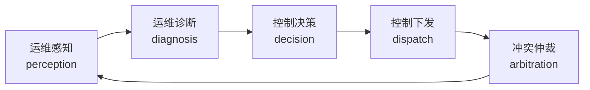
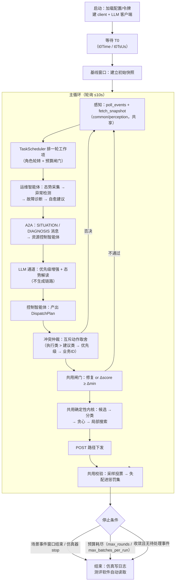

# 智能体设计（运维 + 资源控制双智能体）

> 版本：v1.0　整理日期：2026-11-26
> 定位：**`src/agents/` 的设计规格**——两类智能体怎么分工、怎么协同、LLM 在哪、
> 与 baseline 怎么对比。
> 关联：接口契约见 [接口清单与语义](../common/simulator/接口清单与语义.md)；
> 共享底座见 [总体框架](../architecture/总体框架.md)；
> 对比口径见 [baseline 与 agents 的共享与对比](../architecture/baseline与agents的共享与对比.md)。

---

## 1. 任务与闭环

目标任务：在动态扰动下保障无人集群通信网络的业务 QoS，核心动作是**重路由**和**业务保障**。

```
轮询事件 → 感知拓扑/链路/业务 → 判断受影响业务
        → 计算满足 QoS 的候选路径 → 下发路径
        → 复查实际 QoS（actual.qosMeet） → 继续轮询
```

智能体不需要解析脚本，也不需要直接操作 OVS/tc；脚本事件由仿真控制面执行，
智能体只通过 API 观测和下发路径。

---

## 2. 为什么是两个智能体（赛题要求）

赛题明确要求「至少包含通信网络运维智能体、通信网络资源控制智能体的多智能体协同体系」，
并要求 **A2A 通信协议、动态自决策、任务调度机制、冲突仲裁策略**。

| | 运维智能体 `agents/ops/` | 资源控制智能体 `agents/resource/` |
|---|---|---|
| 职责 | 全网态势采集、拓扑感知、链路质量评估、异常事件检测、故障诊断、自愈建议生成 | 基于运维感知结果与业务协同需求，做资源调度、路由动态调整、带宽分配、业务 QoS 保障 |
| 输入 | 事件 + 快照 | 运维的态势/诊断结论 + 业务需求 |
| 输出 | 异常清单、诊断、自愈建议（A2A 消息） | 优先级建议、路径调整决策 |
| 写权限 | **无** | 有（且仍要过下发闸门） |

**为什么要有「无写权限」这条硬线**：职责边界即安全边界。运维智能体若能直接改路，
"建议"与"执行"就分不清了，评审时也说不清谁该负责。

---

## 3. A2A 协同机制

**代码**：`src/agents/a2a/`

### 3.1 消息协议

`message.py` 定义消息类型与进程内总线：

| 类型 | 方向 | 载荷 |
|---|---|---|
| `SITUATION` | 运维 → 控制 | 全网态势、异常清单 |
| `DIAGNOSIS` | 运维 → 控制 | 根因判断、置信度、自愈建议 |
| `REQUEST` | 控制 → 运维 | 请求补充感知或复核 |
| `DECISION` | 控制 → 全体 | 宣告将下发的路径调整 |
| `REJECT` | 仲裁 → 发起方 | 仲裁否决回执（带理由） |

载荷保持**可序列化**（dict），便于落盘、复盘与 RAG 检索——RAG 的「故障案例库」
正是这些消息的沉淀。

总线是**同步内存实现**：赛题的 A2A 是「逻辑协议」而非分布式通信，同步实现才能
保证实验可复现（无并发竞态）。

### 3.2 任务调度

`scheduler.py` 的 `TaskScheduler` 排出一轮的执行序列：



**为什么是角色轮转而不是并行**：仿真环境是单线程轮询的观测源，并行只会引入竞态与
不可复现。轮转保证执行序确定。

- **依赖序**：控制决策依赖运维诊断的结果，必须在其后；
- **预算**：`max_items_per_round`（单轮工作项上限 = LLM 调用预算）与 `max_rounds`
  （全场轮数上限）是两个硬闸门，避免"没有尽头"的 LLM 循环——与 baseline 的
  `max_batches_per_run` 同一思想；
- **可复现**：无时间/随机依赖。

### 3.3 冲突仲裁

`arbitration.py` 裁决互斥动作。baseline 是单一决策核心，不存在"两个决策者抢同一条路"；
多智能体有，因此规则必须**确定**（同样输入必得同样输出），否则实验不可复现。

| 优先级 | 规则 | 理由 |
|---|---|---|
| 1 | **执行类 > 建议类** | 资源控制智能体的执行动作优先；建议可参考但不能抢执行权 |
| 2 | 业务 `priority` 降序 | 与项目口径「8 最高、1 最低」一致 |
| 3 | 业务 ID 字典序 | 同优先级时的确定性兜底 |

仲裁只决定**动作取舍**，不产生新的网络决策——被采纳的动作仍要过
`common/control/` 的下发闸门。

---

## 4. LLM 通道

**代码**：`src/agents/llm/`（放在 `agents/` 而非 `common/`——baseline 是确定性闭环，
全程不走 LLM，放共享层会给它引入一条不走的依赖）。

### 4.1 硬边界

**LLM 只做三件事**：态势解释、优先级增强、故障诊断建议。
**LLM 不生成链路**——路径永远由 `common/algorithms/` 的确定性内核产出。

理由有三：
1. 确定性算法负责正确性，LLM 的方差不该进热路径；
2. LLM 提的路径会被下游忽略，白烧 token；
3. 对比实验才有意义——同样的安全网，不同的决策。

### 4.2 客户端能力

`client.py` 的 `LLMClient`：

- OpenAI 兼容的 `chat/completions`（网关地址来自 `configs/llm.yaml` 的 `base_url`，
  默认 `:10110/v1`），**密钥不落代码**；
- **重试策略**：只对可重试错误（连接失败、5xx、429）指数退避重试；4xx 业务错误
  **不重试**（重试只是浪费预算）；
- **调用账本**（`CallLedger`）：次数、成功率、耗时、按用途分类——用于实验分析；
- **JSON 解析容错**（`parse_json_object`）：小模型常在 JSON 外裹围栏或加解释文字。

> **计量口径说明**：评测按 agent 调用量统计（读网关的 `llm_gateway_call_stat.log`）；
> 本模块的账本用于定位"哪次调用慢/贵"，两者不冲突。

### 4.3 提示词原则

`prompts.py` 的模板遵循四条：

1. **不诱导生成链路**——明确要求只输出优先级建议/诊断结论/解读文本；
2. **输出结构化**——要求 JSON 并给出字段说明，解析失败走确定性兜底；
3. **上下文最小化**——只喂必要的观测，不把整个拓扑塞进提示词；
4. **同输入同提示词**——渲染是纯函数，便于复现。

---

## 5. 数据契约

### 5.1 运维智能体产物（`agents/ops/`）

| 结构 | 内容 |
|---|---|
| `SituationReport` | 异常清单 + 诊断 + 劣化链路 + 一句话解读 |
| `Anomaly` | 目标、类型（link_down / link_degraded / node_down / service_violation）、证据、严重度 |
| `Diagnosis` | 根因、置信度、受影响 flow、建议列表 |

### 5.2 资源控制智能体产物（`agents/resource/`）

| 结构 | 内容 |
|---|---|
| `ResourceDecision` | 优先级建议 + 目标 flow + 解读 + 决策依据 |
| `PriorityHint` | service_id、建议优先级、理由、来源（llm / rule） |
| `DispatchPlan` | 待下发的路径调整（**尚未过闸门、未 POST**） |

---

## 6. 端到端流程



## 7. 决策流程与时间管理

1. 启动后先等待 T0（页面/API 返回 `t0Time`/`t0TsUs`）；
2. T0 后前 2~3 分钟是基线窗口，先建立初始业务/路径快照；
3. 持续轮询 `/events`（≤10s），同时定期拉 `/topology`、`/links`、`/services`；
4. 运维智能体产出态势与诊断（A2A 消息）→ 资源控制智能体产出调度决策；
5. 冲突动作交仲裁；被采纳的动作过下发闸门后 POST；
6. 用 `/services/{id}` 的 `actual.qosMeet` 复查；
7. 事件持续到约 T0+26/27 分钟，脚本在 1800s 发 stop；自动结束看门狗到点也会终止；
8. 结束后仿真写日志，测评软件自动读取；智能体不需要再提交结果。

---

## 8. 当前状态与待办

**已实现**（`src/agents/`）：

- [x] 两类智能体的**职责契约与数据结构**（`ops/` / `resource/`）
- [x] **A2A 消息协议**、**任务调度**、**冲突仲裁**（`a2a/`）
- [x] **LLM 通道**：客户端、重试、调用账本、提示词模板（`llm/`）

**待实现**：

- [ ] `agents/main.py` 入口 + `agents/orchestrator.py` 端到端编排
- [ ] 运维智能体的异常检测与故障诊断**推理实现**（依赖真机数据）
- [ ] 资源控制智能体如何融合 LLM 建议与确定性结果的**策略**
- [ ] 观测留痕接入（`common/observability/` 已就绪，尚未接线）
- [ ] agent 与 baseline 的**对比实验**（同一场景、同一指标口径）

---

## 9. 待补充 / 扩展记录

- [ ] 智能体最小示例（轮询事件 + 选择路径 + 重试）。
- [ ] RAG 知识增强：网络模型库 / 故障案例库 / 策略库 / 实验经验库（企划书 §8）。
- [ ] 评测指标与日志字段的对应关系。
