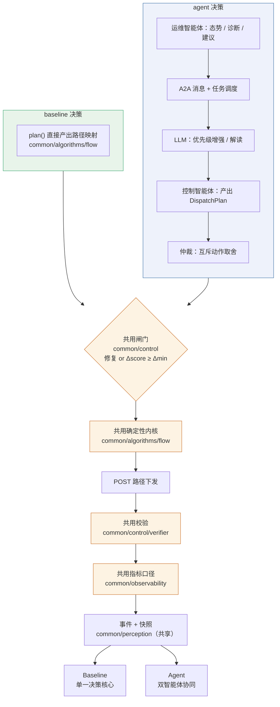

# baseline 与 agents 的共享与对比

> 定位：**两条路径共享什么、差异在哪、怎么公平对比**。
> 这是赛题「实验验证」与「结果分析」的方法论基础。
> 关联：[总体框架](总体框架.md)；[智能体设计](../agents/智能体设计.md)；
> [算法边界与停止条件](算法边界与停止条件.md)。

---

## 1. 共享与差异

### 1.1 共享的部分（共用代码，非"各写一套"）

| 能力 | 共享位置 | 为什么必须共享 |
|---|---|---|
| 感知 | `common/perception/` | 两侧必须看到**同一份**网络视图，否则对比无意义 |
| 建图与容量 | `common/algorithms/topology/` | 容量口径不同则一切指标不可比 |
| 路径候选 | `common/algorithms/path/` | 候选集不同则"谁更好"无从判断 |
| flow 级算法 | `common/algorithms/flow/` | 确定性内核是**共同基线**，agent 在其上增强 |
| 闭环控制 | `common/control/` | 状态机、闸门、实测校验、收敛判据全部相同 |
| 指标口径 | `common/observability/` | 计时与统计口径相同，数字才可比 |
| 接口与建模 | `common/simulator/` `common/modeling/` | 协议与 QoS 判定相同 |

### 1.2 并排对比图



> 橙色 = **两侧完全共用**；绿色 = baseline 独有；蓝色 = agent 独有。
> 差异被压缩到**只有决策核心**那一格。

### 1.3 差异的部分（**唯一**）

| | Baseline | Agent |
|---|---|---|
| **决策核心** | 确定性规划器直接出路径 | 运维智能体（态势/诊断）+ 资源控制智能体（调度决策） |
| **LLM** | 不使用 | 只做解释、优先级增强、诊断建议 |
| **协同** | 单决策核心，无冲突 | A2A 消息 + 任务调度 + 冲突仲裁 |
| **额外开销** | 无 | LLM 调用耗时与调用量 |

**这个结构是刻意的**：差异被压缩到"谁来做决策"这一个可控面，其余全部对齐。
若两侧的感知、时间口径、闸门都不同，对比出来的数字**没有解释力**。

---

## 2. 公平对比的五条纪律

### 2.1 同一场景、同一脚本、同一时刻

- 同一场景 JSON（`simulator/data/scenarios/<套件>/<场景>`）；
- 同一脚本（事件序列与时刻完全一致）；
- 同一 T0 基准（相对时间对齐，不是绝对墙钟）。

### 2.2 同一观测预算

评测按 **agent 调用量**统计（读网关的 `llm_gateway_call_stat.log`）。对比时：

- 两侧的**观测调用数**要记录并对齐口径；
- agent 侧的 LLM 调用**单独计**（评测看的是 API 调用，LLM 走网关是另一本账）。

> 详见 [接口清单与语义](../common/simulator/接口清单与语义.md) §7。

### 2.3 同一指标口径

用 `common/observability/` 的同一套 `DecisionTimeline` 与 `collect_metrics`，
产出可比的：感知/生成/下发耗时、动作数、达标数。

### 2.4 同一安全网

两侧的写动作都过 `common/control/dispatch_gate.py`：
**修复失效路径 or Δscore ≥ Δmin**。

> 否则对比的是"敢不敢乱改路"而不是"决策质量"。

### 2.5 多次重复

单次运行受随机扰动影响大。建议同一场景跑 **≥3 次**取分布，
报告均值与波动，不报单点。

---

## 3. 对比什么

| 维度 | 指标 | 期望 |
|---|---|---|
| **效果** | test 业务保障率 | agent ≥ baseline（这是核心目标） |
| **效率** | 策略生成耗时 p50 | agent 更高（LLM 有代价） |
| **代价** | LLM 调用次数 / 总耗时 | 越少越好 |
| **动作** | 下发次数 / 涉及 flow 数 | 相当（同一闸门） |
| **收敛** | 收敛时间、收敛后是否又下发 | 相当 |
| **鲁棒** | 不同场景下的表现分布 | agent 的方差更小？ |

**怎么解读**：

- agent 达标率更高但动作数也更高 → 说明增益来自"更敢动"，需检查是否绕过了闸门；
- agent 达标率持平但耗时更高 → LLM 暂未带来增益，应分析提示词或知识库；
- agent 达标率更高**且**动作数持平 → 这是理想结果，说明决策质量真的提升了。

---

## 4. 差异归因方法

当结果有差异时，按下面的顺序定位（**从确定性到不确定性**）：

```
1. 感知相同吗？      → 比对两侧的 NetworkSnapshot（路径、现状、分类）
2. 规划输入相同吗？  → 比对 FlowPlan（分类、候选数、权重）
3. 规划输出相同吗？  → 比对最终路径映射
4. 闸门判定相同吗？  → 比对 Δscore 与 batch 内容
5. 下发相同吗？      → 比对 POST 序列
6. 实测相同吗？      → 比对 actual.qosMeet
```

**只有第 3 步出现差异，才是"决策核心"的功劳**；1~2 步差异说明感知/建模有 bug；
4~6 步差异说明执行侧有 bug。

---

## 5. 复现清单

一次可复现的对比实验需要记录：

- [ ] 场景 JSON 路径 + 脚本 id
- [ ] T0 基准（相对时间）
- [ ] 两侧的完整 `DecisionTimeline`（`common/observability/` 的 JSON 导出）
- [ ] 两侧的 `NetworkSnapshot` 摘要（路径映射 + 分类）
- [ ] 两侧的动作序列（POST 时刻 + link_ids）
- [ ] LLM 调用账本（`agents/llm/client.py::CallLedger`）
- [ ] 实测达标统计（每条 test 业务的 `actual.qosMeet`）
- [ ] 运行配置快照（`configs/*.yaml`）

> 工具：`scripts/plan_dump.py`（规划黄金快照）、`scripts/feasible_bound.py`（可达上界）、
> `scripts/smoke_epoch.py`（闭环冒烟）。

---

## 6. 当前进度

| 能力 | baseline | agent |
|---|---|---|
| 确定性闭环（感知→规划→闸门→下发→校验） | ✅ 已实现 | ✅ 复用同一套 |
| 观测留痕与指标 | ✅ `common/observability/` 就绪 | ✅ 同上 |
| 端到端编排 | ✅ `src/baseline/main.py` | ⬜ 待实现 |
| 双智能体职责与数据结构 | — | ✅ `src/agents/{ops,resource}/` |
| A2A 协议 / 调度 / 仲裁 | — | ✅ `src/agents/a2a/` |
| LLM 通道 | — | ✅ `src/agents/llm/` |
| 对比实验脚本 | ⬜ | ⬜ |

**下一步**：把 `common/observability/` 接到 `common/control/loop.py`（产出指标），
再实现 `agents/orchestrator.py`，然后就能跑第一次对比实验。
