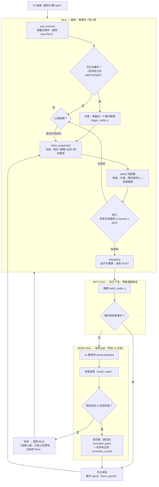
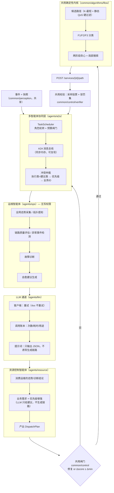

# 总体框架

> 定位：跨切面的**全局视图**——系统有几层、依赖怎么走、两条闭环各是什么、
> 以后往哪扩展。
> 关联：模块边界细则见 [模块边界与依赖方向](模块边界与依赖方向.md)；
> 对比口径见 [baseline 与 agents 的共享与对比](baseline与agents的共享与对比.md)。

---

## 1. 一句话

B03「资源受限环境下通信网络资源管控」：智能体通过公开 HTTP API **观测**网络，
唯一的写动作是 `POST /services/{serviceId}/path` **重分配业务路径**。
确定性算法负责正确性，LLM 做解释与优先级增强（不生成链路）。

---

## 2. 分层结构

```
┌──────────────────────────────────────────────────────────────┐
│  入口层                                                        │
│  src/baseline/   传统路径（确定性闭环）                        │
│  src/agents/     智能体（运维 + 资源控制 + A2A + LLM 通道）    │
└──────────────────────────────────────────────────────────────┘
                              ↓ 依赖
┌──────────────────────────────────────────────────────────────┐
│  共享底座 src/common/                                          │
│                                                              │
│  simulator/      仿真器 HTTP 适配（client / executor）        │
│  perception/     感知层（冻结快照 + 事件流）                  │
│  control/        闭环控制（epoch 状态机 / 闸门 / 实测校验）    │
│  algorithms/     算法库（topology / path / flow）             │
│  observability/  观测留痕与指标产出                            │
│  modeling/       数学建模（纯计算）                           │
│  config/         配置与令牌加载                               │
└──────────────────────────────────────────────────────────────┘
```

**依赖方向（单向，无环）**：

```
modeling ← topology / path / flow ← perception ← simulator ← control ← baseline / agents
```

> `modeling` 是纯计算层（无 IO、无 NetworkX 图依赖），可独立单测；
> `algorithms` 依赖它；`perception` 依赖算法；`simulator` 是协议适配；
> `control` 是闭环编排；入口层组合它们。

---

## 3. 两条闭环

### 3.1 Baseline（确定性，已实现）



- 规划：确定性贪心 + 局部搜索（`common/algorithms/flow/`）
- 闸门：修复失效路径 **or** Δscore ≥ Δmin
- 校验：1s 窗采样多窗投票，失配进惩罚集 + 有界纠正

**三重停止条件**（任一触发即止）：① 场景事件窗口结束 / 仿真器 stop；
② `max_batches_per_run` 预算耗尽；③ 收敛且心跳持续无违约。
详见 [算法边界与停止条件](算法边界与停止条件.md)。

详见 [闭环状态机与收敛判据](../common/control/闭环状态机与收敛判据.md)。

### 3.2 Agent（双智能体，骨架就绪）



**与 baseline 的唯一差异**：决策核心。感知、控制、闸门、校验、算法内核、指标口径
全部共用——这是对比实验公平的结构保证。
详见 [baseline 与 agents 的共享与对比](baseline与agents的共享与对比.md)
与 [智能体设计](../agents/智能体设计.md)。

### 3.3 两条闭环的关系

**共用感知、共用控制、共用算法内核**，唯一差异是**决策核心**：

| | Baseline | Agent |
|---|---|---|
| 感知 | `common/perception/` | 同一份 |
| 决策 | 确定性规划器直接出路径 | 两类智能体分工 + LLM 增强优先级 |
| 闸门 | `common/control/` | 同一套 |
| 校验 | `common/control/verifier.py` | 同一套 |
| 指标 | `common/observability/` | 同一套计时口径 |

这个结构是**为了对比实验公平**——差异被压缩到最小可控面。

---

## 4. 数据流（一次 epoch）

```
仿真器 (netsim)
   │  GET /events（增量游标）
   ▼
EventSource ──► 可行动事件过滤（丢弃自己的 pathChanged）
   │
   ▼
SnapshotSource ──► NetworkSnapshot（图 + flows + 现状路径 + test 范围）
   │
   ▼
plan(flows, graph, config)  ──►  FlowPlan{flow_key, path, cls, weight, ...}
   │                            （纯函数：同快照同结果）
   ▼
build_dispatch_batch(...)  ──► 闸门：修复 or Δscore ≥ Δmin
   │
   ▼
PathExecutor.execute(...)  ──►  POST /services/{id}/path
   │
   ▼
（静置）→ 采样 actual.qosMeet → 多窗投票 → 失配进惩罚集 → 有界纠正
```

---

## 5. 赛题要求 ↔ 落点

| 赛题子任务 | 分值 | 主要落点 |
|---|---|---|
| 1. 动态通信场景建模 | 18 | `simulator/data/scenarios/` + `.agents/skills/scenario-gen/`（**仿真器发布件，不改**） |
| 2. 多智能体协同体系设计 | 36 | `src/agents/`（ops / resource / a2a）+ [智能体设计](../agents/智能体设计.md) |
| 2.1 整体架构 | 12 | 本文档 + [模块边界与依赖方向](模块边界与依赖方向.md) |
| 2.2 协同体系架构 | 12 | A2A 协议 / 调度 / 仲裁（`src/agents/a2a/`） |
| 2.3 成员智能体设计 | 12 | LLM 通道 + 提示词 + RAG（`src/agents/llm/`） |
| 3. 仿真实验验证 | 24 | `experiments/` + `common/observability/` |
| 4. 实验结果分析 | 16 | `docs/experiments/` + `experiments/exp/` |
| 5. 文档质量 | 6 | `docs/`（本文档体系） |

---

## 6. 扩展路线

| 阶段 | 做什么 | 落点 |
|---|---|---|
| **已完成** | baseline 确定性闭环 | `src/baseline/` + `src/common/` |
| **下一步** | agent 端到端编排 | `src/agents/main.py` + `orchestrator.py` |
| | 观测留痕接线 | `common/observability/` → `common/control/loop.py` |
| | 对比实验 | `scripts/` + `experiments/` |
| 后续 | RAG 知识增强 | `src/agents/knowledge/`（预留） |
| | 多策略优化 | `src/common/algorithms/flow/`（按扩展指引） |

---

## 7. 文档导航

| 我想了解 | 看这里 |
|---|---|
| 系统怎么分层、依赖怎么走 | [模块边界与依赖方向](模块边界与依赖方向.md) |
| baseline 与 agent 怎么比 | [baseline 与 agents 的共享与对比](baseline与agents的共享与对比.md) |
| 什么时候停、为什么停 | [算法边界与停止条件](算法边界与停止条件.md) |
| 有哪些接口 | [接口清单与语义](../common/simulator/接口清单与语义.md) |
| 两套 QoS 公式 | [数学建模方案](../common/modeling/数学建模方案.md) §4 |
| 拓扑怎么建 | [拓扑构建与容量记账](../common/algorithms/拓扑构建与容量记账.md) |
| 路径算法怎么取舍 | [路径算法与取舍](../common/algorithms/路径算法与取舍.md) |
| flow 级怎么选路 | [flow 级联合选路](../common/algorithms/flow级联合选路.md) |
| 怎么加新算法 | [扩展指引](../common/algorithms/扩展指引.md) |
| 怎么加新能力（agent/LLM） | [智能体设计](../agents/智能体设计.md) |
