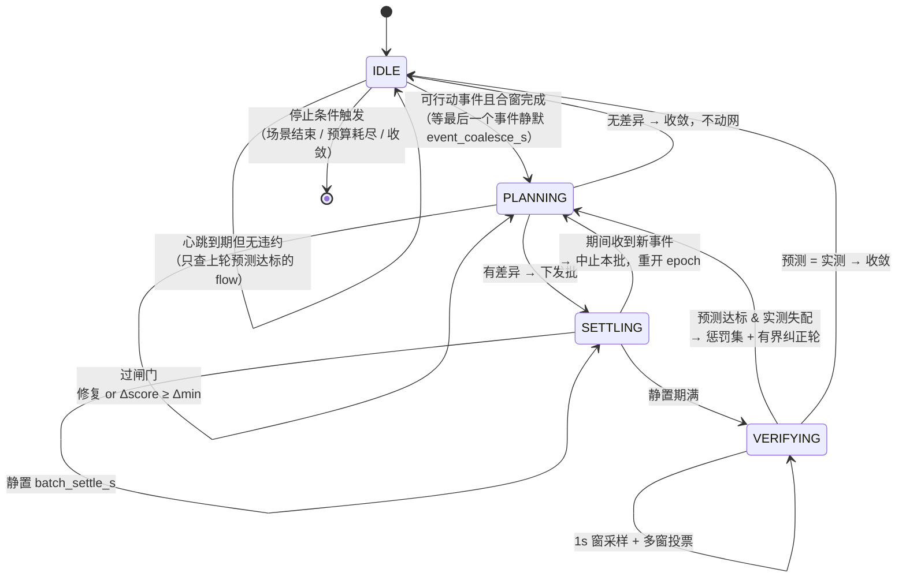

# 闭环状态机与收敛判据

> 定位：**`src/common/control/` 的闭环规格**——epoch 状态机、切换闸门、实测校验、
> 收敛判据与配置项。baseline 与 agent **共用**这一套控制逻辑。
> 关联：算法见 [flow 级联合选路](../algorithms/flow级联合选路.md)；
> 感知见 [感知口径与事件机制](../perception/感知口径与事件机制.md)；
> 停止条件见 [算法边界与停止条件](../../architecture/算法边界与停止条件.md)。

---

## 1. 一个 epoch 是什么

**一次 epoch = 一次冻结快照 + 一次规划 + 一个下发批 + 一次校验。**



**阶段职责**

| 阶段 | 做什么 | 退出条件 |
|---|---|---|
| IDLE | 轮询事件、合窗、等待触发 | 收到可行动事件且合窗完成 / 心跳命中 / 强制 |
| PLANNING | 冻结快照 → 规划 → 过闸门 | 无差异 → 回 IDLE；有差异 → SETTLING |
| SETTLING | 等待数据面稳定（`batch_settle_s`） | 静置期满 → 转 VERIFYING；期间收到新事件则**中止并重开** |
| VERIFYING | 1s 窗采样、多窗投票、比对预测与实测 | 窗口期满 → 出结论；失配且有纠正轮次 → 重开 epoch |

**代码**：`src/common/control/loop.py::Orchestrator`

| 阶段 | 做什么 | 退出条件 |
|---|---|---|
| IDLE | 轮询事件、合窗、等待触发 | 收到可行动事件且合窗完成 / 心跳命中 / 强制 |
| SETTLING | 等待数据面稳定（`batch_settle_s`） | 静置期满 → 转 VERIFYING；期间收到新事件则**中止并重开** |
| VERIFYING | 1s 窗采样、多窗投票、比对预测与实测 | 窗口期满 → 出结论；失配且有纠正轮次 → 重开 epoch |

---

## 2. 触发与合窗

只认可行动事件（链路/节点状态变化、业务转为非 running），**必须过滤自己下发产生的
`service_state_changed(pathChanged=true, running)`**——否则 POST → 事件 → 重规划 → POST
会自激成死循环（过滤规则见 [感知口径](../perception/感知口径与事件机制.md) §4）。

事件成簇到达时先**合窗**：等最后一个可行动事件静默 `event_coalesce_s` 再规划，
避免一条事件簇触发多次全量规划。

---

## 3. 规划是纯函数，下发才是增量

规划器输出只取决于 `(flows, graph, config)`，**不看当前已装路径**：同一份快照重算两次
必然完全一致。

调用方拿「已装路径」与「计划路径」做差集，只下发差集；**差集非空也未必下发**——
还要过闸门：

| 闸门条件 | 含义 |
|---|---|
| **修复**：当前路径失效（链路不在图中/不连续）或静态 QoS 已违约 | 无条件下发 |
| **改进**：全量重排后的加权达标数增益 $\Delta\text{score} \ge \Delta_{\min}$ | 满足才下发 |

**代码**：`src/common/control/dispatch_gate.py::build_dispatch_batch`（纯函数）

> **没有第 2 条就没有终点**：只要重排结果"看起来更好一点点"就改路，会形成永不停歇的
> 路径 churn。背景流单独挪动（达标数不变）默认**不算增益**，不为此改路；它随
> 修复/改进批次一起被处理。

**不动点（可证）**：

```text
一次批下发完成 → installed == plan → 再规划（同快照）差集为空 → 静默
```

---

## 4. 实测校验与惩罚集

批后静置 `batch_settle_s`，再按多个 1s 窗对 test 业务的 `actual.qosMeet` 采样，
**多窗投票**判定（票数过 `verify_required_votes` 才定）以抵消瞬态抖动。

**代码**：`src/common/control/verifier.py::PathVerifier`

| 机制 | 说明 |
|---|---|
| 预测 vs 实测 | 规划时算的 `predicted_compliance` 与实测投票比对 |
| 失配 → 惩罚集 | 该 flow 本轮路径进 `penalized_paths`，下一轮规划经 `PlanConfig.excluded_paths` 剔除 |
| 有界纠正 | 纠正轮数上限 `corrective_round_limit`；用尽后收敛为 best-effort |
| 兜底 | 若排除后该 flow 一条候选都不剩，**回退不排除**（失去路径比违约更糟） |

> **F1/F2 不入判据**：物理上救不回来的 flow（硬失败）不参与"预测=实测"的比对，
> 否则永远不收敛。

---

## 5. 静默期心跳

收敛后只做低频心跳（`heartbeat_interval_s`），且**只对上一轮预测达标的 flow** 检查——
硬失败 flow 不参与，否则永远不收敛。

心跳命中（出现实测违约）→ 开新 epoch。

---

## 6. 批内纪律

- **批内不重算**：批是一次计划的执行，中途重算等于换计划、把瞬态无限延长；
- 批内若收到新的可行动事件，**直接中止剩余下发**并用新快照重开 epoch；
- 批内 POST 有节流（`batch_pace_s`）与防抖（`min_switch_interval_s`）。

---

## 7. 配置项

| 键（`configs/app.yaml`） | 默认 | 含义 |
| --- | --- | --- |
| `reroute_min_gain` | 2.0 | $\Delta_{\min}$，单位 $\sum 2^{priority}$（$2^1$ 为最小 test 权重） |
| `settle_sec` | 10.0 | 批后静置 |
| `verify_windows` | 5 | 校验采样窗数（1s 一窗） |
| `verify_votes` | 3 | 判定「达标/失配」所需票数 |
| `corrective_rounds` | 1 | 每个 epoch 的有界纠正轮数 |
| `trigger_settle_sec` | 3.0 | 事件合窗 |
| `heartbeat_sec` | 60.0 | 静默期实测心跳间隔 |
| `min_switch_interval_sec` | 10.0 | 同一 flow 改路最小间隔（防抖） |
| `batch_pace_sec` | 0.1 | 批内 POST 间隔（≈10 次/秒） |
| `max_batches_per_run` | 60 | 全场批次上限 |
| `bandwidth_headroom` | 0.2 | 摆放约束裕度 $\rho$（注意：与 `utilization_limit=1.0` 不是同一个阈值） |
| `k_shortest_paths` | 30 | 候选路径条数 K |

> 默认值为**建议值，待实验标定**。

---

## 8. 主循环伪代码

```text
loop(every poll_interval):
    events = poll_events(since)              # GET /events, ≤10s
    act    = [e for e in events if actionable(e)]    # 丢弃自己的 pathChanged
    if act: pending = True; last_act = now
    if phase == SETTLING:
        if act: abort(); force_epoch = True; continue
        if now < settle_until: continue
        phase = VERIFYING
    if phase == VERIFYING:
        sample(); if enough_windows: compare_and_maybe_correct()
        continue
    if force or (pending and now - last_act >= trigger_settle):
        G = build_graph(links, nodes)         # 只收 up/online, 剔除 EXT001
        flows = group_services_by_flow(services)
        plans = plan(flows, G, cfg)                   # 纯函数：同快照同结果
        delta = {f: plan[f] for f in plans if plan[f] != installed[f]}
        if delta and (repair(delta) or Δscore >= Δmin):
            for f in order(delta): POST(f)    # 批内不重算、不 sleep 等反馈
            phase = SETTLING
    elif heartbeat_due() and predicted_flow_violating():
        force_epoch = True
```

**代码**：`src/common/control/loop.py`（`Orchestrator.step/run`）

---

## 9. 与 agent 的关系

本层是**共享**的：agent 侧复用同一套 epoch 状态机、闸门、实测校验，只替换**决策核心**
（谁给出路径建议）。详见 [baseline 与 agents 的共享与对比](../../architecture/baseline与agents的共享与对比.md)。
