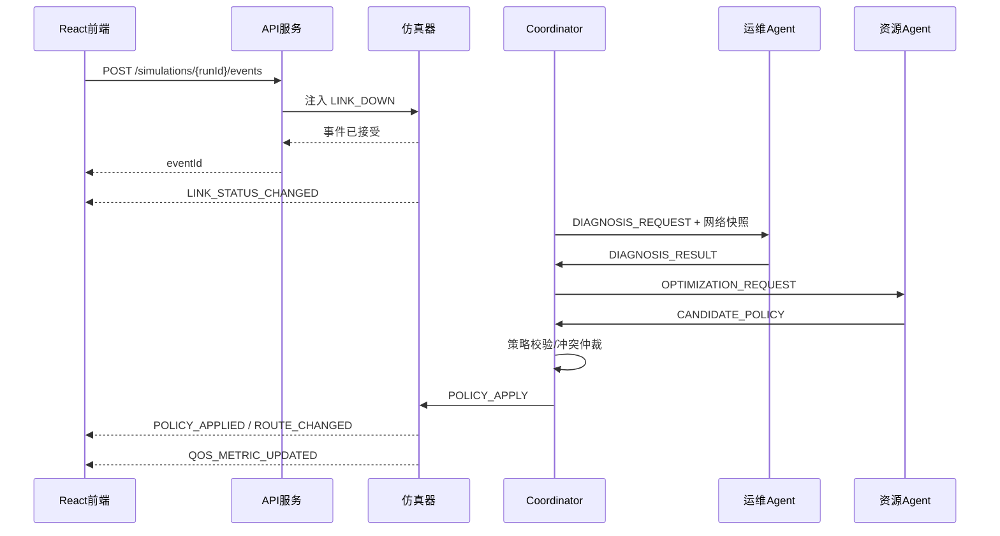
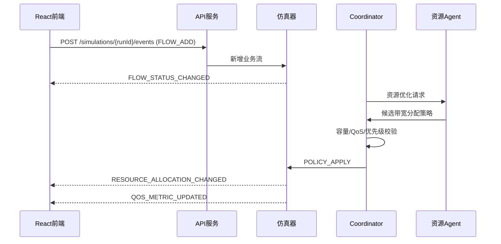

# 动态通信网络多智能体项目——前后端数据模型与接口规范（v1.0）

> 定位：**唯一事实源（Single Source of Truth）**。本文件统一定义前后端共用的数据模型、字段、枚举、REST API 与 WebSocket 事件协议；`前端详细设计方案.md` 只做页面与交互设计，字段与接口一律引用本文，不重复定义。
>
> 状态：基线 v1.0（在 V0.1 两份规范基础上合并、去重并修正跨文档冲突）
>
> 版本：v1.0　日期：2026-11-07
>
> 前端框架：React + TypeScript + Vite（本规范与前端框架无关，供前端 / 仿真后端 / 网络状态服务 / Agent 编排服务 / 算法服务共同遵守）
>
> API 根路径：`/api/v1`　实时通道：`/ws/v1/runs/{runId}`

---

## 1. 文档目的与边界

本文定义 React 前端与后端服务之间的数据契约、REST API、WebSocket 事件协议、请求/响应结构、错误码、分页、并发控制与联调约定，作为前后端并行开发、Mock 数据构造与接口联调的统一基线。

- 以**仿真对象**为核心：节点、链路、业务流、场景、仿真运行构成基础数据。
- **控制链路与数据链路独立建模**：不能因两个节点间存在一种链路就自动推断另一种链路也存在；两种链路可具有不同状态和参数。
- **控制面与数据面分离**：协调器与 Agent 负责态势、决策、校验与策略编排；业务数据转发由网络数据面完成。
- **状态、测量值、资源分配值分开**：链路可用带宽、业务需求带宽、已分配带宽不能混用。
- **全局快照有版本，实时事件有序号**：支持增量更新、乱序检测与断线恢复。
- **可追溯**：场景、仿真运行、Agent 任务、A2A 消息、策略与实验结果通过 ID、`traceId` 关联。

### 1.1 服务边界建议

| 服务/模块 | 主要职责 | 对前端暴露 |
|---|---|---|
| API Gateway / BFF | 统一入口、鉴权、参数校验、响应封装 | REST、WebSocket |
| 场景服务 | 场景 CRUD、场景校验、版本管理 | `/scenarios` |
| 仿真服务 | 创建/控制运行、事件注入、状态查询 | `/simulations` |
| 网络状态服务 | 节点、链路、拓扑快照、路由 | `/simulations/{runId}/topology`、`/nodes`、`/links` |
| 业务/QoS 服务 | 业务流、QoS 测量、资源分配 | `/flows`、`/qos`、`/resources` |
| Agent 编排服务 | Agent 状态、任务、A2A 消息、工具调用 | `/agents`、`/agent-messages`、`/tool-calls` |
| 策略服务 | 策略查询、校验、审批（可选）、应用 | `/policies` |
| 实验服务 | 实验定义、批量运行、指标和对比 | `/experiments`、`/datasets`、`/algorithms` |

服务可先以单体后端实现，接口逻辑边界保持清晰即可。

---

## 2. 通用约定

### 2.1 命名与数据类型

- JSON 字段统一 `camelCase`。
- ID 使用字符串，建议由后端生成；不要求前端理解 ID 内部结构。
- 时间字段使用带时区的 ISO 8601，例如 `2026-11-07T10:00:12.125+08:00`。
- 仿真内部时间统一使用 `simTimeMs`（毫秒，自当前 `runId` 仿真起点累计）。
- 数值字段不得用字符串承载，除非原始数据源确实只提供字符串且经过适配层转换。
- 可选字段缺失表示「未提供/未知」，不要用 `0` 代替未知。
- 枚举值采用大写英文；**链路介质类型 `linkType` 为小写标准化字符串，非封闭枚举**（见 §4 与 §6.2）。

### 2.2 单位约定

| 量 | 单位 |
|---|---|
| 带宽 | `bps`（前端格式化为 Kbps/Mbps/Gbps） |
| 时延/抖动 | `ms` |
| 误码率 / 丢包率 / 可靠性 | 0–1 小数 |
| 仿真时间 | `ms` |
| 时间戳（源数据） | `tsUs`，微秒整数 |

---

## 3. 核心对象关系

```text
Scenario 1 ── N SimulationRun
Scenario 1 ── N ScenarioEvent
SimulationRun 1 ── 1..N TopologySnapshot
SimulationRun 1 ── N BusinessFlow（运行时实例/状态）
SimulationRun 1 ── N AgentTask
AgentTask 1 ── N AgentMessage
AgentTask 1 ── 0..N Policy
Policy 1 ── N PolicyAction
SimulationRun 1 ── N MetricPoint
Experiment 1 ── N ExperimentRun
ExperimentRun 1 ── 1 SimulationRun
```

节点与链路是场景/仿真拓扑的组成部分。链路通过 `srcNodeId`、`dstNodeId` 关联两个节点，但**控制链路与数据链路分别拥有独立 `linkId`**（通过 `linkPlane` 区分）。

---

## 4. 枚举定义

| 枚举 | 推荐值 | 说明 |
|---|---|---|
| `NodeType` | `UAV`、`UGV`、`USV`、`UUV`、`RELAY`、`BASE`、`C2`、`EDGE`、`OTHER` | 平台/设备类别 |
| `NodeRole` | `MEMBER`、`RELAY`、`CLUSTER_HEAD`、`BACKBONE`、`GATEWAY`、`COORDINATOR` | 网络角色；可与 `NodeType` 并存 |
| `NodeStatus` | `ONLINE`、`OFFLINE`、`DEGRADED`、`UNKNOWN` | 节点运行状态 |
| `LinkPlane` | `CONTROL`、`DATA` | 控制面链路/数据面链路（项目扩展字段） |
| `LinkStatus` | `UP`、`DEGRADED`、`DOWN`、`UNKNOWN` | 链路状态 |
| `LinkDirection` | `BIDIRECTIONAL`、`UNIDIRECTIONAL` | 链路方向性 |
| `ServiceType` | `VOICE`、`VIDEO`、`IMAGE`、`DATA` | 业务类型（对应赛题：话音/视频/图片/数据） |
| `FlowStatus` | `PENDING`、`ACTIVE`、`DEGRADED`、`INTERRUPTED`、`FINISHED`、`REJECTED` | 业务流状态 |
| `SimulationStatus` | `CREATED`、`VALIDATING`、`READY`、`RUNNING`、`PAUSED`、`STOPPING`、`STOPPED`、`COMPLETED`、`FAILED` | 仿真生命周期 |
| `AgentType` | `OM`、`RESOURCE`、`COORDINATOR` | 运维智能体、资源控制智能体、协调器 |
| `AgentStatus` | `IDLE`、`BUSY`、`DEGRADED`、`OFFLINE`、`ERROR` | Agent 运行状态 |
| `TaskStatus` | `QUEUED`、`RUNNING`、`SUCCEEDED`、`FAILED`、`CANCELLED`、`TIMEOUT` | Agent 任务状态 |
| `PolicyType` | `ROUTE`、`BANDWIDTH`、`QOS`、`COMPOSITE` | 策略类型 |
| `PolicyStatus` | `GENERATED`、`VALIDATING`、`VALIDATED`、`REJECTED`、`APPLYING`、`APPLIED`、`FAILED`、`ROLLED_BACK` | 策略状态 |
| `ScenarioEventType` | `NODE_ONLINE`、`NODE_OFFLINE`、`NODE_MOVE`、`LINK_UP`、`LINK_DOWN`、`LINK_PARAM_CHANGE`、`LINK_FLAP`、`BANDWIDTH_CHANGE`、`FLOW_ADD`、`FLOW_REMOVE`、`FLOW_QOS_CHANGE`、`INTERFERENCE_CHANGE`、`COORDINATOR_FAILURE`、`CUSTOM` | 场景/运行时注入事件 |

> `linkType`（链路介质类型）**不作为大写枚举**，取值见 §6.2；具体取值范围以仿真器/赛题为准（见 §13 待确认清单 M-04）。

枚举可扩展，但新增值必须同步更新前端类型、后端校验与本文档。

---

## 5. 核心数据对象

### 5.1 NetworkNode（网络节点）

| 字段 | 类型 | 必填 | 说明 |
|---|---|---:|---|
| `nodeId` | string | 是 | 节点唯一 ID |
| `name` | string | 是 | 展示名称 |
| `nodeType` | NodeType | 是 | UAV/UGV/RELAY 等 |
| `role` | NodeRole | 否 | 网络角色 |
| `status` | NodeStatus | 是 | 当前状态 |
| `position` | object | 否 | 坐标，坐标系待确认 |
| `position.x/y/z` | number | position 存在时 | 三维坐标 |
| `position.coordinateSystem` | string | 否 | 如 `LOCAL_ENU`、`WGS84`，待确认 |
| `mobility` | object | 否 | 速度、航向等机动状态 |
| `resources` | object | 否 | 节点资源摘要 |
| `resources.energyPercent` | number | 否 | 剩余能量百分比，0–100 |
| `resources.computeCapacity` | number | 否 | 算力容量，单位待定义 |
| `resources.availableBandwidthBps` | integer | 否 | 节点可用带宽摘要 |
| `tags` | string[] | 否 | 自定义标签 |
| `createdAt` / `updatedAt` | datetime | 否 | 时间 |

```json
{
  "nodeId": "UAV-001",
  "name": "侦察无人机 001",
  "nodeType": "UAV",
  "role": "MEMBER",
  "status": "ONLINE",
  "position": { "x": 1250.5, "y": 830.2, "z": 120.0, "coordinateSystem": "LOCAL_ENU" },
  "mobility": { "speedMps": 18.5, "headingDeg": 72.0 },
  "resources": { "energyPercent": 76.5, "availableBandwidthBps": 12000000 },
  "updatedAt": "2026-11-07T10:00:12.125+08:00"
}
```

### 5.2 NetworkLink（网络链路）与 LinkParams

#### 5.2.1 重要建模规则

- `linkId` 是链路实体唯一标识；**不建议仅以 `srcNodeId + dstNodeId` 作为链路主键**。
- `linkPlane` 必须明确区分 `CONTROL` 与 `DATA`；同一节点对之间可以没有链路、只有控制链路、只有数据链路，或两者同时存在，且两类链路的参数可以完全不同。
- `linkType` 为介质/承载类型（小写字符串），与 `linkPlane` **正交**：一条 `DATA` 链路可以是 `microwave`，也可以是其它的介质类型。
- 若底层链路是双向的，使用 `BIDIRECTIONAL`；若仿真器需要分别模拟两个方向，建议拆成两个有向链路实体，具体方案待确认。

#### 5.2.2 字段定义

| 字段 | 类型 | 必填 | 说明 |
|---|---|---:|---|
| `linkId` | string | 是 | 链路唯一 ID |
| `linkPlane` | LinkPlane | 是 | `CONTROL` / `DATA` |
| `linkType` | string | 是 | 介质/承载类型，小写字符串（如 `microwave`、`satellite`、`vhf_uhf`、`radio`），取值待确认 |
| `srcNodeId` | string | 是 | 起点节点 |
| `dstNodeId` | string | 是 | 终点节点 |
| `direction` | LinkDirection | 是 | 单向/双向 |
| `status` | LinkStatus | 是 | 链路状态 |
| `params` | LinkParams | 是 | 测量/仿真链路参数 |
| `allocatedBandwidthBps` | integer | 否 | 已分配带宽 |
| `availableBandwidthBps` | integer | 否 | 当前可用带宽 |
| `utilization` | number | 否 | 利用率，0–1 |
| `qualityScore` | number | 否 | 归一化质量分，计算口径待确认 |
| `tsUs` | integer | 否 | 源数据微秒时间戳，兼容赛题样例 |
| `time` | string | 否 | 源数据时钟串（赛题字段，见 §6.1） |
| `updatedAt` | datetime | 否 | 更新时间 |

`LinkParams`：

| 字段 | 类型 | 单位/范围 | 说明 |
|---|---|---|---|
| `delayMs` | number | ms | 时延 |
| `jitterMs` | number | ms | 抖动 |
| `bandwidthBps` | integer | bps | 链路标称/当前带宽，具体口径待确认 |
| `ber` | number | 0–1 | 误码率 |
| `packetLossRate` | number | 0–1 | 丢包率 |
| `rssiDbm` | number | dBm | 可选扩展 |
| `snrDb` | number | dB | 可选扩展 |
| `frequencyHz` | number | Hz | 可选扩展 |

```json
{
  "linkId": "L-0087-DATA",
  "linkPlane": "DATA",
  "linkType": "microwave",
  "srcNodeId": "GND-005",
  "dstNodeId": "AIR-003",
  "direction": "BIDIRECTIONAL",
  "status": "UP",
  "params": {
    "delayMs": 12.5,
    "jitterMs": 3.0,
    "bandwidthBps": 8000000,
    "ber": 0.0001,
    "packetLossRate": 0.02
  },
  "allocatedBandwidthBps": 3500000,
  "availableBandwidthBps": 4500000,
  "utilization": 0.4375,
  "tsUs": 1798585182125680,
  "updatedAt": "2026-11-07T10:00:12.125+08:00"
}
```

### 5.3 BusinessFlow（业务流）与 QosRequirement

| 字段 | 类型 | 必填 | 说明 |
|---|---|---:|---|
| `flowId` | string | 是 | 业务流唯一 ID |
| `name` | string | 是 | 业务名称 |
| `serviceType` | ServiceType | 是 | 话音/视频/图片/数据 |
| `srcNodeId` | string | 是 | 源节点 |
| `dstNodeId` | string | 是 | 目的节点 |
| `priority` | integer | 是 | 优先级；数值方向见 §13 M-06（建议数值越小优先级越高） |
| `requiredBandwidthBps` | integer | 是 | 需求带宽 |
| `qos` | QosRequirement | 是 | QoS 约束 |
| `status` | FlowStatus | 是 | 业务状态 |
| `currentPath` | string[] | 否 | 当前路径节点序列 |
| `allocatedBandwidthBps` | integer | 否 | 实际分配带宽 |
| `measuredQos` | object | 否 | 实测 QoS（见 §5.8） |
| `createdAt` / `updatedAt` | datetime | 否 | 时间 |

`QosRequirement` 推荐字段：`maxDelayMs`、`maxJitterMs`、`maxPacketLossRate`、`minBandwidthBps`、`minReliability`（0–1）、`availabilityTarget`（可选，口径待确认）。

```json
{
  "flowId": "FLOW-VOICE-001",
  "name": "UAV-001 至 C2 语音",
  "serviceType": "VOICE",
  "srcNodeId": "UAV-001",
  "dstNodeId": "C2-001",
  "priority": 1,
  "requiredBandwidthBps": 64000,
  "qos": { "maxDelayMs": 150, "maxJitterMs": 30, "maxPacketLossRate": 0.02, "minBandwidthBps": 48000 },
  "status": "ACTIVE",
  "currentPath": ["UAV-001", "RELAY-001", "BASE-001", "C2-001"],
  "allocatedBandwidthBps": 64000,
  "measuredQos": { "delayMs": 92.0, "jitterMs": 14.0, "packetLossRate": 0.008 }
}
```

> 示例 QoS 数值仅用于接口联调，**不构成赛题统一阈值**；实际门槛由场景配置或测试集提供。

### 5.4 Scenario（场景）与 ScenarioEvent

| 字段 | 类型 | 必填 | 说明 |
|---|---|---:|---|
| `scenarioId` | string | 是 | 场景 ID |
| `name` | string | 是 | 场景名称 |
| `description` | string | 否 | 描述 |
| `version` | integer | 是 | 场景版本 |
| `status` | string | 是 | `DRAFT`、`VALID`、`ARCHIVED` |
| `seed` | integer | 否 | 随机种子 |
| `durationMs` | integer | 否 | 计划仿真时长 |
| `nodes` | NetworkNode[] | 是 | 初始节点集合 |
| `links` | NetworkLink[] | 是 | 初始链路集合 |
| `flows` | BusinessFlow[] | 是 | 初始业务流集合 |
| `events` | ScenarioEvent[] | 否 | 动态事件 |
| `createdAt` / `updatedAt` | datetime | 否 | 时间 |

`ScenarioEvent`：

| 字段 | 类型 | 必填 | 说明 |
|---|---|---:|---|
| `eventId` | string | 是 | 事件 ID |
| `eventType` | ScenarioEventType | 是 | 事件类型 |
| `triggerAtMs` | integer | 是 | 相对仿真起点触发时间 |
| `targetType` | string | 是 | `NODE`、`LINK`、`FLOW`、`NETWORK` |
| `targetId` | string | 条件必填 | 目标对象 ID；网络级事件可不填 |
| `payload` | object | 是 | 事件参数 |
| `durationMs` | integer | 否 | 持续时间；永久事件不填 |
| `enabled` | boolean | 是 | 是否启用 |
| `repeat` | object | 否 | 周期/随机重复配置，待扩展 |
| `description` | string | 否 | 说明 |

```json
{
  "eventId": "EVT-001",
  "eventType": "LINK_PARAM_CHANGE",
  "triggerAtMs": 12000,
  "targetType": "LINK",
  "targetId": "L-0087-DATA",
  "payload": { "params": { "bandwidthBps": 2000000, "delayMs": 35, "jitterMs": 12, "packetLossRate": 0.08 } },
  "durationMs": 30000,
  "enabled": true,
  "description": "模拟链路带宽下降与质量退化"
}
```

### 5.5 SimulationRun（仿真运行）与 TopologySnapshot（拓扑快照）

`SimulationRun`：`runId`、`scenarioId`、`scenarioVersion`、`status`、`simTimeMs`、`speed`、`seed`、`startedAt`、`finishedAt`、`createdAt/updatedAt`、`error`。

`TopologySnapshot`：`runId`、`version`（同 runId 内单调递增）、`simTimeMs`、`generatedAt`、`nodes`、`links`、`flows?`、`summary?`（节点数、链路数、连通分量等）。

**版本规则**：快照版本在同一 `runId` 内递增；前端仅接受不低于当前版本的快照；实时事件版本落后则忽略，序号缺口或版本跳跃则重新拉取快照。

### 5.6 AgentInstance / AgentTask / AgentMessage

`AgentInstance`：`agentId`、`agentType`、`name`、`status`、`capabilities[]`、`lastHeartbeatAt`、`currentTaskId`、`metrics`。

`AgentTask`：`taskId`、`traceId`、`runId`、`agentId`、`taskType`（如 `TOPOLOGY_ASSESSMENT`、`FAULT_DIAGNOSIS`、`RESOURCE_OPTIMIZATION`）、`status`、`inputSummary`、`outputSummary`、`startedAt/finishedAt`、`durationMs`、`error`。

`AgentMessage`：`messageId`、`traceId`、`taskId?`、`runId`、`fromAgent`、`toAgent`、`messageType`、`payload`、`timestamp`。

推荐 `messageType`：`NETWORK_SNAPSHOT`、`DIAGNOSIS_REQUEST`、`DIAGNOSIS_RESULT`、`OPTIMIZATION_REQUEST`、`CANDIDATE_POLICY`、`POLICY_VALIDATION_RESULT`、`POLICY_APPLY_RESULT`、`TASK_CANCELLED`。

### 5.7 Policy（策略）与 PolicyAction

`Policy`：`policyId`、`runId`、`traceId`、`taskId?`、`policyType`、`status`、`reason`、`snapshotVersion`（生成策略所依据的快照版本）、`actions[]`、`validation?`、`createdAt`、`appliedAt`。

`PolicyAction` 推荐动作类型：

- `SET_FLOW_PATH`：为业务流设置路径。
- `SET_LINK_BANDWIDTH_ALLOCATION`：调整链路带宽分配。
- `SET_FLOW_PRIORITY`：调整业务优先级。
- `SET_FLOW_QOS_PROFILE`：调整 QoS 配置。
- `ENABLE_LINK` / `DISABLE_LINK`：仅用于仿真策略确实允许操作链路状态时。

```json
{
  "policyId": "POLICY-001",
  "runId": "RUN-001",
  "traceId": "TRACE-20261107-0001",
  "policyType": "COMPOSITE",
  "status": "GENERATED",
  "snapshotVersion": 18,
  "reason": "原路径链路中断，替代路径满足话音时延约束",
  "actions": [
    { "actionType": "SET_FLOW_PATH", "targetId": "FLOW-VOICE-001", "value": { "nodePath": ["UAV-001", "RELAY-002", "BASE-001", "C2-001"] } },
    { "actionType": "SET_LINK_BANDWIDTH_ALLOCATION", "targetId": "L-RELAY-002-BASE-001", "value": { "flowId": "FLOW-VOICE-001", "bandwidthBps": 64000 } }
  ],
  "createdAt": "2026-11-07T10:00:13.000+08:00"
}
```

### 5.8 ResourceAllocation / QosMeasurement

`ResourceAllocation`：`allocationId`、`runId`、`linkId`、`flowId`、`allocatedBandwidthBps`、`priority`、`allocationStatus`、`policyId`、`validFromSimTimeMs`、`validToSimTimeMs`。

`QosMeasurement`：`runId`、`flowId`、`simTimeMs`、`delayMs`、`jitterMs`、`packetLossRate`、`throughputBps`、`availability`、`isCompliant`、`violations[]`。测量值必须与 QoS 要求分离；`isCompliant` 由后端按当前场景/业务门槛计算，前端不自行写死阈值。

### 5.9 MetricPoint / Experiment / ExperimentRun

`MetricPoint`：`metricId?`、`runId`、`experimentRunId?`、`metric`、`value`、`unit`、`simTimeMs`、`timestamp`、`dimensions?`。

建议首批指标：`network_connectivity`、`qos_compliance_rate`、`state_perception_latency_ms`、`policy_generation_latency_ms`、`policy_delivery_latency_ms`、`recovery_time_ms`、`bandwidth_utilization`、`packet_delivery_rate`。

`Experiment`：`experimentId`、`name`、`scenarioIds[]`、`algorithmVersions[]`、`baselineConfig`、`createdAt`。
`ExperimentRun`：`experimentRunId`、`experimentId`、`runId`、`scenarioId`、`scenarioVersion`、`seed`、`algorithmVersion`、`status`、`startedAt`、`finishedAt`、`summary`。

---

## 6. 与赛题数据契约的对照与导入适配（关键）

### 6.1 赛题链路样例（原文，已从赛题 PDF 核验）

```json
{
  "linkId": "L0087",
  "linkType": "microwave",
  "srcNodeId": "GND005",
  "dstNodeId": "AIR003",
  "status": "up",
  "params": {
    "delayMs": 12.5,
    "jitterMs": 3.0,
    "bandwitdhBps": 8000000,
    "ber": 0.0001,
    "packetLossRate": 0.02
  },
  "time": "10:30:02.125480",
  "tsUs": 1798585182125680
}
```

### 6.2 字段语义决议（v1.0 定稿）

| 事项 | 结论 |
|---|---|
| `linkType` 语义 | 赛题 `linkType` 为**介质类型**（样例 `"microwave"`）。内部模型保留 `linkType` 为小写介质串，**不**重定义为控制/数据面。 |
| 控制/数据面字段 | 赛题**没有**控制面/数据面字段；项目新增 `linkPlane`（`CONTROL`/`DATA`）承载「控制面与数据面分离」理念，与 `linkType` 正交。 |
| `status` 大小写 | 赛题样例 `status` 为小写 `"up"`；内部模型统一为大写枚举 `UP`，**导入适配层负责大小写归一**。 |
| `bandwitdhBps` 拼写 | 赛题原文为 `bandwitdhBps`（缺一个 `d`）。内部统一使用正确拼写 `bandwidthBps`，**仅在导入适配层兼容旧拼写**，避免污染内部模型。 |
| `time` 与 `tsUs` | 赛题同时有 `time`（时钟串 `"10:30:02.125480"`）与 `tsUs`（微秒时间戳）。内部以 `tsUs` 为权威时间源，`time` 作为可选展示字段保留，二者在导入适配层统一。 |
| 节点 ID 样例 | 赛题样例使用 `GND005`/`AIR003` 等前缀；内部模型不强制前缀规范，仅要求 `nodeId` 全局唯一且与 `srcNodeId/dstNodeId/currentPath` 一致。 |

---

## 7. REST API 规范

### 7.1 请求头

| Header | 必需 | 说明 |
|---|---:|---|
| `Content-Type: application/json` | 写请求 | JSON 请求体 |
| `Accept: application/json` | 建议 | JSON 响应 |
| `Authorization: Bearer <token>` | 按部署配置 | 若启用鉴权 |
| `X-Request-Id` | 否 | 调用方请求追踪 ID |
| `Idempotency-Key` | 条件必需 | 创建运行、注入事件、应用策略等可能重试的写操作 |
| `If-Match` | 条件必需 | 更新场景时携带版本/ETag，防止覆盖他人修改 |

### 7.2 统一响应结构

成功（HTTP 状态码表达协议层结果，`code` 表达业务结果）：

```json
{ "code": "OK", "message": "success", "data": {}, "requestId": "REQ-20261107-0001", "timestamp": "2026-11-07T10:00:12.125+08:00" }
```

错误：

```json
{
  "code": "SIMULATION_STATE_CONFLICT",
  "message": "simulation is not running",
  "details": { "runId": "RUN-001", "currentStatus": "PAUSED" },
  "requestId": "REQ-20261107-0002",
  "timestamp": "2026-11-07T10:00:12.125+08:00"
}
```

前端业务数据统一从 `data` 读取；列表接口分页信息放在 `data.items`、`data.page`、`data.pageSize`、`data.total` 中。

### 7.3 HTTP 状态码与错误码

| HTTP | 错误码示例 | 含义 |
|---:|---|---|
| 400 | `INVALID_ARGUMENT` | 参数格式错误 |
| 401 | `UNAUTHORIZED` | 未认证 |
| 403 | `FORBIDDEN` | 无权限 |
| 404 | `RESOURCE_NOT_FOUND` | 资源不存在 |
| 409 | `VERSION_CONFLICT`、`SIMULATION_STATE_CONFLICT` | 版本或状态冲突 |
| 422 | `SCENARIO_VALIDATION_FAILED`、`POLICY_VALIDATION_FAILED` | 业务校验不通过 |
| 429 | `RATE_LIMITED` | 请求频率受限 |
| 500 | `INTERNAL_ERROR` | 服务内部错误 |
| 502/503 | `DEPENDENCY_UNAVAILABLE` | 仿真器/算法服务不可用 |
| 504 | `DEPENDENCY_TIMEOUT` | 下游调用超时 |

建议首批业务错误码：`NODE_NOT_FOUND`、`LINK_NOT_FOUND`、`FLOW_NOT_FOUND`、`SCENARIO_NOT_FOUND`、`RUN_NOT_FOUND`、`INVALID_SIMULATION_TRANSITION`、`EVENT_TARGET_INVALID`、`SNAPSHOT_VERSION_STALE`、`POLICY_APPLY_FAILED`、`FEATURE_NOT_SUPPORTED`。

### 7.4 分页、排序与时间范围

列表接口统一支持（适用时）：`page`（从 1 起，默认 1）、`pageSize`（默认 20，最大 200）、`sortBy`（字段白名单）、`order`（`asc`/`desc`）、`from`/`to`（ISO 8601 时间范围），以及 `runId`、`traceId`、`status` 等业务过滤参数。

### 7.5 接口总表

| 模块 | 方法 | 路径 | 用途 | 优先级 |
|---|---|---|---|---|
| 总览 | GET | `/dashboard/summary` | 系统总览摘要 | P1 |
| 场景 | GET/POST | `/scenarios` | 场景列表/创建 | P0 |
| 场景 | GET/PUT | `/scenarios/{scenarioId}` | 场景详情/更新 | P0 |
| 场景 | DELETE | `/scenarios/{scenarioId}` | 删除/归档场景 | P1 |
| 场景 | POST | `/scenarios/{scenarioId}/validate` | 场景校验 | P0 |
| 场景 | POST | `/scenarios/{scenarioId}/clone` | 复制场景 | P1 |
| 仿真 | POST | `/simulations` | 创建运行 | P0 |
| 仿真 | GET | `/simulations/{runId}` | 运行详情 | P0 |
| 仿真 | GET | `/simulations/{runId}/status` | 运行状态 | P0 |
| 仿真 | POST | `/simulations/{runId}/start` | 启动 | P0 |
| 仿真 | POST | `/simulations/{runId}/pause` | 暂停 | P0 |
| 仿真 | POST | `/simulations/{runId}/resume` | 恢复 | P0 |
| 仿真 | POST | `/simulations/{runId}/stop` | 停止 | P0 |
| 仿真 | POST | `/simulations/{runId}/step` | 单步推进 | P1 |
| 仿真 | PATCH | `/simulations/{runId}/speed` | 调整倍速 | P1 |
| 仿真 | POST | `/simulations/{runId}/events` | 运行时注入事件 | P0 |
| 仿真 | GET | `/simulations/capabilities` | 能力发现（支持的事件类型/字段范围/单步/调速） | P1 |
| 网络 | GET | `/simulations/{runId}/topology` | 获取拓扑快照 | P0 |
| 网络 | GET | `/nodes/{nodeId}?runId=` | 节点详情 | P1 |
| 网络 | GET | `/links/{linkId}?runId=` | 链路详情 | P1 |
| 网络 | GET | `/nodes/{nodeId}/neighbors?runId=` | 邻居表 | P1 |
| 网络 | GET | `/nodes/{nodeId}/routes?runId=` | 节点路由表 | P1 |
| 业务 | GET | `/flows?runId=` | 业务流列表 | P1 |
| 业务 | GET | `/flows/{flowId}?runId=` | 业务流详情 | P1 |
| 业务 | GET | `/flows/{flowId}/route?runId=` | 业务当前路径 | P1 |
| Agent | GET | `/agents?runId=` | Agent 状态列表 | P1 |
| Agent | GET | `/agents/{agentId}/tasks?runId=` | Agent 任务列表 | P1 |
| Agent | GET | `/agent-messages?runId=` | A2A 消息列表 | P1 |
| Agent | GET | `/tool-calls?traceId=` | 工具调用列表 | P1 |
| 策略 | GET | `/policies?runId=` | 策略列表 | P1 |
| 策略 | GET | `/policies/{policyId}` | 策略详情 | P1 |
| 策略 | POST | `/policies/{policyId}/validate` | 策略校验 | P1 |
| 策略 | POST | `/policies/{policyId}/apply` | 应用策略 | P1 |
| 指标 | GET | `/metrics/links?runId=` | 链路指标序列 | P1 |
| 指标 | GET | `/metrics/flows?runId=` | 业务/QoS 指标序列 | P1 |
| QoS | GET | `/qos/summary?runId=` | QoS 汇总 | P1 |
| QoS | GET | `/qos/flows/{flowId}?runId=` | 单业务 QoS 详情 | P1 |
| 资源 | GET | `/resources/allocation?runId=` | 资源分配快照 | P1 |
| 资源 | GET | `/resources/history?runId=` | 资源变化记录 | P1 |
| 实验 | GET/POST | `/experiments` | 实验列表/创建 | P2 |
| 实验 | GET | `/experiments/{experimentId}` | 实验详情 | P2 |
| 实验 | POST | `/experiments/{experimentId}/runs` | 启动实验批次 | P2 |
| 实验 | GET | `/experiments/{experimentId}/metrics` | 实验指标 | P2 |
| 实验 | GET | `/experiments/compare?experimentRunIds=` | 多实验对比 | P2 |
| 数据 | GET | `/datasets` | 数据集列表 | P2 |
| 数据 | GET | `/algorithms` | 算法版本列表 | P2 |

### 7.6 场景 API

`GET /scenarios?page=&pageSize=&status=DRAFT` → `data.items[]` 为 Scenario 摘要（至少含 `scenarioId`、`name`、`version`、`status`、`updatedAt`）。

`POST /scenarios` → `201 Created`，请求体含 `name`、`description`、`seed`、`durationMs`、`nodes`、`links`、`flows`、`events`；后端生成 `scenarioId`、`version`、时间字段。

`PUT /scenarios/{scenarioId}` 通过 `If-Match` 或请求体 `expectedVersion` 做乐观锁；`DELETE` 默认归档，不物理删除已被运行/实验引用的场景。

`POST /scenarios/{scenarioId}/validate`：

```json
{ "version": 3, "strict": true }
```

响应 `data`：`valid`、`errors[]`（`code`、`path`、`message`）、`warnings[]`。

### 7.7 仿真生命周期 API

`POST /simulations`：

```json
{ "scenarioId": "SCN-001", "scenarioVersion": 3, "seed": 20261107, "speed": 1.0,
  "options": { "enableAgents": true, "enableRealtimeEvents": true } }
```

状态机（`INVALID_SIMULATION_TRANSITION` 表示非法迁移；`FEATURE_NOT_SUPPORTED` 表示仿真器不支持该能力）：

| 操作 | 允许的前置状态 | 成功状态 |
|---|---|---|
| start | `CREATED`、`READY` | `RUNNING` |
| pause | `RUNNING` | `PAUSED` |
| resume | `PAUSED` | `RUNNING` |
| stop | `RUNNING`、`PAUSED` | `STOPPED` |
| step | `PAUSED` | `PAUSED`（仿真时间前进一个步长） |
| speed | `RUNNING`、`PAUSED` | 状态不变 |

控制请求允许空请求体；单步可传 `{ "steps": 1 }`；调速传 `{ "speed": 5.0 }`。所有控制响应返回最新 `SimulationRun`。

运行时事件注入 `POST /simulations/{runId}/events`：

```json
{
  "eventType": "LINK_PARAM_CHANGE", "triggerAtMs": 0, "targetType": "LINK", "targetId": "L-0087-DATA",
  "payload": { "params": { "bandwidthBps": 2000000, "delayMs": 35, "jitterMs": 12, "packetLossRate": 0.08 } },
  "durationMs": 30000
}
```

响应返回 `eventId`、`accepted`、`scheduledAtSimTimeMs`。运行时注入与场景预设事件使用同一事件模型；目标不存在或当前状态不允许注入返回 422/409。

`GET /simulations/capabilities`：返回仿真器支持的能力声明（可注入的事件类型与字段范围、是否支持单步/调速等），前端据此动态生成表单并禁用不支持控件；未实现时前端回退到集中管理的固定 Mock 配置。

### 7.8 网络状态 API

`GET /simulations/{runId}/topology`，可选 `includeFlows=true`、`sinceVersion=`。完整响应 `data`：`runId`、`version`、`simTimeMs`、`generatedAt`、`nodes`、`links`、`flows`、`summary`（`nodeCount`、`onlineNodeCount`、`linkCount`、`upLinkCount`、`connectedComponents`）。

`links[]` 必须保留 `linkPlane`，不得根据节点对自动生成控制链路或数据链路。

`GET /nodes/{nodeId}?runId=`、`GET /links/{linkId}?runId=`：查询运行态时**必须传 `runId`**；不传时是否返回模板/静态定义由后端确定。

### 7.9 业务、QoS 与资源 API

- `GET /flows?runId=&status=ACTIVE`、`GET /flows/{flowId}?runId=`、`GET /flows/{flowId}/route?runId=`
- `GET /qos/summary?runId=`：返回 `totalFlows`、`compliantFlows`、`nonCompliantFlows`、`complianceRate`、`byServiceType`、`violations[]`（flowId、指标、实际值、阈值、超限方向）。
- `GET /metrics/links?runId=&linkId=&metric=delayMs&fromSimTimeMs=&toSimTimeMs=&intervalMs=`
- `GET /metrics/flows?runId=&flowId=&metric=throughputBps&fromSimTimeMs=&toSimTimeMs=&intervalMs=`
- `GET /resources/allocation?runId=&linkId=`：每条链路的业务分配明细，至少区分额定带宽、已分配带宽、剩余可用带宽、分配到的业务流和策略来源。
- `GET /resources/history?runId=`：带宽抢占/释放记录。

### 7.10 Agent、消息与策略 API

- `GET /agents?runId=`、`GET /agents/{agentId}/tasks?runId=&status=&page=&pageSize=`
- `GET /agent-messages?runId=&traceId=&page=&pageSize=`：默认返回摘要，`includePayload=true` 返回完整载荷。
- `GET /tool-calls?traceId=`：按 `traceId` 查询工具调用。
- `GET /policies?runId=&status=`、`GET /policies/{policyId}`

`POST /policies/{policyId}/validate`：

```json
{ "expectedSnapshotVersion": 18 }
```

`POST /policies/{policyId}/apply`：

```json
{ "expectedSnapshotVersion": 18, "approval": { "approved": true, "approvedBy": "operator" } }
```

若系统采用自动审批模式，可不要求 `approval`。应用策略必须校验快照版本、目标链路状态、路径连通性、链路容量和业务 QoS 约束；不通过时返回明确校验项。

### 7.11 Dashboard 与实验 API

`GET /dashboard/summary?runId=`：当前仿真状态和时间、节点在线数/链路可用数/网络连通度、活跃业务数与 QoS 达标率、Agent 在线数/运行任务数、最近策略与最近告警。后端无聚合接口时，前端可组合调用拓扑/指标/Agent/事件接口（见设计方案 Dashboard 页）。

`GET/POST /experiments`、`GET /experiments/{experimentId}`、`POST /experiments/{experimentId}/runs`、`GET /experiments/{experimentId}/metrics`、`GET /experiments/compare?experimentRunIds=ER-1,ER-2`。

实验运行必须记录 `scenarioId`、`scenarioVersion`、`seed`、`algorithmVersion`、运行配置和指标口径，保证结果可复现。

---

## 8. WebSocket 实时事件协议

### 8.1 连接与鉴权

`ws(s)://{host}/ws/v1/runs/{runId}`。浏览器原生 WebSocket 不便自定义 Header，优先考虑安全 Cookie 或短期连接令牌参数交换机制，避免长期令牌暴露在 URL。

### 8.2 事件信封

```json
{
  "eventId": "EVT-000001",
  "eventType": "LINK_STATUS_CHANGED",
  "runId": "RUN-001",
  "seq": 1024,
  "version": 18,
  "simTimeMs": 12000,
  "timestamp": "2026-11-07T10:00:12.125+08:00",
  "traceId": "TRACE-20261107-0001",
  "data": { "linkId": "L-0087-DATA", "oldStatus": "UP", "newStatus": "DOWN" }
}
```

`seq` 在单个 `runId` 事件流内严格递增；`version` 表示事件对应的状态/拓扑版本（是否与拓扑快照版本同源，见 §13 M-08）。

### 8.3 事件类型

| 事件 | data 核心字段 | 前端动作 |
|---|---|---|
| `SIMULATION_STATUS_CHANGED` | `status`、`previousStatus` | 更新仿真状态 |
| `SIMULATION_TIME_UPDATED` | `simTimeMs`、`speed` | 更新时间轴 |
| `NODE_STATUS_CHANGED` | `nodeId`、`oldStatus`、`newStatus` | 更新节点 |
| `NODE_POSITION_UPDATED` | `nodeId`、`position` | 更新位置 |
| `LINK_STATUS_CHANGED` | `linkId`、`oldStatus`、`newStatus` | 更新链路 |
| `LINK_METRIC_UPDATED` | `linkId`、`params` | 更新链路指标 |
| `TOPOLOGY_UPDATED` | `snapshotVersion`、`changeSummary` | 必要时拉取快照 |
| `ROUTE_CHANGED` | `flowId`、`oldPath`、`newPath` | 更新路径 |
| `FLOW_STATUS_CHANGED` | `flowId`、`status` | 更新业务状态 |
| `QOS_METRIC_UPDATED` | `flowId`、`measurement` | 更新 QoS |
| `RESOURCE_ALLOCATION_CHANGED` | `linkId`、`allocations` | 更新资源分配 |
| `AGENT_STATUS_CHANGED` | `agentId`、`status` | 更新 Agent |
| `AGENT_TASK_STARTED` | `task` | 展示任务开始 |
| `AGENT_TASK_COMPLETED` | `task` | 展示任务完成 |
| `A2A_MESSAGE` | `message` | 追加协同消息 |
| `TOOL_CALL_STARTED` / `TOOL_CALL_COMPLETED` | `toolCall` | 展示工具调用 |
| `POLICY_GENERATED` | `policy` | 展示候选策略 |
| `POLICY_VALIDATED` | `policyId`、`validation` | 展示校验结果 |
| `POLICY_APPLIED` | `policyId`、`result` | 更新策略状态 |
| `POLICY_FAILED` | `policyId`、`error` | 更新策略状态 |
| `SIMULATION_COMPLETED` / `SIMULATION_ERROR` | `result` / `error` | 展示结束/错误 |

### 8.4 订阅、心跳与断线恢复

客户端连接后发送：

```json
{ "action": "SUBSCRIBE", "lastSeq": 1020, "filters": ["NODE_STATUS_CHANGED", "LINK_STATUS_CHANGED", "POLICY_APPLIED"] }
```

服务端可回复 `SUBSCRIBED`。心跳建议采用 WebSocket Ping/Pong；若应用层心跳，定义 `PING`/`PONG` 并明确间隔。

恢复规则：

1. 前端记录最近处理的 `seq`。
2. 断线重连时携带 `lastSeq`。
3. 服务端若支持补发则从下一序号补发；若不支持或缓存过期，返回 `RESYNC_REQUIRED`。
4. 收到 `RESYNC_REQUIRED`、发现序号缺口、版本倒退或无法应用事件时，前端先拉取仿真状态和完整拓扑快照。
5. 高频指标批量推送，前端按 500ms–2s 节流刷新（最终周期按压测确定）。

---

## 9. 典型闭环时序

### 9.1 链路中断与业务恢复



### 9.2 资源不足与高优先级业务抢占



---

## 10. 并发、幂等与安全

1. 创建仿真、注入事件、应用策略等写操作建议使用 `Idempotency-Key`，避免前端重试产生重复动作。
2. 场景更新使用版本号/ETag 乐观锁；冲突返回 409。
3. 策略应用必须带 `expectedSnapshotVersion`，过期策略不得直接应用。
4. 停止仿真、应用策略、删除场景等操作应在 UI 侧二次确认；服务端仍需校验权限。
5. 日志和消息中不得记录访问令牌、密钥等敏感信息。
6. `traceId` 贯穿 Coordinator、Agent、算法服务和仿真器；`requestId` 用于单次 API 请求。
7. 对策略下发保留完整审计信息：发起者、校验结果、依据快照版本、动作明细、执行反馈。

---

## 11. 数据一致性、校验与兼容要求

1. `srcNodeId`、`dstNodeId`、`currentPath` 中的节点必须能在对应快照中解析；允许节点下线后保留历史路径。
2. 链路引用的两个端点必须存在于场景/快照节点集合中。
3. 业务流源/目的节点必须存在；若节点离线，业务状态由仿真后端更新。
4. `params.bandwidthBps`、`allocatedBandwidthBps`、`availableBandwidthBps` 均为 bps，且语义不同，不得混用。
5. `ber`、`packetLossRate`、`minReliability` 使用 0–1 小数。
6. `priority` 排序规则必须统一；建议额外定义 `priorityRank` 或在接口文档明确「数值越小优先级越高」。
7. 同一仿真运行锁定场景版本，避免运行中编辑场景导致不可复现。
8. 随机仿真必须记录 `seed`；实验结果必须记录场景版本和算法版本。
9. 导入赛题样例数据时：兼容 `bandwitdhBps` 拼写、`status` 小写归一、`linkType` 透传为介质串；内部只保留 `bandwidthBps`、大写枚举。
10. 所有未知字段采用向前兼容策略；前端忽略无法识别的扩展字段。

---

## 12. Mock 约定

前端使用 MSW（REST）+ WebSocket Mock Provider 实现与正式接口同构的 Mock；`VITE_USE_MOCK=true/false` 控制切换。Mock 的 REST 与 WebSocket 必须共享同一份运行态内存数据，使用固定随机种子保证可复现，并在 UI 显著标注「Mock 数据/模拟策略结果」。Mock 只能验证交互与接口契约，不能证明算法性能和策略正确性。分层与演示场景细节见《前端详细设计方案_v1.0》。

---

## 13. 待确认清单

| 编号 | 待确认问题 | 建议默认值/处理 |
|---|---|---|
| M-01 | 节点坐标系、单位 | 初版采用仿真平面坐标；增加 `coordinateSystem` |
| M-02 | 节点位置、速度是否实时上报 | 可选字段，事件增量更新 |
| M-03 | 控制/数据链路的方向建模 | 首版支持双向/单向；是否拆分方向待仿真器确认 |
| M-04 | `linkType` 介质取值全集（`microwave`/`satellite`/`vhf_uhf`/`radio` 等） | 以仿真器/赛题实际取值导出 |
| M-05 | 丢包率/误码率是否统一 0–1 | 建议统一 0–1 |
| M-06 | 优先级数值方向 | 建议数值越小优先级越高 |
| M-07 | QoS 阈值来源 | 由场景或测试集定义，不写死在前端 |
| M-08 | 事件 `version` 语义 | 快照版本与事件状态版本是否同源 |
| M-09 | 仿真是否支持暂停、单步、运行时注入 | 以仿真器能力为准，前端经 `FEATURE_NOT_SUPPORTED` 禁用 |
| M-10 | Agent 是否输出完整结构化 A2A 消息与工具调用 | 首版至少提供摘要和 traceId |
| M-11 | 策略是否需要人工审批 | 初版支持策略状态字段，审批流程可选 |
| M-12 | 实验测试集导入格式 | JSON/CSV/其他待确认 |
| M-13 | 赛题 `time` 与 `tsUs` 的权威时间源 | 建议 `tsUs` 为权威，`time` 仅展示 |

---

## 14. 首轮联调最小数据集与验收用例

**最小数据集**：第一轮仅打通 `Scenario`、`NetworkNode`、`NetworkLink`、`BusinessFlow`、`ScenarioEvent`、`SimulationRun`、`TopologySnapshot`、`RealtimeEvent`；第二轮再接入 Agent、Policy、ResourceAllocation、MetricPoint、Experiment。

**验收用例**：

1. 创建一个包含至少 3 个节点、2 条链路和 1 条业务流的场景。
2. 创建并启动仿真，前端显示运行状态和仿真时间。
3. 注入 `LINK_DOWN` 事件，拓扑中仅对应链路变为 `DOWN`。
4. 注入 `LINK_PARAM_CHANGE`，链路时延、丢包或带宽指标更新。
5. 注入节点下线事件，节点状态和关联链路状态按仿真器规则更新。
6. Agent 产生诊断任务，前端可通过 `traceId` 查询任务与 A2A 消息。
7. 资源 Agent 生成候选策略，协调器校验并下发，前端收到策略执行结果。
8. 验证控制链路和数据链路可以独立存在、独立变化，不会因同一节点对而被错误合并。
9. WebSocket 断开后重连，前端通过 `lastSeq` 或快照重同步恢复一致状态。
10. 同一场景、随机种子和算法版本可重复运行并获得可比较的实验指标。

---
