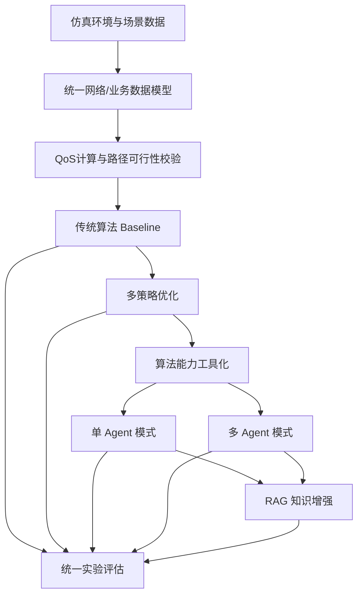

# B03 资源受限环境下通信网络资源管控项目企划书

> 版本：V1.0  
> 编制日期：2026-11-16  
> 项目代号：B03-Network-Intelligence  
> 技术路线：数学模型 → 传统算法 → 多策略优化 → 单 Agent → 多 Agent → RAG 增强（可选）  
> 技术栈：Python 3.12+  
> 工程形态：初期单仓库、多模块；后期可按边界拆分为独立服务
>
> ---
>
> **⚠️ 现状提示（2026-11-26）**——本文是**立项时的规划文档**，保留作史料与评审依据；
> 部分内容已被后续实现超越，**当前事实以以下文档为准**：
>
> | 本文章节 | 现状 | 看这里 |
> |---|---|---|
> | §10 单仓库多模块工程结构 | 目录已重组为 `src/common/`（共享底座）+ `src/baseline/` + `src/agents/`（两个入口） | [模块边界与依赖方向](../architecture/模块边界与依赖方向.md) |
> | §6 算法与 Agent 可切换架构 | 已落地：两侧共用感知/控制/算法内核，差异仅在决策核心 | [baseline 与 agents 的共享与对比](../architecture/baseline与agents的共享与对比.md) |
> | §4 数学模型设计 | 已落地为 `src/common/modeling/` | [数学建模方案](../common/modeling/数学建模方案.md) |
> | §5 传统算法与多策略优化 | 已落地为 `src/common/algorithms/`（topology/path/flow 三分） | [flow 级联合选路](../common/algorithms/flow级联合选路.md) |
> | §7 大模型与 Agent 设计 | A2A 协议/调度/仲裁、LLM 通道已落地；端到端编排待实现 | [智能体设计](../agents/智能体设计.md) |
> | §8 RAG 知识增强设计 | 尚未实现（知识库与检索层待建） | [智能体设计](../agents/智能体设计.md) §8 |
> | §12–§16 实验/阶段/交付物 | 部分完成，进度见实验记录 | `docs/experiments/`、`experiments/` |
>
> **文档总入口**：[文档索引](../index.md)

---

## 1. 项目概述

### 1.1 项目名称

面向资源受限动态无人集群通信网络的多智能体协同资源管控系统。

### 1.2 项目背景

无人集群通信网络面临节点机动、链路质量波动、链路中断、业务并发和资源受限等问题。网络状态具有动态性，数据、图像、话音、视频等业务对端到端时延、抖动、带宽、误码率和丢包率具有不同要求。单纯依赖静态最短路径或人工配置，难以持续保障多业务 QoS。

B03 赛题要求依托指定仿真环境，构建至少包含通信网络运维智能体和通信网络资源控制智能体的多智能体协同体系，实现网络状态感知、故障识别、链路优选、路由动态调整和业务 QoS 保障，并通过仿真实验进行量化评估。

### 1.3 项目定位

本项目采用渐进式研发策略：

1. 先建立可信、可验证的网络数学模型；
2. 再实现不依赖大模型的传统算法基线；
3. 逐项增加路由策略并完成组合优化；
4. 在传统算法能力之上接入单 Agent；
5. 扩展为运维 Agent 与资源控制 Agent 协同；
6. （可选）最后引入 RAG，增强知识检索、故障分析和策略选择能力。

**核心原则：数学模型和确定性算法是系统的公共能力层；传统算法模式与 Agent 模式共享同一套算法工具、仿真适配器和评估体系。** Agent 不替代 QoS 硬约束校验，也不直接绕过路径可行性检查。

### 1.4 项目目标

- 构建可准确表达仿真网络、节点、链路、业务和动态事件的统一数据模型。
- 实现端到端 QoS 计算、路径可行性判断和路径代价评估。
- 建立可运行、可复现的传统算法基线。
- 通过多策略组合提升测试业务保障率、网络连通度和故障恢复能力。
- 建立可切换的传统算法 / 单 Agent / 多 Agent 运行模式。
- 通过 RAG 提供网络知识、故障案例和历史实验经验支持。
- 建立统一实验框架，客观比较各技术阶段的收益与代价。
- 满足赛题对多智能体体系、低参数量低比特量化大模型和仿真实验验证的要求。

### 1.5 项目范围与边界

本项目以仿真平台实际开放接口为准，第一阶段将**路径选择与路径下发**作为主要可控动作。

当前不将以下能力假设为可直接控制的动作：无线发射功率、PRB 调度、基站内部调度、底层带宽动态切片、服务器扩缩容等。它们可作为背景状态、资源约束或未来扩展方向，但只有在平台提供明确接口后才能纳入执行闭环。

---

## 2. 赛题理解与仿真环境边界

### 2.1 仿真网络抽象

仿真环境模拟无人集群通信网络，网络由三类节点构成：

| 节点类型 | 含义 | 网络角色 | 业务端点 |
|---|---|---|---|
| `uav` | 无人平台 | 业务终端、网络主机 | 是，业务源/宿 |
| `ground` | 地面节点 | 汇聚、骨干转发 | 否 |
| `air` | 空中节点 | 空中中继 | 否 |

业务源节点和目的节点必须为 UAV；ground 和 air 主要承担转发/中继作用。拓扑中可能存在同一节点对之间的并行链路，必须通过 `linkId` 区分，不能只用节点序列表示一条路径。

### 2.2 链路模型

链路是无向链路对象，主要字段包括：

- `linkId`
- `linkType`
- `srcNodeId`
- `dstNodeId`
- `status`
- `params.delayMs`
- `params.jitterMs`
- `params.bandwidthBps`
- `params.ber`
- `params.packetLossRate`

仿真环境涉及光纤、卫通、VHF、UHF、微波和 5G 等链路类型。链路质量由时延、抖动、带宽、误码率和丢包率描述。

链路可用性由链路状态和两端节点状态共同决定。链路状态为 `up` 且两端节点在线时，才可作为候选路径边。

### 2.3 业务模型

业务包括 `data`、`image`、`voice`、`video` 四类。每条业务至少包含：

- `serviceId`
- `category`：`test` 或 `background`
- `serviceType`
- `srcNodeId`
- `dstNodeId`
- `requirement`
- `priority`
- 业务运行状态和当前路径

业务 QoS 需求包括：

| 指标 | 约束方向 | 含义 |
|---|---|---|
| `delayMs` | 上限 | 端到端时延不得超过需求 |
| `jitterMs` | 上限 | 端到端抖动不得超过需求 |
| `bandwidthBps` | 下限 | 可用带宽不得低于需求 |
| `ber` | 上限 | 误码率不得超过需求 |
| `packetLossRate` | 上限 | 丢包率不得超过需求 |

`test` 业务参与评测；`background` 业务主要用于制造并发负载。系统可将背景业务纳入链路负载估计，但实验报告中必须区分测试业务保障指标与背景业务负载。

### 2.4 动态事件

重点覆盖：

- 节点下线 / 上线；
- 链路中断 / 恢复；
- 链路参数变化；
- 业务新增 / 移除；
- 节点移动（需先验证当前仿真发布版本是否真正支持）。

特别注意：项目背景分析材料指出，当前发布版本的 `node_move` 可能受到 `attrs` 字段口径和 `linkTypes.json` 中 `losMeters` 配置问题影响，导致移动事件不能按预期生效。因此初期动态场景应以节点上下线、链路状态变化、链路参数变化和业务调整为主；只有完成端到端验证后，才把节点移动作为有效实验因素。

### 2.5 两套 QoS 判定口径

仿真环境存在静态路径 QoS 校验和运行期实测 QoS 评估，两者不能混为一谈。

**静态路径 QoS 计算：**

对路径 \(P\) 上的链路集合 \(E(P)\)：

\[
D(P)=\sum_{e\in E(P)}d_e
\]

\[
J(P)=\sqrt{\sum_{e\in E(P)}j_e^2}
\]

\[
B(P)=\min_{e\in E(P)}b_e
\]

\[
L(P)=1-\prod_{e\in E(P)}(1-p_e)
\]

\[
\epsilon(P)\approx\sum_{e\in E(P)}\epsilon_e
\]

其中 \(D\) 为时延、\(J\) 为抖动、\(B\) 为瓶颈带宽、\(L\) 为端到端丢包率、\(\epsilon\) 为平台静态校验采用的误码率近似值。

**说明：**上述公式是本仿真平台静态路径校验口径，不应被表述为所有真实通信网络都通用的物理定律。尤其是抖动均方根合成和误码率近似求和，应服从平台实现。

**实测 QoS：**

运行期间通过实际 UDP 报文统计时延、抖动、有效带宽、误码/无效包百分比和丢包率。静态校验通过不保证实测一定达标。实测 `errPct` 是百分数，而静态 `ber` 是小数，比较时必须按平台定义换算。

### 2.6 仿真接口约束

- 仿真 API 使用 HTTP + JSON。
- 公开 API 前缀：`/api/open/v1`。
- 请求需携带公开令牌；多 Agent 可通过 `X-Agent-Id` 标识调用方。
- 提交类请求应使用 `requestId` 实现幂等。
- 客户端超时、频控和重试必须按接口约定处理。
- 事件轮询间隔不大于 10 秒，并维护 `sinceTsUs` 游标，避免重复处理或漏处理事件。
- 路径设置接口为 `POST /services/{serviceId}/path`，请求中使用连续的链路段列表。纯链路段序列是确定性较强的标准用法。
- 路径提交被受理不等于业务实测 QoS 已达标，必须继续采集运行反馈。

**端点对与业务路径：**同一源、目的 UAV 对可能存在多个业务。设计时应检查同端点对业务之间的路径一致性和共同 QoS 可行性，避免多个业务控制动作互相覆盖。具体执行前需结合当前接口行为做集成测试；内部优化模型应支持按端点对分组，同时逐条业务检查 QoS 约束。

### 2.7 评测口径与硬性要求

评测分**初赛（文档评审）**与**复赛（现场测试 + 答辩）**两轮，口径不同，须同时兼顾。

**初赛（100 分，纯文档评审）：**

| 评分项 | 分值 | 要点 |
|---|---|---|
| 动态场景建模 | 18 | 场景合理、充分、典型 |
| 多智能体体系设计 | 36 | 见下三项拆解 |
| 　2.1 整体架构 | 12 | 逻辑清晰、分层合理 |
| 　2.2 协同体系架构 | 12 | 分工明确、闭环完整、协同机制清晰、有创新 |
| 　2.3 成员智能体设计 | 12 | 微调/RAG/技能库/工具调用/驾驭工程等技术选型论述是否详细充分 |
| 实验验证 | 24 | 方案设计 8 + 智能体验证 8 + 多智能体验证 8 |
| 实验结果分析 | 16 | 数据真实充分 8 + 分析合理客观 8 |
| 文档质量 | 6 | 结构完整、图文规范 |

**复赛（100 分）：** 现场测试 80（测评软件按七项权重打分，见下）+ 评审答辩 20。

**现场测试七项权重（`scoring-defaults.yaml`，可场次覆盖）：**

| 指标 | 权重 | 说明 |
|---|---|---|
| 业务保障 | 40 | 测试业务 `qosMeet` 五项全满足（判定容差 0，时延差异 ±1ms 内不判负） |
| 网络连通度 | 15 | 网络连通性保持 |
| 智能体行为质量 | 15 | 必须调用评测代理的大模型接口（`http://{IP}:10110/v1`） |
| 模型选型 | 15 | 必须挂载并检测模型文件 |
| 状态感知 / 策略生成 / 策略下发 | 各 5 | 决策过程质量 |

据此确立硬性结论：

1. **多智能体是赛题硬性要求，且是初赛最大得分项**：任务说明书要求"至少包含通信网络运维智能体与通信网络资源控制智能体"；初赛「多智能体体系设计」36 分，2.2 明确要求 A2A 通信协议、动态自决策、任务调度、冲突仲裁。方案文档必须详实论述。
2. **成员智能体技术选型需逐项论述**：初赛 2.3（12 分）点名微调、RAG、技能库、工具调用、驾驭工程等技术，设计文档须给出选型与实现说明（选与不选都要给理由）。
3. **大模型是评分硬门槛 + 约束**：复赛「智能体行为质量（必须调用网关）+ 模型选型（必须挂载模型）」合计 30 分；且解题约束要求使用小参数量、低比特量化大模型。
4. **业务保障（40 分）是复赛最大权重**，由确定性选路 + QoS 校验驱动，是系统核心；大模型定位为态势解释、优先级增强与策略编排旁路，路径计算与校验的热路径保持确定性。

---

## 3. 总体技术路线

### 3.1 六阶段研发路线

| 阶段 | 名称 | 核心产出 | 是否依赖大模型 |
|---|---|---|---|
| P1 | 数学建模与仿真适配 | 数据模型、QoS 计算器、接口适配器 | 否 |
| P2 | 传统算法基线 | Dijkstra / K 路径 / QoS 过滤 | 否 |
| P3 | 多策略优化 | 风险、优先级、切换惩罚、事件触发等策略 | 否 |
| P4 | 单 Agent | LLM 工具调用与策略编排 | 是 |
| P5 | 多 Agent | 运维 Agent、资源控制 Agent、协同协议 | 是 |
| P6 | RAG 增强与综合对比（可选） | 知识库、案例检索、消融实验 | 是 |

### 3.2 技术路线图



### 3.3 关键设计原则

1. **算法与智能体解耦：**路径搜索、QoS 计算、优化器不依赖 LLM。
2. **模式可切换：**传统算法、单 Agent、多 Agent 通过统一 `DecisionEngine` 接口切换。
3. **约束优先：**任何模式生成的路径都必须经过同一个确定性校验器。
4. **实验可复现：**记录场景、脚本、参数、模型版本、策略配置和结果。
5. **逐步增加复杂度：**先证明基础闭环可靠，再增加策略和智能体。
6. **资源受限优先：**LLM 使用赛题允许/指定的大模型网关和小参数量、低比特量化模型，控制推理开销。

---

## 4. 数学模型设计

### 4.1 时变网络图

定义时刻 \(t\) 的网络：

\[
G_t=(V_t,E_t)
\]

其中 \(V_t\) 为节点集合，\(E_t\) 为链路集合。每条链路 \(e\) 具有状态和 QoS 属性：

\[
e=(u_e,v_e,a_e,d_e,j_e,b_e,\epsilon_e,p_e)
\]

其中 \(a_e(t)\in\{0,1\}\) 表示链路是否可用。若链路 down 或任一端节点 offline，则 \(a_e(t)=0\)。

当前发布版本的拓扑链路集合通常在场景生成时确定，运行期事件主要改变节点状态、链路状态或链路参数；模型仍采用时变图表达，以兼容未来扩展。

### 4.2 业务集合

定义业务集合 \(K\)，每条业务 \(k\)：

\[
s_k=(o_k,d_k,c_k,q_k,\pi_k,r_k)
\]

- \(o_k,d_k\)：源、目的 UAV；
- \(c_k\)：业务类型；
- \(q_k=(D_k^{max},J_k^{max},B_k^{min},\epsilon_k^{max},L_k^{max})\)：QoS 需求；
- \(\pi_k\)：业务优先级；
- \(r_k\)：业务速率需求或估计发送速率。

优先级数值的大小方向必须根据实际评测口径确认，不能默认数字越大越重要。

### 4.3 路径变量

采用候选路径建模。对业务或端点对 \(g\)，候选路径集合为 \(\mathcal P_g(t)\)，路径选择变量：

\[
y_{g,p,t}\in\{0,1\}
\]

每个业务流组选择一条路径：

\[
\sum_{p\in\mathcal P_g(t)}y_{g,p,t}=1
\]

只允许选择静态可行路径：

\[
y_{g,p,t}\le F(g,p,t)
\]

其中 \(F(g,p,t)=1\) 表示路径可用，并且满足该组内每条业务的全部静态 QoS 约束。

如果同一端点对有多个业务，必须对组内每条业务分别计算路径 QoS 并校验，不能简单把多个业务的 QoS 上下限随意合并。

### 4.4 端到端 QoS 约束

对每个业务 \(k\) 和候选路径 \(p\)：

\[
D_{k,p}\le D_k^{max}
\]

\[
J_{k,p}\le J_k^{max}
\]

\[
B_{k,p}\ge B_k^{min}
\]

\[
\epsilon_{k,p}\le \epsilon_k^{max}
\]

\[
L_{k,p}\le L_k^{max}
\]

五项约束同时满足才视为静态可行。任何一项不满足，都不能通过降低其他指标代价来抵消。

### 4.5 多业务链路负载近似

对链路 \(e\)，估计聚合负载：

\[
R_e(t)=\sum_{g}\sum_{k\in K_g}r_k(t)x_{g,e,t}
\]

可选地设置安全容量约束：

\[
R_e(t)\le \rho_e b_e(t), \quad 0<\rho_e<1
\]

其中 \(\rho_e\) 是安全利用率参数。

该约束属于本项目用于估计并发竞争的工程近似，不等同于平台静态路径校验规则。最终效果必须由实测 QoS 验证。

### 4.6 路径代价函数

仅对已通过 QoS 硬约束的路径计算综合代价：

\[
C_{g,p}=
\alpha\frac{D_{g,p}}{D_g^{max}}
+\beta\frac{J_{g,p}}{J_g^{max}}
+\gamma\frac{B_g^{min}}{B_{g,p}}
+\delta\frac{\epsilon_{g,p}}{\epsilon_g^{max}}
+\eta\frac{L_{g,p}}{L_g^{max}}
+\lambda R_{g,p}
\]

其中：

\[
\alpha+\beta+\gamma+\delta+\eta+\lambda=1
\]

实际实现需对零值阈值、单位和数值稳定性进行保护。若某项需求缺失或不适用，应使用明确的配置规则，不可直接除零。

### 4.7 路径切换代价

定义 \(h_{g,t}\in\{0,1\}\)，表示端点对 \(g\) 的路径是否发生变化：

\[
h_{g,t}=
\begin{cases}
0,&P_{g,t}=P_{g,t-1}\\
1,&P_{g,t}\ne P_{g,t-1}
\end{cases}
\]

优化时加入切换惩罚，避免链路参数轻微波动造成频繁重路由。若旧路径已经失效，则故障恢复优先，不应为了避免切换而保留不可用路径。

### 4.8 优化目标

建议采用分层/词典序优化，而不是单纯把所有指标加权成一个目标：

**第一层：保障业务可行性。**

优先最大化测试业务静态可行覆盖，并尽量避免测试业务失联。

**第二层：优化路径质量。**

在可行路径中最小化路径代价、链路风险和预测拥塞。

**第三层：控制变更成本。**

在 QoS 不明显变差的前提下减少路径切换次数和控制动作数量。

可表达为：

\[
\min \left(
M_1 V_{qos}
+M_2 C_{route}
+M_3 C_{risk}
+M_4 C_{switch}
\right)
\]

其中 \(M_1\gg M_2\gg M_3\gg M_4\)，或使用分阶段求解实现词典序优先级。这里的 \(V_{qos}\) 表示静态约束违反/不可保障惩罚。

**重要：**实测 `qosMeet` 是仿真运行反馈，不是当前路径选择时已知的决策变量。优化器不能把未来实测达标标志直接当作当前可控变量。可用历史数据训练预测器估计达标概率 \(\hat q_{k,p}\)，但必须在实验中单独验证预测质量。

### 4.9 无可行路径时的处理

若当前业务不存在满足静态 QoS 的可行路径：

1. 不提交明知会被平台拒绝的路径；
2. 若旧路径仍然可用，可根据策略保留并持续监测；
3. 若旧路径失效，标记业务暂不可保障并继续监测网络恢复；
4. 对可降级业务，可在明确配置允许的前提下尝试业务等级降级或替代策略；若平台没有业务需求修改接口，则只做建议，不执行虚构动作；
5. 记录无解原因和相关约束，为实验分析提供依据。

---

## 5. 传统算法与多策略优化

### 5.1 Baseline 设计

第一版建议实现：

**Dijkstra 最短路径 + 不可用链路剔除 + QoS 硬约束校验。**

其目的不是追求最终最优，而是尽快打通：

```text
读取状态 → 建图 → 搜索路径 → QoS 校验 → 下发路径
        → 采集实测结果 → 记录指标
```

如果最短路径不满足 QoS，Baseline 应报告无可行路径或转入有限候选搜索，不应直接下发不合格路径。

### 5.2 算法演进

| 策略编号 | 策略 | 核心作用 | 对比指标 |
|---|---|---|---|
| S0 | Dijkstra | 最小基础路径代价 | 基础成功率、时延 |
| S1 | K 最短路径 | 扩大候选空间 | QoS 达标率 |
| S2 | QoS 硬约束过滤 | 剔除不可行路径 | QoS 违规数 |
| S3 | 多目标路径评分 | 综合五项 QoS | 综合业务质量 |
| S4 | 链路风险评分 | 避免高风险链路 | 故障恢复、业务中断 |
| S5 | 业务优先级 | 优先保障关键业务 | 分优先级达标率 |
| S6 | 路径切换惩罚 | 抑制路径振荡 | 切换次数 |
| S7 | 事件触发重路由 | 关键事件时快速决策 | 恢复时间、调用开销 |
| S8 | 负载感知近似 | 降低共享链路拥塞风险 | 有效带宽、丢包 |

建议从 K=5 或 K=10 条候选路径开始做实验，但该值仅是初始实验参数，最终应通过验证集调优。候选路径搜索必须保留链路 ID，能够区分并行链路。

### 5.3 策略组合与调优

采用逐项叠加与消融实验：

- Baseline；
- Baseline + K 路径；
- Baseline + K 路径 + QoS 过滤；
- 再增加多目标评分；
- 再增加风险惩罚；
- 再增加切换惩罚；
- 再增加优先级与事件触发；
- 最后形成综合传统算法方案。

每个策略需要记录：启用条件、输入特征、参数、预期收益、可能副作用、实验结果。权重、阈值、候选路径数和优先级映射均通过实验调参，不在代码中散落硬编码。

### 5.4 推荐传统算法实现

- 图结构：NetworkX `MultiGraph` 或等价的带链路 ID 图结构。
- 候选搜索：Dijkstra、Yen K-shortest paths 或自实现受限搜索。
- QoS 计算：独立纯函数，提供单元测试。
- 多目标选择：规则评分起步；必要时使用 OR-Tools / SciPy 优化。
- 动态策略：事件触发 + 周期性兜底检查。
- 参数优化：网格搜索或 Optuna；训练/验证场景分离，防止对测试脚本过拟合。

初期不建议直接上强化学习或大型 MILP。先把可解释、可控、可复现的传统算法做好。

---

## 6. 算法与 Agent 可切换架构

### 6.1 统一决策接口

传统算法和 Agent 不应各自实现一套路径计算、校验和下发逻辑。统一抽象：

```python
class DecisionEngine(Protocol):
    async def decide(self, context: DecisionContext) -> DecisionResult:
        ...
```

可实现：

- `TraditionalDecisionEngine`
- `SingleAgentDecisionEngine`
- `MultiAgentDecisionEngine`

所有模式最终返回统一的 `DecisionResult`，再交给公共的校验和执行管线。

### 6.2 模式配置

通过配置切换运行模式：

```yaml
app:
  mode: traditional  # traditional | single_agent | multi_agent

decision:
  strategy: qos_k_shortest
  candidate_k: 8
  event_poll_interval_sec: 5
  route_switch_threshold: 0.08

agent:
  enabled: false
  model_profile: small_quantized
  max_iterations: 3
  tool_timeout_sec: 6

rag:
  enabled: false
```

配置项仅为建议初值。生产/竞赛运行参数应根据仿真接口约束、模型网关能力和验证结果确定。

### 6.3 公共安全执行管线

无论由传统算法还是 Agent 产生建议，都经过：

1. 输入结构校验；
2. 当前拓扑和业务状态版本检查；
3. 链路连通性检查；
4. 逐业务 QoS 硬约束检查；
5. 路径切换收益与风险检查；
6. 请求幂等标识生成；
7. 调用仿真 API 下发；
8. 查询执行结果；
9. 采集实测 QoS；
10. 记录决策、执行和反馈。

Agent 不允许直接绕过该管线调用任意写接口。对于不确定性较高的动作，优先采用“建议—校验—执行”流程。

---

## 7. 大模型与 Agent 设计

### 7.1 模型选型原则

- 使用赛题要求的小参数量、低比特量化大模型。大模型使用是评分硬门槛：智能体行为质量（必须调用评测代理的大模型接口）与模型选型（必须挂载并检测模型文件）合计 30 分。
- 大模型调用必须经过仿真评测环境提供的大模型网关。
- 模型具体名称、量化位数、上下文长度和调用额度以实际网关开放能力为准。
- LLM 主要负责任务理解、态势解释、策略编排、工具选择和报告生成。
- 精确 QoS 计算、路径搜索、约束验证和路径提交由确定性工具负责。

### 7.2 单 Agent 阶段

先实现一个单 Agent，验证大模型是否能在传统算法工具之上提供增益。

职责：

- 理解网络事件和业务保障目标；
- 选择适当的诊断工具；
- 识别需要调用的算法策略；
- 组织工具调用顺序；
- 汇总候选路径与 QoS 校验结果；
- 形成结构化决策理由；
- 将最终路径建议提交公共执行管线。

单 Agent 不应直接自由生成链路 ID 列表后就下发，必须调用路径搜索工具并通过确定性校验。

### 7.3 多 Agent 阶段

至少包含两个核心 Agent：

#### A. 通信网络运维 Agent（OM Agent）

职责：

- 获取网络状态、节点状态、链路状态和事件流；
- 维护拓扑视图；
- 评估链路质量与风险；
- 检测节点下线、链路中断和参数劣化；
- 诊断异常原因；
- 生成结构化运维态势报告和恢复建议。

输出示例：

```json
{
  "event_id": "EVT012",
  "event_type": "link_degraded",
  "affected_links": ["L00021"],
  "severity": "high",
  "impact_services": ["TSV0001"],
  "recommended_actions": ["recompute_routes"],
  "evidence": {
    "bandwidth_drop": true,
    "delay_increase": true
  }
}
```

#### B. 通信网络资源控制 Agent（RC Agent）

职责：

- 接收 OM Agent 的态势与故障分析；
- 读取业务需求和优先级；
- 选择合适的路由策略；
- 调用候选路径搜索和 QoS 评估工具；
- 处理多业务路径冲突和优先级；
- 通过公共执行管线下发路径；
- 根据实测 QoS 反馈触发二次优化。

#### C. 可选协调器 / Supervisor

当两个 Agent 的协作流程复杂后，可增加轻量协调器负责：

- 任务拆解与派发；
- 超时和重试；
- 冲突仲裁；
- 决策终止条件；
- 运行预算和最大迭代次数控制。

初期不必为了“多 Agent”而引入大量角色。两个职责明确的 Agent 加一套确定性协调流程即可。

### 7.4 A2A 消息协议

建议采用结构化 JSON 消息，字段统一：

```json
{
  "message_id": "uuid",
  "correlation_id": "event-or-task-id",
  "sender": "om_agent",
  "receiver": "rc_agent",
  "message_type": "network_assessment",
  "timestamp": "ISO-8601",
  "topology_version": 12,
  "payload": {},
  "confidence": 0.92
}
```

消息类型包括：

- `network_assessment`
- `fault_diagnosis`
- `route_optimization_request`
- `route_candidates`
- `route_decision`
- `execution_result`
- `qos_feedback`
- `task_failed`

必须携带 `correlation_id` 和拓扑版本，防止 Agent 基于过期状态作出决策。

### 7.5 Agent 工具清单

所有工具先以 Python 服务内部函数实现，后续可平滑改成 HTTP/MCP 工具：

| 工具 | 功能 | 是否允许写操作 |
|---|---|---|
| `get_network_state` | 获取网络状态 | 否 |
| `get_services` | 获取业务列表和需求 | 否 |
| `get_events` | 获取事件增量 | 否 |
| `analyze_topology` | 拓扑分析 | 否 |
| `evaluate_link_risk` | 链路风险评估 | 否 |
| `calculate_path_qos` | 计算路径 QoS | 否 |
| `find_candidate_paths` | 搜索候选路径 | 否 |
| `optimize_routes` | 调用传统优化器 | 否 |
| `validate_route` | 校验路径可行性 | 否 |
| `apply_route` | 通过公共执行管线下发路径 | 是，受控 |
| `get_service_qos` | 获取实测 QoS | 否 |
| `evaluate_experiment` | 计算实验指标 | 否 |
| `search_knowledge` | RAG 检索 | 否 |

---

## 8. RAG 知识增强设计（成员智能体技术选型论述项，实现可灵活）

### 8.1 RAG 的定位

RAG 是知识增强层，不是路径算法替代品。它主要提升 Agent 对网络规则、故障案例和策略适用条件的理解，降低重复分析成本。

### 8.2 知识库规划

| 知识库 | 数据来源 | 用途 |
|---|---|---|
| 网络模型知识库 | 接口文档、环境说明、链路类型规则 | 解释节点、链路和 QoS 语义 |
| 故障案例库 | 仿真事件、故障处置记录 | 故障诊断与恢复建议 |
| 策略知识库 | 算法说明、策略参数、适用场景 | 选择路由策略 |
| 实验经验库 | 历史场景、实验结果、失败原因 | 相似场景参考和策略复盘 |

### 8.3 检索与生成流程

```text
事件 / 业务保障任务
       ↓
意图与场景识别
       ↓
按知识类型检索（网络规则 / 故障 / 策略 / 实验）
       ↓
检索结果去重、排序和证据组织
       ↓
Agent 生成诊断或策略建议
       ↓
调用确定性算法验证
       ↓
执行与反馈
       ↓
将可复用案例沉淀到知识库
```

### 8.4 RAG 技术实现

初期采用轻量方案：

- 文档解析：Markdown、PDF、JSON、YAML。
- 分块：按标题、表格、接口条目和案例边界分块。
- Embedding：选用本地或网关允许的轻量向量模型。
- 向量检索：FAISS 或 Chroma。
- 元数据过滤：知识类型、链路类型、事件类型、业务类型、版本。
- 重排：初期可用关键词 + 向量相似度；必要时再增加 reranker。
- 生成：通过赛题大模型网关完成。

每条知识必须保留来源、版本和更新时间。对于接口约束和 QoS 规则，优先采用结构化配置和确定性代码，不依赖向量检索结果作为唯一事实来源。

---

## 9. Python 技术栈

### 9.1 运行环境

- OS：Ubuntu 22.04.5 x64
- Python：3.12+
- 容器：Docker / Docker Compose
- 仿真环境：按赛题提供的镜像与 Compose 部署
- 输出：JSON、CSV、Markdown、日志

### 9.2 推荐依赖

| 领域 | 推荐技术 | 用途 |
|---|---|---|
| API 服务 | FastAPI、Uvicorn | 项目内部 API 和管理入口 |
| 数据校验 | Pydantic v2 | 网络、业务、事件、决策结构校验 |
| HTTP 客户端 | httpx | 调用仿真公开 API 和模型网关 |
| 图算法 | NetworkX | MultiGraph、路径搜索、拓扑分析 |
| 科学计算 | NumPy、SciPy | 指标计算、优化辅助 |
| 优化求解 | OR-Tools（可选） | 约束优化扩展 |
| 参数调优 | Optuna（可选） | 策略权重和阈值调优 |
| Agent 编排 | 轻量自研工具调用层；必要时 LangGraph | 单 Agent / 多 Agent 流程 |
| RAG | FAISS 或 Chroma | 向量检索 |
| 文档解析 | pypdf、python-frontmatter 等 | 文档知识入库 |
| 配置 | PyYAML、pydantic-settings | 环境与策略配置 |
| 日志 | structlog 或标准 logging | 结构化日志 |
| 测试 | pytest、pytest-asyncio、Hypothesis | 单元、集成和属性测试 |
| 数据分析 | pandas | 实验数据整理 |
| 可视化 | matplotlib、Plotly | 拓扑、指标和对比图 |
| 代码质量 | Ruff、mypy、pre-commit | 格式、静态检查 |
| 部署 | Docker、Docker Compose | 可复现部署 |

不建议一开始引入过多框架。FastAPI + Pydantic + httpx + NetworkX + pytest 足以完成 P1—P3。Agent/RAG 组件在相应阶段再加入。

### 9.3 模型调用

- 统一封装 `LLMClient`。
- 只配置赛题指定网关地址和授权信息，不在代码中硬编码密钥。
- 支持模型名称、温度、超时、最大 token、重试和调用预算配置。
- 对 LLM 输出使用 Pydantic Schema 校验。
- 记录模型版本、输入摘要、输出摘要、耗时和 token 使用量。
- 对超时、格式错误和模型不可用提供传统算法降级路径。

---

## 10. 单仓库多模块工程结构

### 10.1 初期目录结构

```text
dynamic-network-agents/
│
├── README.md
├── pyproject.toml
├── uv.lock
├── .env.example
├── .gitignore
├── Makefile
│
├── configs/                         # 全局配置中心（扁平文件）
│   ├── app.yaml                     # 应用运行配置
│   ├── simulator.yaml               # 仿真环境及接口配置
│   ├── qos.yaml                     # QoS约束与计算配置
│   └── llm.yaml                     # 大模型及推理配置
│
├── docs/                            # 项目设计文档
│   ├── project/                     # 项目背景、需求与总体规划
│   ├── architecture/                # 系统架构与模块设计（含领域/算法说明）
│   └── decisions/                   # 架构决策记录
│
├── src/
│       ├── api/                     # 仿真 API client（鉴权、轮询、path 下发、事件）
│       ├── math_modeling/           # 数学建模（node/link/service/event + 静态/实测 QoS 计算）
│       ├── algorithms/              # 选路算法（NetworkX 构图 + K 最短路径）
│       ├── agents/                  # 智能体层（运维 Agent + 资源控制 Agent + 控制循环 + LLM 旁路）
│       └── util/                    # 公共工具
│
├── tests/                           # 测试（含针对真实 simulator 的集成测试）
│
└── experiments/                     # 场景库与结果报告
```

### 10.2 模块边界

| 模块 | 责任 | 不应承担 |
|---|---|---|
| `api` | 仿真 API 适配（鉴权、轮询、path 下发、事件） | 路由策略、QoS 计算 |
| `math_modeling` | 领域对象与 QoS 计算（静态/实测） | HTTP、LLM 调用 |
| `algorithms` | 构图与 K 最短路径等选路算法 | 仿真接口细节、Agent 推理 |
| `agents` | 运维/资源控制 Agent、控制循环、LLM 旁路 | 复制路径算法实现 |
| `util` | 公共工具 | 业务逻辑 |

### 10.3 后期拆分原则

初期采用单仓库、多模块、单进程运行，避免过早微服务化。模块间只通过接口和领域 DTO 交互，禁止跨模块直接访问内部实现。

当规模和部署需求增长时，可按以下边界拆分：

1. `simulator-adapter`：仿真 API 适配与事件订阅；
2. `network-optimization`：数学建模、QoS 与选路算法服务；
3. `agent-orchestrator`：运维/资源控制 Agent 编排与模型网关。

拆分条件应是独立扩缩容、独立部署、团队协作或故障隔离确有需要，而不是仅为了采用微服务。

---

## 11. 运行流程设计

### 11.1 传统算法模式

```text
启动程序
  ↓
加载配置与仿真连接
  ↓
获取全量网络、业务和当前路径
  ↓
构建拓扑图与业务分组
  ↓
轮询事件（≤10 秒）并更新状态
  ↓
判断是否触发重路由
  ↓
传统策略生成候选路径
  ↓
QoS 硬约束校验与路径评分
  ↓
路径切换收益/风险判断
  ↓
公共执行管线下发
  ↓
采集实测 QoS 与事件
  ↓
记录日志、指标和实验数据
  ↺
```

### 11.2 多 Agent 模式

```text
仿真环境
   ↓
状态采集与事件轮询
   ↓
OM Agent：态势感知、故障诊断
   ↓ 结构化态势消息
RC Agent：业务分析、策略选择
   ↓
调用传统算法工具
   ↓
公共 QoS 校验与执行管线
   ↓
仿真路径下发
   ↓
实测 QoS 反馈
   ↓
OM Agent / RC Agent 复盘与下一轮决策
```

### 11.3 事件触发策略

满足以下条件之一时触发路径重算：

- 当前路径出现链路 down 或节点 offline；
- 当前路径静态 QoS 已不满足；
- 实测 QoS 连续多个窗口不达标；
- 链路参数明显恶化；
- 新增业务导致共享链路负载风险上升；
- 存在收益显著且更稳定的替代路径。

采用滞回阈值或连续观测次数防止频繁切换；链路故障等明确失效事件可立即触发恢复。事件轮询间隔遵守平台不大于 10 秒的要求。

---

## 12. 实验设计与评估体系

### 12.1 场景设计

建立从简单到复杂的场景矩阵：

| 场景 | 事件 | 主要验证能力 |
|---|---|---|
| E0 | 无动态事件 | 基础路径与 QoS |
| E1 | 单链路中断 | 故障重路由 |
| E2 | 节点下线/上线 | 拓扑可达性更新 |
| E3 | 链路时延/抖动变化 | QoS 约束适应 |
| E4 | 链路带宽下降 | 瓶颈路径规避 |
| E5 | 丢包/误码劣化 | 可靠性保障 |
| E6 | 新增/移除业务 | 多业务动态适应 |
| E7 | 多事件并发 | 协同决策与冲突处理 |
| E8 | 高频连续事件 | 稳定性和抗振荡 |
| E9 | 大规模网络与业务 | 可扩展性和运行开销 |

节点移动场景在修复并验证当前发布件相关配置/接口问题后再纳入正式对比。

### 12.2 对照组

| 组别 | 方法 | 目的 |
|---|---|---|
| A | 原始系统路径 / 简单 Dijkstra | 基础参考 |
| B | QoS 约束传统算法 | 衡量约束建模收益 |
| C | 多策略传统算法 | 衡量策略优化收益 |
| D | 单 Agent + 同一算法工具 | 衡量单 Agent 编排收益 |
| E | 多 Agent + 同一算法工具 | 衡量协同收益 |
| F | 多 Agent + RAG（可选） | 衡量知识增强收益 |

各组使用相同场景、业务、事件脚本、仿真时长和评价口径。应重复运行并报告均值、标准差或置信区间。传统算法组和 Agent 组都应记录计算预算与响应时间，避免不公平比较。

### 12.3 核心评价指标

#### 业务保障

- 测试业务 QoS 达标率；
- 测试业务成功率；
- 分业务类型 QoS 达标率；
- 分优先级业务保障率；
- 媒体质量指标（按平台评测结果，如 PESQ、VMAF、PSNR、SSIM）。

#### 网络性能

- 网络连通度；
- 端到端平均时延；
- 抖动；
- 丢包率；
- 有效带宽；
- 业务中断时长。

#### 控制效率

- 状态感知时间；
- 策略生成时间；
- 策略下发时间；
- 故障响应时间；
- 故障恢复时间；
- 路径切换次数。

#### 智能体与系统开销

- Agent 工具调用次数；
- LLM 推理时间；
- Token 消耗；
- Agent 决策成功率；
- JSON/工具调用格式错误率；
- CPU、内存占用；
- RAG 检索耗时和命中率。

### 12.4 消融实验

- 去掉链路风险评分；
- 去掉切换惩罚；
- 去掉业务优先级；
- 去掉负载估计；
- 去掉事件触发机制；
- 单 Agent 替代多 Agent；
- 多 Agent 不使用 RAG；
- 仅网络知识 RAG；
- 网络知识 + 故障案例 + 历史经验 RAG。

### 12.5 实验数据管理

每次实验保存：

```text
run_id
scenario_suite
scenario_id
script_id
random_seed（如适用）
decision_mode
strategy_config
agent_model_version
rag_corpus_version
start_time / end_time
event_log
decision_log
route_changes
qos_measurements
evaluation_metrics
runtime_metrics
```

实验结果至少输出 JSON 和 CSV，配套生成 Markdown 报告和关键图表。禁止只保留最终得分而不保存原始数据。

---

## 13. 研发阶段、里程碑与验收标准

### M0：工程初始化

**工作内容：**
- 初始化 Python 3.12 项目；
- 建立单仓库多模块结构；
- 配置 Ruff、pytest、mypy；
- 建立配置、日志和异常体系；
- 接通仿真 API 的只读接口。

**验收标准：**
- 能稳定连接仿真环境；
- 能读取节点、链路、业务和事件；
- 有接口调用日志和错误处理。

### M1：数学模型与仿真适配

**工作内容：**
- 完成节点、链路、业务、事件领域模型；
- 完成 MultiGraph 构建；
- 完成静态 QoS 计算器；
- 完成路径连通性与 QoS 校验；
- 完成路径接口适配与实测 QoS 读取。

**验收标准：**
- QoS 计算结果与平台静态校验规则一致；
- 并行链路能准确区分；
- 无效路径能解释具体失败约束；
- 路径 API 的成功、拒绝、超时和重试场景均有测试。

### M2：传统算法 Baseline

**工作内容：**
- Dijkstra；
- 路径可行性过滤；
- 路径下发；
- 实测反馈采集；
- 基础实验报告。

**验收标准：**
- 完成端到端闭环；
- 运行过程可重复；
- 所有动作有审计日志；
- 不提交静态校验必然失败的路径。

### M3：多策略优化

**工作内容：**
- K 最短路径；
- 多目标评分；
- 链路风险；
- 业务优先级；
- 路径切换惩罚；
- 事件触发；
- 参数调优与消融。

**验收标准：**
- 有策略逐项对比；
- 有组合策略结果；
- 有参数敏感性分析；
- 确定传统算法最优基线。

### M4：单 Agent

**工作内容：**
- 接入赛题大模型网关；
- 建立工具注册表；
- 实现单 Agent 任务理解与工具调用；
- 加入超时、预算、降级和输出校验。

**验收标准：**
- Agent 能正确调用既有算法工具；
- 所有路径仍经公共校验管线；
- 模型不可用时可退化为传统算法。

### M5：多 Agent

**工作内容：**
- 实现 OM Agent；
- 实现 RC Agent；
- 定义 A2A 消息协议；
- 实现任务协同、冲突处理和超时恢复。

**验收标准：**
- 至少两个 Agent 能完成分工协作；
- 协作过程可追踪；
- 不会基于过期拓扑执行路径动作；
- 有与单 Agent 的公平对照实验。

### M6：RAG 增强（可选）

**工作内容：**
- 构建知识库；
- 文档切分与向量索引；
- 实现元数据过滤和检索；
- 将检索证据注入 Agent；
- 沉淀实验案例。

**验收标准：**
- 检索结果可追溯来源；
- 能对故障诊断和策略建议提供有效证据；
- 有 RAG 开启/关闭的消融对比。

### M7：综合验证与交付

**工作内容：**
- 全场景实验；
- 性能优化；
- 部署脚本；
- 设计方案和实验报告；
- 演示流程与答辩材料。

**验收标准：**
- 代码、配置和报告版本一致；
- 关键实验可复现；
- 满足赛题交付格式；
- 在目标机器环境中完成部署验证。

---

## 14. 风险分析与应对

| 风险 | 影响 | 应对措施 |
|---|---|---|
| 静态 QoS 与实测 QoS 不一致 | 路径静态可行但业务不达标 | 建立实测反馈闭环，区分两套指标 |
| 并行链路建模错误 | 路径下发不准确 | 使用 MultiGraph，候选路径保留 linkId |
| 同端点多业务路径冲突 | 不同 service 的控制动作不一致 | 按端点对分析，逐业务校验，集成验证接口行为 |
| API 频控、超时或重复提交 | 控制失败或重复动作 | requestId 幂等、退避重试、调用预算 |
| 事件漏处理 | 使用过期网络状态 | 游标持久化、事件去重、周期性全量校准 |
| Agent 幻觉或格式错误 | 错误路径建议 | Schema 校验、工具约束、确定性校验 |
| LLM 网关不可用 | Agent 模式中断 | 自动降级传统算法 |
| RAG 检索错误 | 错误知识影响决策 | 来源追溯、版本控制、权威规则代码化 |
| 策略过拟合特定脚本 | 泛化能力差 | 场景分层、独立验证集、跨场景测试 |
| 节点移动事件版本问题 | 动态场景覆盖不完整 | 初期不依赖移动事件，先修复并验证 |
| 过早微服务化 | 开发和部署复杂度上升 | 单仓库模块化，按实际需求拆分 |

---

## 15. 交付物规划

### 15.1 软件交付

- Python 源代码；
- 配置文件和环境模板；
- Dockerfile / Compose 部署文件；
- 仿真 API 适配模块；
- 传统算法与策略模块；
- 单 Agent、多 Agent 模块（RAG 可选）；
- 自动化测试；
- 实验运行脚本和结果数据。

### 15.2 文档交付

- 项目设计方案；
- 动态场景建模说明；
- 数学模型说明；
- 多智能体体系设计；
- Agent 技术选型与实现说明；
- 实验验证方案；
- 实验结果分析报告；
- 部署与运行手册。

### 15.3 实验交付

- 场景配置与脚本清单；
- 原始实验 JSON/CSV；
- 指标汇总；
- 算法对比图表；
- 消融实验结果；
- 失败案例和原因分析；
- 运行日志与版本信息。

---

## 16. 初期开发任务清单

建议按以下顺序开始，不要并行铺开所有技术：

- [ ] 初始化 Python 3.12 单仓库多模块工程。
- [ ] 核对仿真 API 只读接口和路径设置接口。
- [ ] 实现 Node、Link、Service、Event 数据模型。
- [ ] 实现 MultiGraph 拓扑构建，保留并行链路 ID。
- [ ] 实现静态 QoS 计算器和逐项校验器。
- [ ] 用已知样例对照平台路径校验结果。
- [ ] 实现 Dijkstra 基础路径搜索。
- [ ] 实现路径下发、幂等、错误处理和结果查询。
- [ ] 实现实测 QoS 采集与实验记录。
- [ ] 完成至少一个无事件场景和一个链路中断场景的闭环测试。
- [ ] 再增加 K 最短路径和多策略优化。
- [ ] 传统算法基线稳定后再接入单 Agent。

---

## 17. 项目成功标准

使用大模型是评分硬门槛（智能体行为质量 15 分 + 模型选型 15 分），但大模型不替代确定性控制：业务保障（40 分）由确定性选路驱动，大模型作为态势解释与优先级增强的旁路，两者共同决定最终成绩。

成功应体现为：

1. 数学模型忠实反映仿真环境的数据和约束；
2. 传统算法可以独立运行并完成路径控制闭环；
3. 多策略相对基础算法有可测量、可解释的收益；
4. Agent 能有效调用算法能力，而不是重复实现算法；
5. 多 Agent 有明确分工、消息协议和协同闭环；
6. （可选）RAG 对诊断、策略选择或解释能力有经实验验证的增益；
7. 所有方案在统一实验体系下公平比较；
8. 系统具备降级能力、运行审计和可复现性。

**最终技术主张：构建一套以 QoS 数学模型和确定性优化算法为核心、以多智能体为协同决策层、以 RAG 为知识增强层的动态通信网络资源管控系统，实现从网络状态感知、故障诊断、路径优选到实测反馈优化的闭环。**

---

## 附录 A：关键配置示例

```yaml
app:
  name: b03-network-intelligence
  mode: traditional
  log_level: INFO

simulator:
  base_url: http://127.0.0.1:10100/api/open/v1
  request_timeout_sec: 6
  event_poll_interval_sec: 5
  event_page_limit: 100
  # token 从环境变量 SIMULATOR_OPEN_TOKEN 读取

decision:
  strategy: qos_k_shortest
  candidate_k: 8
  switch_penalty: 0.15
  min_improvement_ratio: 0.08
  route_recheck_interval_sec: 30

qos:
  static_validation: true
  measured_feedback: true
  require_all_dimensions: true

agent:
  enabled: false
  model_gateway_url: ${MODEL_GATEWAY_URL}
  model_name: ${MODEL_NAME}
  max_iterations: 3
  timeout_sec: 20
  fallback_to_traditional: true

multi_agent:
  om_agent_enabled: false
  rc_agent_enabled: false
  max_rounds: 3

rag:
  enabled: false
  vector_store: faiss
  top_k: 5
  corpus_version: v1
```

## 附录 B：建议的第一版技术决策

| 决策项 | 第一版选择 | 后续扩展 |
|---|---|---|
| 语言 | Python 3.12+ | 保持 |
| 工程结构 | 单仓库多模块 | 按边界拆服务 |
| 图模型 | NetworkX MultiGraph | 大规模时评估 igraph 等 |
| 路径算法 | Dijkstra + K shortest | 多目标优化 / OR-Tools |
| QoS | 独立确定性计算器 | 加入预测模型但保留硬校验 |
| 调度 | 事件触发 + 周期兜底 | MPC / 更复杂的滚动优化 |
| Agent | 先单 Agent，再双 Agent | 增加协调器 |
| RAG | 最后引入 | 多知识源与案例学习 |
| 存储 | JSONL/CSV + 本地文件 | SQLite/PostgreSQL |
| 部署 | 单进程 + Docker | 按负载拆分服务 |

---

## 参考资料

本企划书依据项目提供的以下材料整理，接口字段、实际行为和评测口径以参赛环境当前发布版本及官方最新通知为准：

1. 《B03资源受限环境下通信网络资源管控赛题详情描述文档》
2. 《仿真环境使用说明》
3. 《仿真软件接口》
4. 《无人集群通信网络仿真环境——项目背景与物理意义详解》
5. 《中国电科人工智能创新大赛章程》

> 注：本文件为研发企划和技术设计基线，不替代官方赛题文件。若接口版本、评测规则或赛事通知发生变化，应同步更新本企划书及对应实现。
