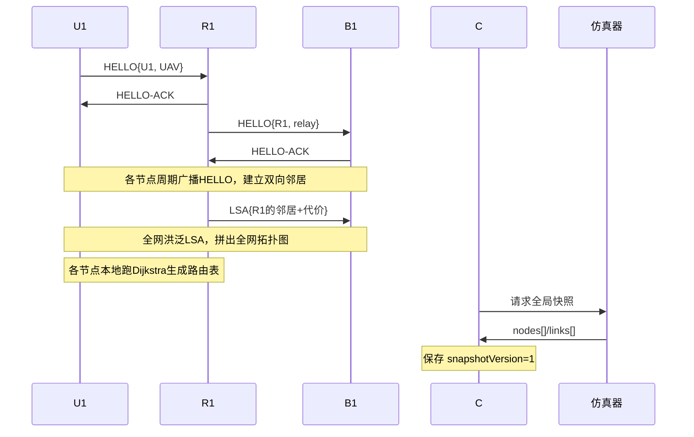
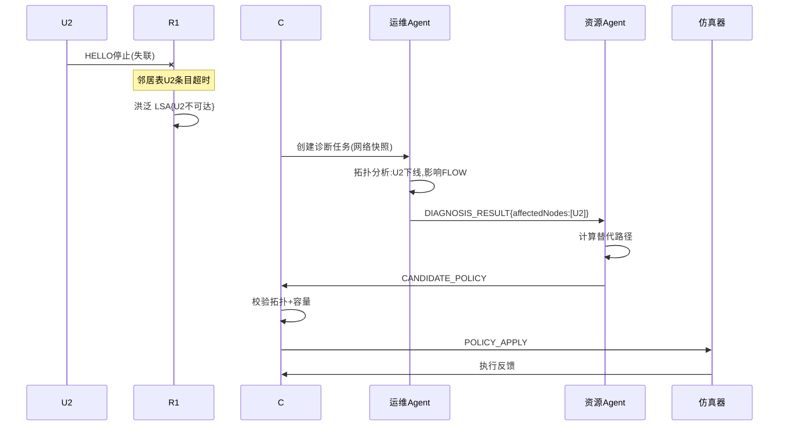
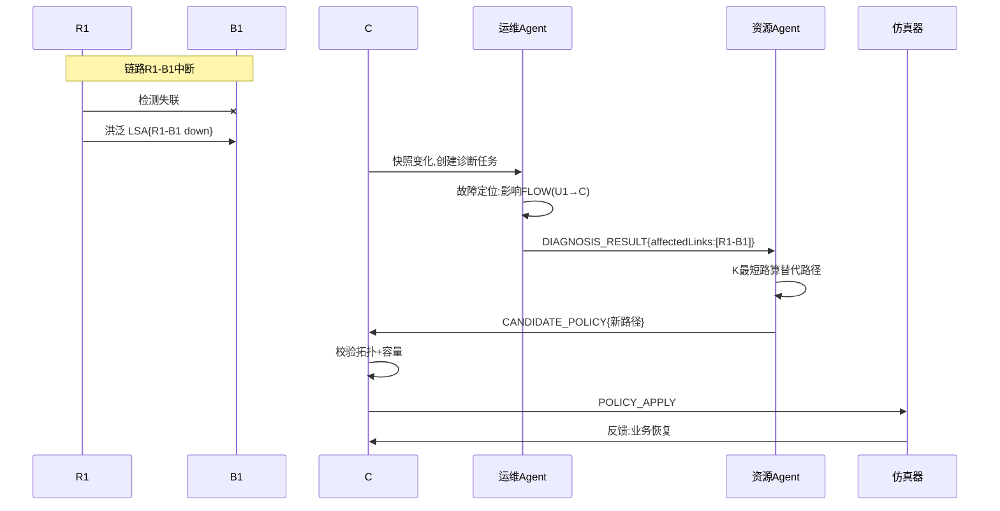
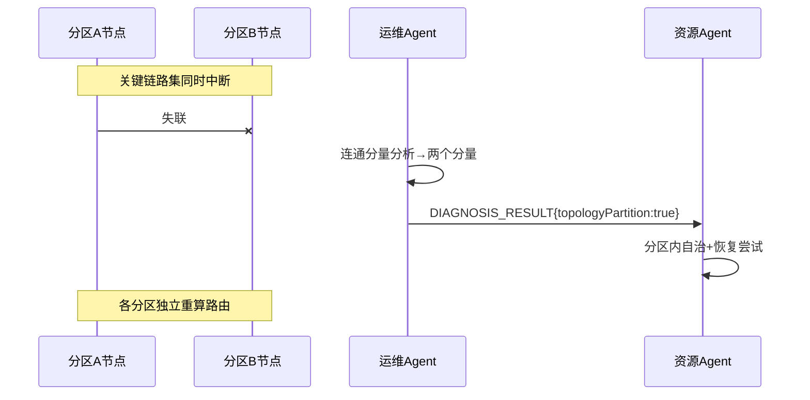
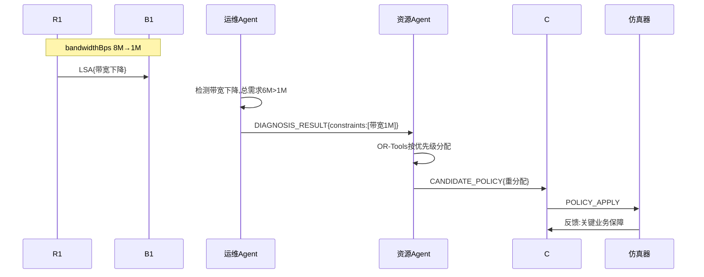
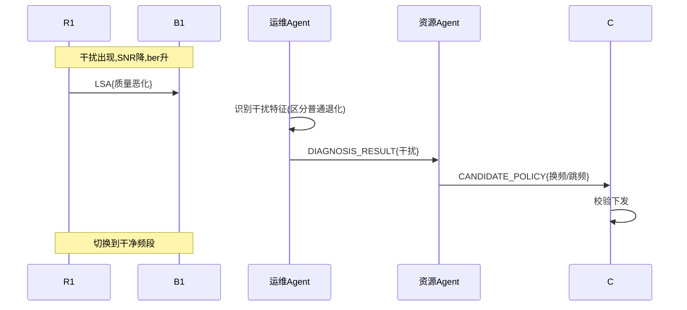
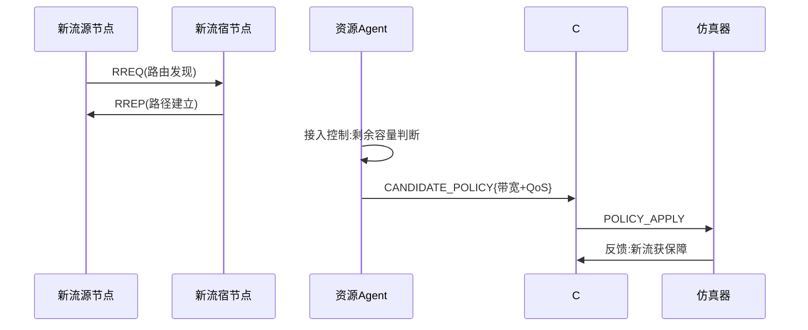
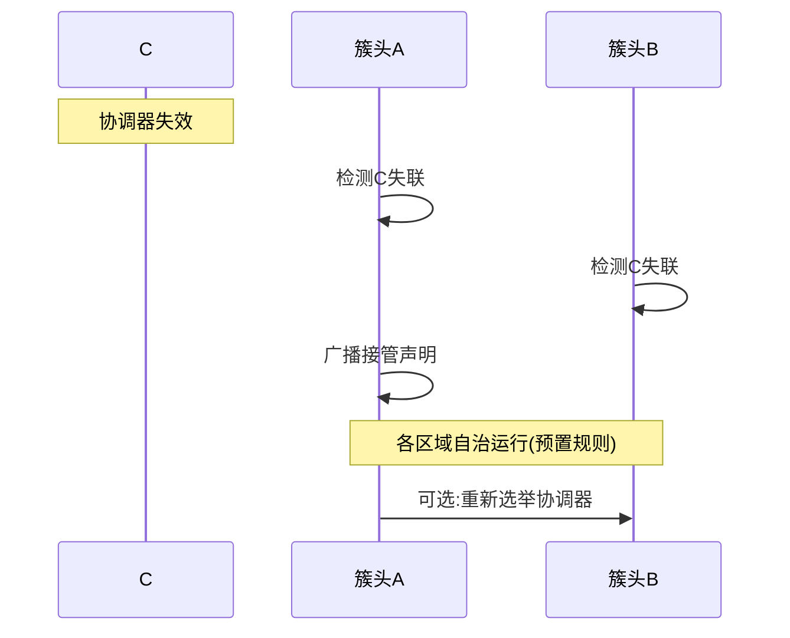

# 无人平台动态场景需求文档

> 面向「资源受限环境下通信网络资源管控」竞赛：系统枚举无人平台网络的动态场景（大场景 + 小场景），每个小场景按统一模板描述背景、参与方、前置条件、步骤、后置状态，并论述"引入智能体"与"普通无 LLM 网络"的差别。

---

## 0. 文档约定

### 0.1 场景模板（6 部分）

每个小场景统一按以下 6 部分描述：

1. **背景**：场景发生的业务背景与触发原因。
2. **参与方**：涉及哪些节点/智能体。
3. **前置条件**（Precondition）：场景发生前网络必须满足的状态。
4. **步骤**：主体行为（谁发什么消息）→ 目标行为（谁收到、做什么动作）→ 数据操作 → 结果。
5. **后置状态**（Post-condition）：场景结束后网络的状态。
6. **智能体 vs 普通无 LLM 差别**：该场景下引入智能体带来的增益。

### 0.2 节点命名（沿用前文）

| 标识 | 角色 | 层次 |
|------|------|------|
| C | 协调器（Coordinator） | 管控面 |
| B1 | 骨干节点（地面站） | 骨干网 |
| R1、R2 | 中继节点 | 中继层 |
| U1、U2 | 末端 UAV | 接入网 |
| G1、G2 | 末端 UGV | 接入网 |

**智能体**：运维智能体（O&M Agent）、资源控制智能体（Resource Agent）、协调器 C。

### 0.3 通用消息与数据

| 消息/数据 | 内容 | 说明 |
|-----------|------|------|
| HELLO | `{nodeId, type, position, seq}` | 邻居发现周期广播 |
| LSA | `{nodeId, 邻居列表+代价}` | 链路状态通告 |
| 邻居表 | `{邻居, ETX代价, 最近HELLO, 有效期}` | 每节点本地 |
| 路由表 | `{目的地, 下一跳, 跳数, 代价}` | 每节点本地 |
| 全局快照 | `{snapshotVersion, nodes[], links[]}` | 协调器保存 |
| A2A 消息 | `{messageId, traceId, taskId, fromAgent, toAgent, messageType, payload}` | 智能体间消息 |
| DIAGNOSIS_RESULT | `{affectedLinks, failedNodes, constraints, impactedFlows}` | 运维→资源 |
| CANDIDATE_POLICY | `{候选路由, 带宽分配, QoS调整}` | 资源→协调器 |
| POLICY_APPLY | `{策略内容, 幂等键}` | 协调器→仿真器 |

---

## 1. 大场景：初始组网

### 1.1 小场景：全网冷启动

**1. 背景**：任务开始，所有节点同时开机，网络从零开始自组织成网，无任何预配置拓扑。

**2. 参与方**：C、B1、R1、R2、U1、U2、G1、G2（全部节点）。

**3. 前置条件**：所有节点已上电、无线模块就绪，但尚未建立任何链路；各节点只有自身 ID 和角色配置。

**4. 步骤**：

| # | 主体行为 | 目标行为 | 数据操作 | 结果 |
|---|----------|----------|----------|------|
| 1 | U1 广播 `HELLO{nodeId:"U1",type:"UAV",seq:1}` | R1 收到，回 `HELLO-ACK` | R1 邻居表新增 `U1 → ETX 1.0` | U1 与 R1 建立双向邻居 |
| 2 | R1 广播 `HELLO` | B1 收到并回 ACK；U1 收到并回 ACK | B1、U1 各自邻居表新增 R1 | R1 同时连 B1 和 U1 |
| 3 | B1 广播 `HELLO` | C、R1、R2 收到并回 ACK | 各节点邻居表更新 | B1 与 C、R1、R2 建邻居 |
| 4 | 各节点洪泛 `LSA{自己和邻居的链路代价}` | 全网节点收到并转发 | 每节点拓扑表拼出全网地图 | 全网拓扑视图一致 |
| 5 | 各节点本地跑 Dijkstra | — | 每节点路由表生成到全网目的地的下一跳 | 全网路由建立 |
| 6 | C 向仿真器请求全局快照 | 仿真器返回 `nodes[]/links[]` | C 保存 `snapshotVersion=1` | 协调器获得全局视图 |

**5. 后置状态**：全网连通，每节点有完整邻居表、拓扑表、路由表；C 持有初始快照；可承载业务。

**6. 智能体 vs 普通无 LLM 差别**：普通网络靠 HELLO+LSA+Dijkstra 也能自动成网（步骤 1-5 都是协议层，两者相同）。差别在**步骤 6 及之后**：智能体版本由运维 Agent 对初始拓扑做**主动评估**（连通度、关键节点、单点风险），并生成初始资源规划；无 LLM 版本只有"能连通"，没有"态势评估和初始优化"。

### 1.2 小场景：分批/增量入网

**1. 背景**：R2 因故晚开机，网络已由其他节点组成，R2 现在加入。

**2. 参与方**：R2、B1、G1、G2、C。

**3. 前置条件**：除 R2 外全网已连通；R2 开机但未接入。

**4. 步骤**：

| # | 主体行为 | 目标行为 | 数据操作 | 结果 |
|---|----------|----------|----------|------|
| 1 | R2 广播 `HELLO` | B1、G1、G2 收到并回 ACK | 各节点邻居表新增 R2 | R2 与 B1、G1、G2 建邻居 |
| 2 | R2 洪泛自己的 `LSA` | 全网收到，触发增量拓扑更新 | 各节点拓扑表新增 R2 及其链路 | 全网拓扑增量刷新 |
| 3 | 各节点重算路由 | — | 部分节点路由表更新（如 G1 改走 R2） | 流量可能切到 R2 |
| 4 | C 更新全局快照 | — | C 快照 `snapshotVersion+1` | 协调器感知新拓扑 |

**5. 后置状态**：R2 入网，拓扑更新，部分流量切换到经 R2 的更优路径。

**6. 智能体 vs 普通无 LLM 差别**：普通网络靠增量 LSA 也能把 R2 纳入（步骤 1-3）。差别：智能体版本由运维 Agent **识别"有新节点入网"这一事件**并评估其影响（是否成为更优中继、是否需要重分配带宽），资源 Agent 决定是否主动迁移业务；无 LLM 版本只做协议级路由收敛，不主动优化业务分布。

---

**时序图：初始组网（以全网冷启动为例）**

---

## 2. 大场景：节点动态

### 2.1 小场景：节点上线

同 1.2 分批入网（单个节点上线可复用同一流程）。

### 2.2 小场景：节点下线（故障）

**1. 背景**：U2 因被毁/故障突然失联，不再响应任何报文。这是赛题明确的"节点下线"建模手段。

**2. 参与方**：U2、R1、C、运维 Agent、资源 Agent。

**3. 前置条件**：U2 通过 R1 接入，且有一条业务流（如 U2→C 的视频）正在传输。

**4. 步骤**：

| # | 主体行为 | 目标行为 | 数据操作 | 结果 |
|---|----------|----------|----------|------|
| 1 | U2 停止广播（物理失联） | R1 连续 N 个周期收不到 U2 的 HELLO | R1 邻居表 U2 条目 lifetime 超时 | R1 判定 U2 下线 |
| 2 | R1 洪泛 `LSA{U2 不可达}` | 全网收到，触发拓扑更新 | 各节点拓扑表移除 U2 | 全网知道 U2 下线 |
| 3 | C 检测到快照变化，创建诊断任务 | 运维 Agent 收到网络快照 | C 分配 `traceId/taskId` | 进入智能体诊断 |
| 4 | 运维 Agent 调用拓扑分析工具 | 返回连通分量、受影响业务 | 诊断结果：U2 下线、影响 FLOW(U2→C) | 生成 DIAGNOSIS_RESULT |
| 5 | 运维 Agent 发 `DIAGNOSIS_RESULT` | 资源 Agent 收到 | 读取 affectedNodes、impactedFlows | 资源 Agent 得知故障与约束 |
| 6 | 资源 Agent 调用路由算法 | 返回替代路径（若有）或"业务无替代路径" | 生成 CANDIDATE_POLICY | 候选策略 |
| 7 | 资源 Agent 发 `CANDIDATE_POLICY` | C 收到并校验 | C 校验拓扑有效性、容量 | 策略通过/拒绝 |
| 8 | C 下发 `POLICY_APPLY` | 仿真器执行 | 仿真器应用策略并反馈 | 业务恢复或标记不可恢复 |

**5. 后置状态**：U2 已从全网拓扑移除；U2 相关业务流或被重路由恢复、或被标记为中断；路由表收敛。

**6. 智能体 vs 普通无 LLM 差别**：普通网络靠"HELLO 超时 → LSA 洪泛 → 重算路由"也能把 U2 移除、恢复连通（步骤 1-2）。差别在**步骤 3-8**：智能体版本能**解释"为什么 U2 下线、影响了哪些业务、业务能否恢复"**，并给出可追溯的自愈建议；无 LLM 版本只知道"U2 断了、重路由了"，不区分业务影响、无根因、无解释。

### 2.3 小场景：节点移动

**1. 背景**：U1 高速机动，位置变化导致原邻居链路质量下降、新邻居出现。

**2. 参与方**：U1、R1、R2、运维 Agent、资源 Agent。

**3. 前置条件**：U1 经 R1 接入，移动到 R1/R2 覆盖交界处。

**4. 步骤**：

| # | 主体行为 | 目标行为 | 数据操作 | 结果 |
|---|----------|----------|----------|------|
| 1 | U1 持续广播 HELLO（位置更新） | R1、R2 都收到 | R1 邻居表 U1 代价升高；R2 邻居表新增 U1 | 链路质量动态变化 |
| 2 | 各节点更新 LSA | 全网触发拓扑更新 | 拓扑表链路代价刷新 | 全网感知 U1 移动 |
| 3 | 运维 Agent 检测链路质量波动 | 调用质量评估工具 | 评估 R1-U1 代价 vs R2-U1 代价 | 识别"U1 应切换接入" |
| 4 | 资源 Agent 计算切换方案 | 返回新接入路径 | 生成 CANDIDATE_POLICY | 候选切换策略 |
| 5 | C 校验并下发 | 仿真器执行 | 更新路由表 | U1 切换到 R2 接入 |

**5. 后置状态**：U1 切换到更优邻居，业务不中断或短暂中断后恢复。

**6. 智能体 vs 普通无 LLM 差别**：普通网络靠 ETX 代价变化也能让路由自动切换（步骤 1-2，类似 handover）。差别：智能体版本**预测性切换**（提前评估、主动迁移业务），并解释切换原因；无 LLM 版本是**反应式**的，代价超过阈值才被动切换，可能已造成丢包。

---

**时序图：节点下线（故障）**

---

## 3. 大场景：链路动态

### 3.1 小场景：链路中断

**1. 背景**：R1-B1 链路因遮挡/干扰中断（`status`→down）。这是赛题"链路随机通断"的核心场景。

**2. 参与方**：R1、B1、C、运维 Agent、资源 Agent。

**3. 前置条件**：存在经 R1-B1 的业务流（如 U1→C 的话音）。

**4. 步骤**：

| # | 主体行为 | 目标行为 | 数据操作 | 结果 |
|---|----------|----------|----------|------|
| 1 | 链路 R1-B1 状态变 down | R1、B1 双向检测到失联 | 双方邻居表删除对方 | 判定链路中断 |
| 2 | R1、B1 洪泛 `LSA{R1-B1 中断}` | 全网拓扑更新 | 拓扑表移除该链路 | 全网知道中断 |
| 3 | 运维 Agent 收到快照变化 | 调用故障诊断工具 | 定位"R1-B1 中断，影响 FLOW(U1→C)" | 生成 DIAGNOSIS_RESULT |
| 4 | 运维 Agent 发 DIAGNOSIS_RESULT | 资源 Agent 收到 | 读取 affectedLinks、constraints | 得知约束"R1-B1 不可用" |
| 5 | 资源 Agent 调用 K 最短路算法 | 返回替代路径（如 U1→R1→R2→B1→C） | 生成 CANDIDATE_POLICY | 候选替代路由 |
| 6 | C 校验替代路径 | 校验拓扑有效、容量足够 | 通过校验 | 策略可下发 |
| 7 | C 下发 POLICY_APPLY | 仿真器应用 | 更新相关节点路由表 | 业务切换到替代路径 |

**5. 后置状态**：业务经替代路径恢复，全网路由收敛；R1-B1 标记为 down。

**6. 智能体 vs 普通无 LLM 差别**：普通网络靠 LSA+Dijkstra 也能收敛到替代路径（步骤 1-2）。差别：智能体版本**主动生成多条候选路径并择优**（考虑业务 QoS 约束，不只"最短"），且能解释"为什么选这条路"；无 LLM 版本只算最短路径，不区分业务 QoS，可能把话音切到高时延路径导致 QoS 不达标。

### 3.2 小场景：链路质量退化

**1. 背景**：R1-B1 链路未断，但误码率/丢包率/时延显著变差（如 `ber` 从 1e-4 升到 1e-2）。

**2. 参与方**：R1、B1、运维 Agent、资源 Agent、C。

**3. 前置条件**：R1-B1 链路 up 但质量恶化，承载的视频业务出现卡顿。

**4. 步骤**：

| # | 主体行为 | 目标行为 | 数据操作 | 结果 |
|---|----------|----------|----------|------|
| 1 | R1 测量链路参数变化 | 更新邻居表 R1-B1 的 ETX 代价 | ETX 显著升高 | 链路质量被感知 |
| 2 | R1 洪泛 `LSA{R1-B1 代价升高}` | 全网拓扑更新 | 拓扑表代价刷新 | 全网知道质量退化 |
| 3 | 运维 Agent 检测 `ber/packetLossRate` 异常 | 调用阈值+时序检测 | 判定"质量退化事件" | 识别退化 |
| 4 | 运维 Agent 发 DIAGNOSIS_RESULT | 资源 Agent 收到 | constraints 含"R1-B1 质量不达标" | 资源 Agent 知约束 |
| 5 | 资源 Agent 评估业务 QoS | 调用 QoS 评估工具 | 判断视频业务是否仍达标 | 决定是否切路径/降级 |
| 6 | 资源 Agent 生成策略（切路径或降码率） | C 校验并下发 | 更新路由或业务参数 | 业务 QoS 恢复 |

**5. 后置状态**：业务切换到质量更好的路径，或降级保障；链路质量被持续监控。

**6. 智能体 vs 普通无 LLM 差别**：这是**差别最大的场景**。普通网络（如 OSPF）**感知不到**链路质量退化——链路仍 up，OSPF 不重路由，视频继续卡顿丢包。智能体版本通过运维 Agent 主动监测 `ber/packetLossRate/delayMs`，识别"质量退化但未断"，并主动切路径或降级保障。这是"自感知"能力的核心体现。

### 3.3 小场景：链路恢复

**1. 背景**：此前中断的 R1-B1 链路恢复 up。

**2. 参与方**：R1、B1、C、运维 Agent、资源 Agent。

**3. 前置条件**：R1-B1 之前为 down，业务正走替代路径。

**4. 步骤**：

| # | 主体行为 | 目标行为 | 数据操作 | 结果 |
|---|----------|----------|----------|------|
| 1 | R1、B1 重新收到对方 HELLO | 双向握手成功 | 邻居表恢复 R1-B1 | 链路恢复 |
| 2 | 洪泛 `LSA{R1-B1 恢复}` | 全网拓扑更新 | 拓扑表恢复该链路 | 全网知道恢复 |
| 3 | 运维 Agent 检测恢复事件 | 评估原路径质量 | 对比原路径 vs 替代路径代价 | 决定是否切回 |
| 4 | 资源 Agent 决定切回或保持 | C 校验下发 | 更新路由 | 业务回到最优路径 |

**5. 后置状态**：链路恢复，业务按代价择优走原路径或继续走替代路径。

**6. 智能体 vs 普通无 LLM 差别**：普通网络也会自动收敛回原路径（最短路径）。差别：智能体版本**有策略地判断"是否值得切回"**（避免频繁振荡），并记录决策；无 LLM 版本只要原路径更短就切回，可能在高动态下引起**路由振荡**。

### 3.4 小场景：链路随机通断（间歇性断续）

**1. 背景**：链路 up↔down 频繁切换（间歇性），稳定路径不存在。

**2. 参与方**：R1、B1、运维 Agent、资源 Agent、C。

**3. 前置条件**：R1-B1 链路间歇性断续，业务时通时断。

**4. 步骤**：

| # | 主体行为 | 目标行为 | 数据操作 | 结果 |
|---|----------|----------|----------|------|
| 1 | 链路频繁 up↔down | 各节点反复更新邻居表/LSA | 拓扑频繁变更 | 路由频繁重算 |
| 2 | 运维 Agent 检测"高频断续"模式 | 判定为间歇性故障 | 记录断续频率 | 识别不稳定链路 |
| 3 | 资源 Agent 采取防抖策略 | 提高切换阈值、加迟滞 | 避免路由振荡 | 策略稳定 |
| 4 | 数据面启用 DTN 存储转发 | 断续期间缓存数据，链路恢复再传 | 缓存队列 | 数据不丢失 |

**5. 后置状态**：业务通过 DTN 存储转发在断续链路下仍能送达；策略防抖避免振荡。

**6. 智能体 vs 普通无 LLM 差别**：普通网络面对间歇断续会**反复重路由、振荡、丢包**（协议只做"尽力转发"）。智能体版本通过运维 Agent **识别"断续模式"并加迟滞防抖**，同时启用 DTN 存储转发兜底。这是应对"链路随机通断"的关键增益。

---

**时序图：链路中断**

---

## 4. 大场景：拓扑结构

### 4.1 小场景：网络分区/割裂

**1. 背景**：多条关键链路同时断，网络裂成两个不连通子网。

**2. 参与方**：全网节点、C、运维 Agent、资源 Agent。

**3. 前置条件**：存在把网络分成两半的关键链路集。

**4. 步骤**：

| # | 主体行为 | 目标行为 | 数据操作 | 结果 |
|---|----------|----------|----------|------|
| 1 | 关键链路集同时中断 | 各节点检测失联 | 拓扑表更新 | 网络分裂 |
| 2 | 运维 Agent 调用连通分量分析 | 返回两个不连通分量 | 判定"拓扑分区" | 识别分区 |
| 3 | 运维 Agent 发 DIAGNOSIS_RESULT{topologyPartition:true} | 资源 Agent 收到 | 得知分区 | 进入分区处理 |
| 4 | 各分区内自治运行 | 分区内重算路由 | 分区内路由表 | 分区内仍连通 |
| 5 | 资源 Agent 尝试跨分区恢复 | 若有可修复链路则下发 | 恢复策略 | 分区可能重新合并 |

**5. 后置状态**：网络分为两个自治分区，分区内业务正常，跨分区业务中断/降级。

**6. 智能体 vs 普通无 LLM 差别**：普通网络分区后只是"各自连通、跨区不通"，无全局感知。智能体版本通过运维 Agent **主动识别"这是分区而非普通故障"**，并触发分区自治 + 降级运行 + 恢复尝试，是抗毁性的体现。

### 4.2 小场景：分区合并

**1. 背景**：隔离的两个分区之间的链路恢复，重新连通。

**2. 参与方**：两个分区的边界节点、C、运维 Agent。

**3. 前置条件**：网络处于分区状态，恢复链路出现。

**4. 步骤**：

| # | 主体行为 | 目标行为 | 数据操作 | 结果 |
|---|----------|----------|----------|------|
| 1 | 边界节点互相发现 | HELLO 握手 | 邻居表恢复 | 跨区链路恢复 |
| 2 | 洪泛 LSA | 两分区拓扑融合 | 拓扑表合并 | 全网重连 |
| 3 | 运维 Agent 检测合并事件 | 重算连通度 | 判定"分区已合并" | 恢复全局视图 |

**5. 后置状态**：网络重新连通，全局路由收敛，跨区业务恢复。

**6. 智能体 vs 普通无 LLM 差别**：普通网络靠 LSA 洪泛自动合并。差别：智能体版本能**识别合并事件并协调跨区资源重新分配**，避免合并瞬间的资源冲突。

### 4.3 小场景：关键节点失效（割点/中继）

**1. 背景**：R1 是多个末端节点的唯一上游（割点），R1 被毁导致其下所有末端失联。

**2. 参与方**：R1、其下末端节点、C、运维 Agent、资源 Agent。

**3. 前置条件**：R1 是割点，U1、U2 只经 R1 上联。

**4. 步骤**：

| # | 主体行为 | 目标行为 | 数据操作 | 结果 |
|---|----------|----------|----------|------|
| 1 | R1 失效 | U1、U2 检测到 R1 失联 | 邻居表删除 R1 | 末端失联 |
| 2 | 运维 Agent 识别"关键节点失效" | 分析影响范围 | 判定 R1 是割点 | 识别单点风险 |
| 3 | 资源 Agent 寻找备用中继 | 若有备用中继则切换 | 生成 CANDIDATE_POLICY | 恢复或确认不可恢复 |
| 4 | 簇头机制触发重选 | 区域内重选簇头 | 新簇头产生 | 局部自治接管 |

**5. 后置状态**：若存在备用中继则业务恢复；否则该区域业务中断，触发簇头重选降级运行。

**6. 智能体 vs 普通无 LLM 差别**：普通网络只知"R1 断了、末端失联"。智能体版本能**提前识别割点/单点风险**（运维 Agent 的关键节点分析），并在设计时通过冗余中继规避，故障时主动切换。这是"抗毁性设计"的体现。

---

**时序图：网络分区/割裂**

---

## 5. 大场景：资源与带宽

### 5.1 小场景：带宽下降

**1. 背景**：R1-B1 链路可用带宽从 8Mbps 收缩到 1Mbps（`bandwidthBps` 下降）。

**2. 参与方**：R1、B1、运维 Agent、资源 Agent、C。

**3. 前置条件**：R1-B1 承载多条业务流，总需求 6Mbps。

**4. 步骤**：

| # | 主体行为 | 目标行为 | 数据操作 | 结果 |
|---|----------|----------|----------|------|
| 1 | 带宽动态收缩 | 各节点测量到 `bandwidthBps` 下降 | 更新链路参数 | 带宽受限被感知 |
| 2 | 运维 Agent 检测带宽下降事件 | 评估总需求 vs 新容量 | 判定"带宽不足" | 识别瓶颈 |
| 3 | 运维 Agent 发 DIAGNOSIS_RESULT | 资源 Agent 收到 | constraints 含"带宽 1Mbps" | 资源 Agent 知约束 |
| 4 | 资源 Agent 调用带宽分配算法（OR-Tools） | 返回重分配方案 | 按优先级分配 1Mbps | 生成 CANDIDATE_POLICY |
| 5 | C 校验（容量、优先级） | 下发 POLICY_APPLY | 更新带宽分配 | 关键业务保障、低优先级降级 |

**5. 后置状态**：带宽按业务优先级重新分配，话音等高优先级业务保障，低优先级业务降级/排队。

**6. 智能体 vs 普通无 LLM 差别**：**差别巨大的场景**。普通网络**感知不到带宽下降**（链路仍 up，协议不重路由），所有业务继续竞争 1Mbps，导致拥塞丢包、无差别劣化。智能体版本通过运维 Agent 感知 `bandwidthBps` 变化，资源 Agent 用优化算法**按优先级重分配**，实现"关键业务保障、普通业务降级"。这是"资源动态调度"的核心价值。

### 5.2 小场景：拥塞

**1. 背景**：业务量突增超过链路容量，产生拥塞。

**2. 参与方**：R1、B1、资源 Agent、C。

**3. 前置条件**：某链路流量逼近或超过容量。

**4. 步骤**：

| # | 主体行为 | 目标行为 | 数据操作 | 结果 |
|---|----------|----------|----------|------|
| 1 | 流量突增 | 链路队列增长、时延上升 | 监测到拥塞指标 | 拥塞发生 |
| 2 | 运维 Agent 检测拥塞 | 定位拥塞链路 | 判定拥塞点 | 识别瓶颈 |
| 3 | 资源 Agent 执行限流/调度 | 优先级队列（DiffServ） | 高优先级先发 | 拥塞缓解 |
| 4 | 资源 Agent 可选切流到其他路径 | C 校验下发 | 更新路由 | 负载均衡 |

**5. 后置状态**：拥塞缓解，高优先级业务不受影响，低优先级业务可能被限流。

**6. 智能体 vs 普通无 LLM 差别**：普通网络拥塞后只能被动丢包（TCP 降速）。智能体版本**主动限流 + 优先级调度 + 负载均衡**，把拥塞影响限定在低优先级业务。

### 5.3 小场景：多业务争抢同一链路

**1. 背景**：话音、视频两条流同时竞争同一条有限带宽链路。

**2. 参与方**：两条业务流、资源 Agent、C。

**3. 前置条件**：两业务总需求超过链路容量。

**4. 步骤**：

| # | 主体行为 | 目标行为 | 数据操作 | 结果 |
|---|----------|----------|----------|------|
| 1 | 两业务同时请求带宽 | 资源 Agent 收到竞争 | 检测到冲突 | 资源冲突 |
| 2 | 资源 Agent 按优先级仲裁 | 话音优先于视频 | 分配带宽 | 话音保障 |
| 3 | C 做冲突仲裁审批 | 下发分配结果 | 更新各流带宽 | 冲突解决 |

**5. 后置状态**：高优先级业务得到保障，低优先级业务被降级或拒绝，冲突消解。

**6. 智能体 vs 普通无 LLM 差别**：普通网络对两流**同等对待**（先到先得），无业务语义，话音可能被视频挤掉导致时延超标。智能体版本理解"话音时延敏感、视频带宽敏感"的差异，按优先级**差异化保障**。这是"冲突仲裁"能力的体现。

---

**时序图：带宽下降**

---

## 6. 大场景：干扰

### 6.1 小场景：电磁干扰

**1. 背景**：某频段随机出现强干扰，链路 SNR 下降、误码率飙升。

**2. 参与方**：受影响链路节点、运维 Agent、资源 Agent、C。

**3. 前置条件**：链路正常，干扰随机出现。

**4. 步骤**：

| # | 主体行为 | 目标行为 | 数据操作 | 结果 |
|---|----------|----------|----------|------|
| 1 | 干扰出现 | 节点测到 SNR 下降、ber 上升 | 链路质量恶化 | 干扰被感知 |
| 2 | 运维 Agent 检测干扰特征 | 判定为干扰（非普通退化） | 区分干扰与故障 | 识别干扰 |
| 3 | 资源 Agent 触发换频/跳频 | 动态频谱接入（DSA） | 切换到干净频段 | 抗干扰 |
| 4 | 资源 Agent 可选降速率/纠错 | C 校验下发 | 调整编码 | 维持链路 |

**5. 后置状态**：通过换频/跳频避开干扰，链路质量恢复或维持。

**6. 智能体 vs 普通无 LLM 差别**：普通网络无频谱感知能力，干扰下只能硬扛（误码率升高→丢包）。智能体版本通过运维 Agent **识别干扰并触发换频/跳频**（认知无线电思想，IEEE 802.22），主动规避。这是"频谱感知/自感知"在干扰场景的体现。

---

**时序图：电磁干扰**

---

## 7. 大场景：业务需求

### 7.1 小场景：新增业务流

**1. 背景**：新任务产生一条新业务流（如新增一路视频回传）。

**2. 参与方**：新流源/宿节点、资源 Agent、C。

**3. 前置条件**：网络已运行，新业务流请求接入。

**4. 步骤**：

| # | 主体行为 | 目标行为 | 数据操作 | 结果 |
|---|----------|----------|----------|------|
| 1 | 新业务流请求建立 | 源节点发起路由请求 | RREQ/RREP 找到路径 | 路由建立 |
| 2 | 资源 Agent 做接入控制 | 判断剩余容量是否足够 | 接入判定 | 准入或拒绝 |
| 3 | 资源 Agent 分配带宽/QoS | C 校验下发 | 更新资源分配 | 新流获得保障 |

**5. 后置状态**：新业务流接入并获 QoS 保障，或因资源不足被拒绝/降级。

**6. 智能体 vs 普通无 LLM 差别**：普通网络无接入控制，新流直接加入导致已有业务被挤占。智能体版本**接入控制 + 资源预留**，保护已有关键业务。

### 7.2 小场景：QoS 要求变化

**1. 背景**：某业务流的最低带宽要求提高、时延上限降低（业务优先级提升）。

**2. 参与方**：该业务流、资源 Agent、C。

**3. 前置条件**：业务流在运行，QoS 要求突然收紧。

**4. 步骤**：

| # | 主体行为 | 目标行为 | 数据操作 | 结果 |
|---|----------|----------|----------|------|
| 1 | 业务 QoS 要求变化 | 资源 Agent 收到新约束 | 更新业务需求 | 需求变化 |
| 2 | 资源 Agent 重算资源分配 | 判断当前路径/带宽是否满足 | 约束检查 | 是否达标 |
| 3 | 资源 Agent 调整路由或带宽 | C 校验下发 | 更新策略 | 满足新 QoS |

**5. 后置状态**：业务按新 QoS 要求得到保障，或触发降级/拒绝。

**6. 智能体 vs 普通无 LLM 差别**：普通网络无业务语义，无法感知 QoS 要求变化。智能体版本理解业务需求，**动态调整资源满足新约束**。这是"业务 QoS 保障"的体现。

---

**时序图：新增业务流**

---

## 8. 大场景：复合与极端

### 8.1 小场景：多重故障

**1. 背景**：多个节点 + 多条链路同时异常（如 R1 下线同时 R2-B1 链路中断）。

**2. 参与方**：全网节点、C、运维 Agent、资源 Agent。

**3. 前置条件**：网络正常，多个故障同时注入。

**4. 步骤**：

| # | 主体行为 | 目标行为 | 数据操作 | 结果 |
|---|----------|----------|----------|------|
| 1 | 多故障同时注入 | 各节点检测各自失联 | 多处邻居表/拓扑更新 | 多重故障 |
| 2 | 运维 Agent 综合分析 | 识别多个故障及其交互影响 | 关联分析 | 完整故障视图 |
| 3 | 资源 Agent 联合优化 | 多约束下重算路由+带宽 | 联合调度 | 全局最优恢复 |
| 4 | C 仲裁多个候选策略 | 冲突消解 | 统一策略集 | 协调下发 |

**5. 后置状态**：系统在多重约束下尽可能恢复关键业务，可能部分业务降级。

**6. 智能体 vs 普通无 LLM 差别**：普通网络面对多重故障只能各自独立收敛，可能产生**冲突的路由决策**（各节点算各的）。智能体版本通过协调器**全局联合优化 + 冲突仲裁**，得到全局一致的恢复方案。这是"多 Agent 协作 + 复杂约束处理"的核心场景。

### 8.2 小场景：协调器失效 / 降级自治

**1. 背景**：管控面协调器 C 被毁，系统需降级为区域自治继续运行。

**2. 参与方**：C、各簇头、区域节点。

**3. 前置条件**：C 正常运行，突然失效。

**4. 步骤**：

| # | 主体行为 | 目标行为 | 数据操作 | 结果 |
|---|----------|----------|----------|------|
| 1 | C 失效 | 各节点检测到 C 失联 | 管控面失去中心 | 协调器失效 |
| 2 | 各区域簇头检测并接管 | 簇头广播接管声明 | 新协调角色产生 | 局部接管 |
| 3 | 各区域自治运行 | 区域内本地调度 | 退化为预置规则 | 降级自治 |
| 4 | （可选）重新选举协调器 | 新协调器上任 | 恢复全局协调 | 重新集中 |

**5. 后置状态**：系统降级为区域自治，关键业务仍维持，全局优化暂停。

**6. 智能体 vs 普通无 LLM 差别**：这是智能体架构的**抗毁性优势**。集中式普通网络中心失效即瘫痪；智能体系统设计为"协调器可降级、簇头可接管"，失效后仍能**降级自治运行**。这是"中心可降级、可替换"设计的直接体现。

---

**时序图：协调器失效/降级自治**

---

## 附录：场景与赛题/评分的对应

| 大场景 | 赛题建模手段 | 赛题现象 | 评分点 |
|--------|--------------|----------|--------|
| 初始组网 | —（基础） | 拓扑形成 | 1 场景建模 |
| 节点动态 | 节点下线 | 拓扑快速变化 | 1 |
| 链路动态 | 链路参数调整 | 链路随机通断 | 1 |
| 拓扑结构 | 节点下线 | 拓扑快速变化 | 1、2.2 |
| 资源与带宽 | 链路参数调整 | 带宽时变、资源约束 | 1、2.3 |
| 干扰 | 链路参数调整 | 强干扰 | 1 |
| 业务需求 | 业务需求调整 | 资源约束 | 1、2.3 |
| 复合与极端 | 组合 | 多重叠加 | 1、2.2、3 |
