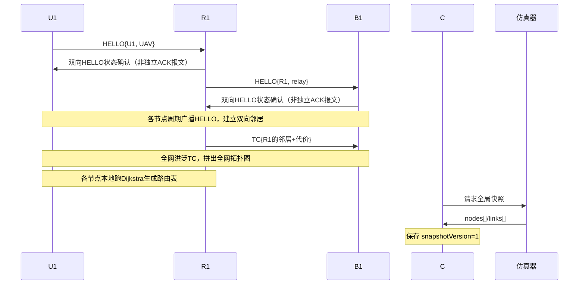
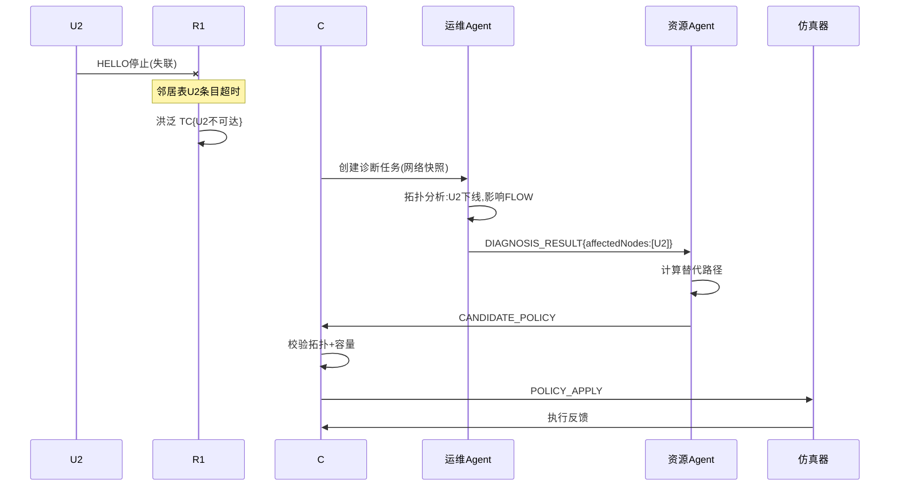
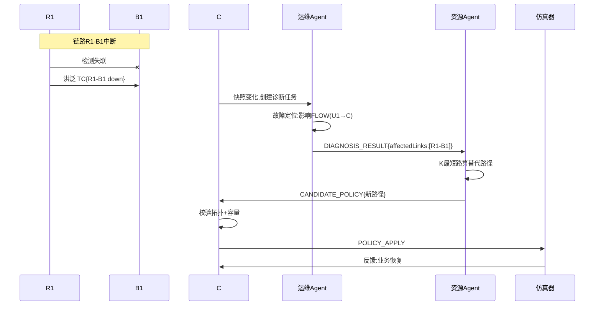
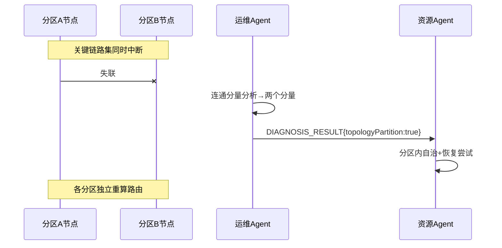
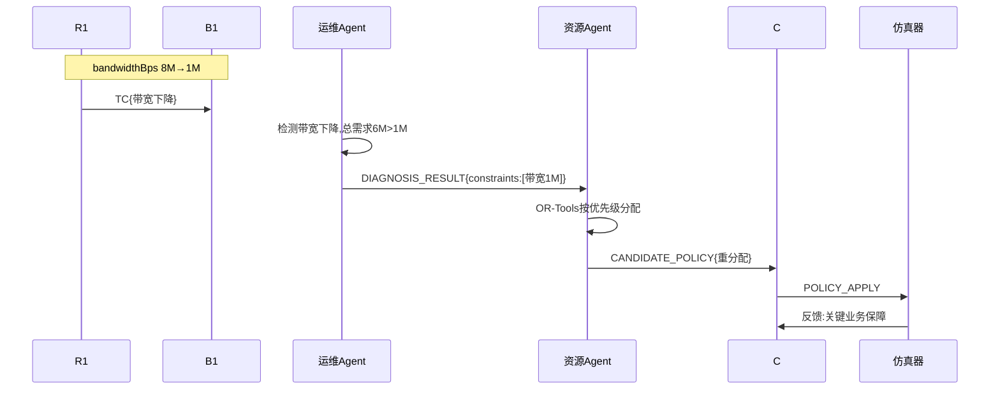
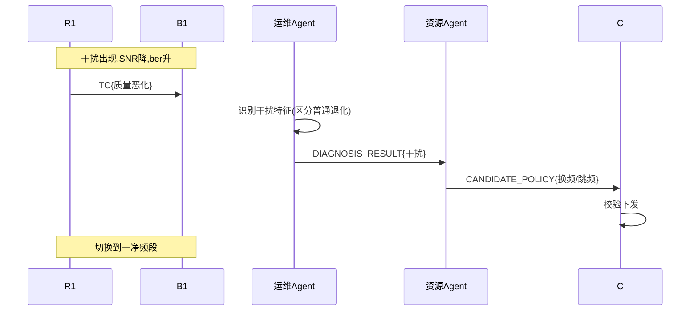
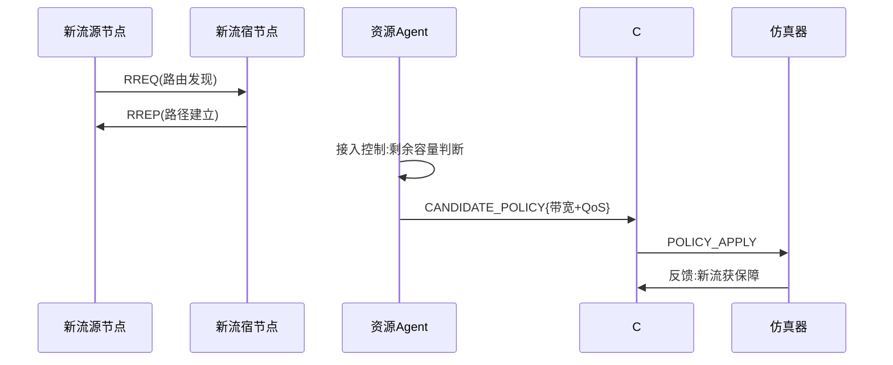
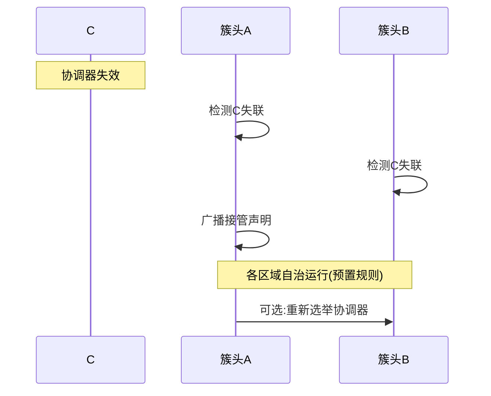

# 无人平台动态场景需求文档

> 面向动态通信场景仿真器的可编码需求文档。以大场景/小场景组织需求；每个小场景明确背景、参与方、前置条件、事件步骤、后置状态、仿真器应记录/输出的结果，并给出智能体方案与普通规则/传统网络方案的对照验证口径。

> 修订版 v2.1｜2026-11-06。保留 v2.0 的场景颗粒度和六段式模板，进一步将场景步骤转为仿真器可执行事件与可观测状态；智能体、协调器只作为外部参与方，不在本 Task 展开其内部设计。

---

## 本文档定位与使用方式

本文件是仿真器的**场景需求规格**，不是多智能体系统设计文档。场景中出现运维智能体、资源控制智能体、协调器时，只用于描述外部控制程序如何消费仿真器观测、提交策略，以及如何与普通方案做对照。仿真器不负责实现这些角色的内部推理、协同协议、任务分配或LLM提示词。

每个场景至少应能转化为：

- 一份初始场景配置（节点、接口、链路、业务流和资源初始值）；
- 一组按仿真时间排序的事件（事件对象、发生时间、持续时间、作用范围和参数）；
- 一组通信模型响应（邻居、拓扑、路由、转发、队列、资源账本的变化）；
- 一组后置状态断言（哪些节点/链路/业务应处于何种状态）；
- 一组观测和指标（感知、路由、QoS、资源、执行反馈）；
- 一组对照实验条件（相同初始状态、事件序列、随机种子和资源约束）。

场景中的“步骤”区分三类动作：**场景注入动作**（仿真器收到事件）、**网络机制响应**（邻居/路由/转发模型执行）、**外部控制动作**（智能体或普通方案读取状态并提交策略）。这三类动作不能混写成同一种协议报文流程。

---

## 0. 文档约定

### 0.1 场景模板（六个必需部分 + 仿真验收补充）

每个小场景统一按以下 6 部分描述：

1. **背景**：场景发生的业务背景与触发原因。
2. **参与方**：涉及哪些节点/智能体。
3. **前置条件**（Precondition）：场景发生前网络必须满足的状态。
4. **步骤**：主体行为（谁发什么消息）→ 目标行为（谁收到、做什么动作）→ 数据操作 → 结果。
5. **后置状态**（Post-condition）：场景结束后网络的状态。
6. **智能体 vs 普通方案差别**：说明外部智能体方案与明确指定的普通规则/传统网络基线如何处理该场景，差异必须可观测、可量化，不得笼统声称传统网络无法处理。

为满足编码需求，每个场景还应补充：**仿真器输入/事件参数、关键状态字段、后置断言、采集指标、可复现条件**。这些是六段式场景描述的工程化展开，不替代六个主体部分。

### 0.2 节点命名（沿用前文）

| 标识 | 角色 | 层次 |
|------|------|------|
| C | 协调器（Coordinator） | 管控面 |
| B1 | 骨干节点（地面站） | 骨干网 |
| R1、R2 | 中继节点 | 中继层 |
| U1、U2 | 末端 UAV | 接入网 |
| G1、G2 | 末端 UGV | 接入网 |

**外部控制参与方（按对照实验选择）**：运维智能体（O&M Agent）、资源控制智能体（Resource Agent）、协调器 C；普通方案可为固定规则控制器、传统路由协议或规则式资源调度器。上述参与方均在仿真器外运行，通过统一接口读取状态和提交动作。

### 0.3 通用消息与数据

| 消息/数据 | 内容 | 说明 |
|-----------|------|------|
| HELLO | `{nodeId, type, position, seq}` | 邻居发现周期广播 |
| TC（仿真抽象） | `{originator, advertisedNeighbors, sequenceNumber, validity}` | 对应OLSRv2拓扑控制信息；字段为仿真内部简化结构，不等同于标准报文编码 |
| 邻居表 | `{邻居, ETX代价, 最近HELLO, 有效期}` | 每节点本地 |
| 路由表 | `{目的地, 下一跳, 跳数, 代价}` | 每节点本地 |
| 全局快照 | `{snapshotVersion, nodes[], links[]}` | 协调器保存 |
| A2A 消息（外部系统可选） | `{messageId, traceId, taskId, fromAgent, toAgent, messageType, payload}` | 仅供独立多智能体Task参考，不属于仿真器内部协议 |
| DIAGNOSIS_RESULT（外部系统可选） | `{affectedLinks, failedNodes, constraints, impactedFlows}` | 外部控制程序之间的消息，不由仿真器生成 |
| CANDIDATE_POLICY（外部系统可选） | `{候选路由, 带宽分配, QoS调整}` | 外部控制程序的候选动作；仿真器只接收标准化动作 |
| POLICY_APPLY | `{策略内容, 幂等键}` | 外部程序向仿真器提交的动作请求；接口细节由API契约定义 |

---

## 1. 大场景：初始组网

### 1.1 小场景：全网冷启动

**1. 背景**：任务开始，所有节点同时开机，网络从零开始自组织成网，无预配置拓扑；无线接口、信道、地址与必要安全参数已按实验假设完成初始化。

**2. 参与方**：C、B1、R1、R2、U1、U2、G1、G2（全部节点）。

**3. 前置条件**：所有节点已上电、无线模块就绪，但尚未建立任何链路；各节点只有自身 ID 和角色配置。

**4. 步骤**：

| # | 主体行为 | 目标行为 | 数据操作 | 结果 |
|---|----------|----------|----------|------|
| 1 | 仿真器按链路可达性触发邻居发现 | U1/R1按所选协议交换发现信息并分别判断单向/双向可达 | 更新双方邻居状态与测量样本 | 仅当双向条件满足时标记双向邻居 |
| 2 | R1周期发送发现信息 | 可达邻居接收并更新本地邻居状态 | 更新链路方向和质量样本 | 依据实际链路配置形成邻居关系 |
| 3 | B1周期发送发现信息 | 可达节点接收并更新本地状态 | 邻居表更新 | 实际可达节点形成邻居关系 |
| 4 | 网络模型按选定路由基线传播拓扑信息，或由仿真抽象模块生成拓扑更新 | 各节点按模型接收/更新 | 更新局部或全局拓扑视图 | 拓扑收敛范围取决于协议与连通性，不预设必然全网一致 |
| 5 | 路由模型计算可达目的地路径 | — | 更新路由表/候选路径 | 仅对拓扑可达目的地生成有效路由 |
| 6 | C 向仿真器请求全局快照 | 仿真器返回 `nodes[]/links[]` | C 保存 `snapshotVersion=1` | 协调器获得全局视图 |

**5. 后置状态**：节点、链路和邻居状态完成初始化；网络连通性、拓扑视图和路由状态以实际场景拓扑与协议模型为准；C（若配置）可读取初始快照；仅对存在可行路径且资源满足条件的业务开放承载。

**6. 智能体 vs 普通无 LLM 差别**：普通网络采用HELLO/TC拓扑维护与路由算法 也能自动成网（步骤 1-5 都是协议层，两者相同）。差别在**步骤 6 及之后**：智能体版本由运维 Agent 对初始拓扑做**主动评估**（连通度、关键节点、单点风险），并生成初始资源规划；普通基线也可配置拓扑分析和规则式资源规划；实验应比较其分析覆盖、策略生成耗时、资源利用率和业务QoS，而不是预设普通方案没有态势评估能力。

### 1.2 小场景：分批/增量入网

**1. 背景**：R2 因故晚开机，网络已由其他节点组成，R2 现在加入。

**2. 参与方**：R2、B1、G1、G2、C。

**3. 前置条件**：除 R2 外全网已连通；R2 开机但未接入。

**4. 步骤**：

| # | 主体行为 | 目标行为 | 数据操作 | 结果 |
|---|----------|----------|----------|------|
| 1 | R2 广播 `HELLO` | B1、G1、G2 收到并回 ACK | 各节点邻居表新增 R2 | R2 与 B1、G1、G2 建邻居 |
| 2 | R2 发布自己的 `TC` | 全网收到，触发增量拓扑更新 | 各节点拓扑表新增 R2 及其链路 | 全网拓扑增量刷新 |
| 3 | 各节点重算路由 | — | 部分节点路由表更新（如 G1 改走 R2） | 流量可能切到 R2 |
| 4 | C 更新全局快照 | — | C 快照 `snapshotVersion+1` | 协调器感知新拓扑 |

**5. 后置状态**：R2 入网，拓扑更新，部分流量切换到经 R2 的更优路径。

**6. 智能体 vs 普通无 LLM 差别**：普通网络靠增量 TC 也能把 R2 纳入（步骤 1-3）。差别：智能体版本由运维 Agent **识别"有新节点入网"这一事件**并评估其影响（是否成为更优中继、是否需要重分配带宽），资源 Agent 决定是否主动迁移业务；若普通基线仅运行路由协议，则主要完成协议级路由收敛；若配置规则式资源控制，也可评估其业务迁移能力。应在实验配置中明确基线能力。

---

**时序图：初始组网（以全网冷启动为例）**



---

## 2. 大场景：节点动态

### 2.1 小场景：节点上线

同 1.2 分批入网（单个节点上线可复用同一流程）。

### 2.2 小场景：节点下线（故障）

**1. 背景**：U2 因被毁/故障突然失联，不再响应任何报文。这是赛题明确的"节点下线"建模手段。

**2. 参与方**：U2、R1、C、运维 Agent、资源 Agent。

**3. 前置条件**：U2 通过 R1 接入，且有一条业务流（如 U2→C 的视频）正在传输。

**4. 步骤**：

| # | 主体行为 | 目标行为 | 数据操作 | 结果 |
|---|----------|----------|----------|------|
| 1 | U2 停止广播（物理失联） | R1 连续 N 个周期收不到 U2 的 HELLO | R1 邻居表 U2 条目 lifetime 超时 | R1 判定 U2 下线 |
| 2 | R1 传播 `TC{U2 不可达}` | 全网收到，触发拓扑更新 | 各节点拓扑表移除 U2 | 全网知道 U2 下线 |
| 3 | C 检测到快照变化，创建诊断任务 | 运维 Agent 收到网络快照 | C 分配 `traceId/taskId` | 进入智能体诊断 |
| 4 | 运维 Agent 调用拓扑分析工具 | 返回连通分量、受影响业务 | 诊断结果：U2 下线、影响 FLOW(U2→C) | 生成 DIAGNOSIS_RESULT |
| 5 | 运维 Agent 发 `DIAGNOSIS_RESULT` | 资源 Agent 收到 | 读取 affectedNodes、impactedFlows | 资源 Agent 得知故障与约束 |
| 6 | 资源 Agent 调用路由算法 | 返回替代路径（若有）或"业务无替代路径" | 生成 CANDIDATE_POLICY | 候选策略 |
| 7 | 资源 Agent 发 `CANDIDATE_POLICY` | C 收到并校验 | C 校验拓扑有效性、容量 | 策略通过/拒绝 |
| 8 | C 下发 `POLICY_APPLY` | 仿真器执行 | 仿真器应用策略并反馈 | 业务恢复或标记不可恢复 |

**5. 后置状态**：U2 已从全网拓扑移除；U2 相关业务流或被重路由恢复、或被标记为中断；路由表收敛。

**6. 智能体 vs 普通无 LLM 差别**：普通网络靠"HELLO 超时 → TC 洪泛 → 重算路由"也能把 U2 移除、恢复连通（步骤 1-2）。差别在**步骤 3-8**：智能体版本能**解释"为什么 U2 下线、影响了哪些业务、业务能否恢复"**，并给出可追溯的自愈建议；简单路由基线通常不直接输出业务影响解释；带遥测和规则诊断的普通方案也能关联受影响业务。比较重点是诊断准确率、覆盖率、耗时和解释可追溯性。

### 2.3 小场景：节点移动

**1. 背景**：U1 高速机动，位置变化导致原邻居链路质量下降、新邻居出现。

**2. 参与方**：U1、R1、R2、运维 Agent、资源 Agent。

**3. 前置条件**：U1 经 R1 接入，移动到 R1/R2 覆盖交界处。

**4. 步骤**：

| # | 主体行为 | 目标行为 | 数据操作 | 结果 |
|---|----------|----------|----------|------|
| 1 | U1 持续广播 HELLO（位置更新） | R1、R2 都收到 | R1 邻居表 U1 代价升高；R2 邻居表新增 U1 | 链路质量动态变化 |
| 2 | 各节点更新 TC | 全网触发拓扑更新 | 拓扑表链路代价刷新 | 全网感知 U1 移动 |
| 3 | 运维 Agent 检测链路质量波动 | 调用质量评估工具 | 评估 R1-U1 代价 vs R2-U1 代价 | 识别"U1 应切换接入" |
| 4 | 资源 Agent 计算切换方案 | 返回新接入路径 | 生成 CANDIDATE_POLICY | 候选切换策略 |
| 5 | C 校验并下发 | 仿真器执行 | 更新路由表 | U1 切换到 R2 接入 |

**5. 后置状态**：U1 切换到更优邻居，业务不中断或短暂中断后恢复。

**6. 智能体 vs 普通无 LLM 差别**：普通网络靠 ETX 代价变化也能让路由自动切换（步骤 1-2，类似 handover）。差别：智能体版本**预测性切换**（提前评估、主动迁移业务），并解释切换原因；无 LLM 版本是**反应式**的，代价超过阈值才被动切换，可能已造成丢包。

---

**时序图：节点下线（故障）**



---

## 3. 大场景：链路动态

### 3.1 小场景：链路中断

**1. 背景**：R1-B1 链路因遮挡/干扰中断（`status`→down）。这是赛题"链路随机通断"的核心场景。

**2. 参与方**：R1、B1、C、运维 Agent、资源 Agent。

**3. 前置条件**：存在经 R1-B1 的业务流（如 U1→C 的话音）。

**4. 步骤**：

| # | 主体行为 | 目标行为 | 数据操作 | 结果 |
|---|----------|----------|----------|------|
| 1 | 链路 R1-B1 状态变 down | R1、B1 双向检测到失联 | 双方邻居表删除对方 | 判定链路中断 |
| 2 | R1、B1 传播 `TC{R1-B1 中断}` | 全网拓扑更新 | 拓扑表移除该链路 | 全网知道中断 |
| 3 | 运维 Agent 收到快照变化 | 调用故障诊断工具 | 定位"R1-B1 中断，影响 FLOW(U1→C)" | 生成 DIAGNOSIS_RESULT |
| 4 | 运维 Agent 发 DIAGNOSIS_RESULT | 资源 Agent 收到 | 读取 affectedLinks、constraints | 得知约束"R1-B1 不可用" |
| 5 | 资源 Agent 调用 K 最短路算法 | 返回替代路径（如 U1→R1→R2→B1→C） | 生成 CANDIDATE_POLICY | 候选替代路由 |
| 6 | C 校验替代路径 | 校验拓扑有效、容量足够 | 通过校验 | 策略可下发 |
| 7 | C 下发 POLICY_APPLY | 仿真器应用 | 更新相关节点路由表 | 业务切换到替代路径 |

**5. 后置状态**：业务经替代路径恢复，全网路由收敛；R1-B1 标记为 down。

**6. 智能体 vs 普通无 LLM 差别**：普通路由基线可通过拓扑更新和最短路收敛；增强基线也可采用约束最短路。比较智能体是否在多业务约束下提升QoS达标率、恢复时间或资源利用率，并统计决策耗时。

### 3.2 小场景：链路质量退化

**1. 背景**：R1-B1 链路未断，但误码率/丢包率/时延显著变差（如 `ber` 从 1e-4 升到 1e-2）。

**2. 参与方**：R1、B1、运维 Agent、资源 Agent、C。

**3. 前置条件**：R1-B1 链路 up 但质量恶化，承载的视频业务出现卡顿。

**4. 步骤**：

| # | 主体行为 | 目标行为 | 数据操作 | 结果 |
|---|----------|----------|----------|------|
| 1 | R1 测量链路参数变化 | 更新邻居表 R1-B1 的 ETX 代价 | ETX 显著升高 | 链路质量被感知 |
| 2 | R1 传播 `TC{R1-B1 代价升高}` | 全网拓扑更新 | 拓扑表代价刷新 | 全网知道质量退化 |
| 3 | 运维 Agent 检测 `ber/packetLossRate` 异常 | 调用阈值+时序检测 | 判定"质量退化事件" | 识别退化 |
| 4 | 运维 Agent 发 DIAGNOSIS_RESULT | 资源 Agent 收到 | constraints 含"R1-B1 质量不达标" | 资源 Agent 知约束 |
| 5 | 资源 Agent 评估业务 QoS | 调用 QoS 评估工具 | 判断视频业务是否仍达标 | 决定是否切路径/降级 |
| 6 | 资源 Agent 生成策略（切路径或降码率） | C 校验并下发 | 更新路由或业务参数 | 业务 QoS 恢复 |

**5. 后置状态**：业务切换到质量更好的路径，或降级保障；链路质量被持续监控。

**6. 智能体 vs 普通无 LLM 差别**：仅依赖连通状态的路由基线可能不会因质量退化而切路；配置了链路度量、遥测或流量工程策略的普通网络也可以检测和响应。实验应分别设置“仅连通性路由”与“质量感知规则路由”两类基线。智能体版本通过运维 Agent 主动监测 `ber/packetLossRate/delayMs`，识别"质量退化但未断"，并主动切路径或降级保障。这是"自感知"能力的核心体现。

### 3.3 小场景：链路恢复

**1. 背景**：此前中断的 R1-B1 链路恢复 up。

**2. 参与方**：R1、B1、C、运维 Agent、资源 Agent。

**3. 前置条件**：R1-B1 之前为 down，业务正走替代路径。

**4. 步骤**：

| # | 主体行为 | 目标行为 | 数据操作 | 结果 |
|---|----------|----------|----------|------|
| 1 | R1、B1 重新收到对方 HELLO | 双向握手成功 | 邻居表恢复 R1-B1 | 链路恢复 |
| 2 | 传播 `TC{R1-B1 恢复}` | 全网拓扑更新 | 拓扑表恢复该链路 | 全网知道恢复 |
| 3 | 运维 Agent 检测恢复事件 | 评估原路径质量 | 对比原路径 vs 替代路径代价 | 决定是否切回 |
| 4 | 资源 Agent 决定切回或保持 | C 校验下发 | 更新路由 | 业务回到最优路径 |

**5. 后置状态**：链路恢复，业务按代价择优走原路径或继续走替代路径。

**6. 智能体 vs 普通无 LLM 差别**：普通网络也会自动收敛回原路径（最短路径）。差别：智能体版本**有策略地判断"是否值得切回"**（避免频繁振荡），并记录决策；无 LLM 版本只要原路径更短就切回，可能在高动态下引起**路由振荡**。

### 3.4 小场景：链路随机通断（间歇性断续）

**1. 背景**：链路 up↔down 频繁切换（间歇性），稳定路径不存在。

**2. 参与方**：R1、B1、运维 Agent、资源 Agent、C。

**3. 前置条件**：R1-B1 链路间歇性断续，业务时通时断。

**4. 步骤**：

| # | 主体行为 | 目标行为 | 数据操作 | 结果 |
|---|----------|----------|----------|------|
| 1 | 链路频繁 up↔down | 各节点反复更新邻居表/TC | 拓扑频繁变更 | 路由频繁重算 |
| 2 | 运维 Agent 检测"高频断续"模式 | 判定为间歇性故障 | 记录断续频率 | 识别不稳定链路 |
| 3 | 资源 Agent 采取防抖策略 | 提高切换阈值、加迟滞 | 避免路由振荡 | 策略稳定 |
| 4 | 数据面启用 DTN 存储转发 | 断续期间缓存数据，链路恢复再传 | 缓存队列 | 数据不丢失 |

**5. 后置状态**：业务通过 DTN 存储转发在断续链路下仍能送达；策略防抖避免振荡。

**6. 智能体 vs 普通无 LLM 差别**：仅使用常规路由收敛机制时，间歇链路可能引发频繁更新和业务丢包；是否振荡取决于协议定时器、度量和防抖配置（协议只做"尽力转发"）。智能体版本通过运维 Agent **识别"断续模式"并加迟滞防抖**，同时启用 DTN 存储转发兜底。这是应对"链路随机通断"的关键增益。

---

**时序图：链路中断**



---

## 4. 大场景：拓扑结构

### 4.1 小场景：网络分区/割裂

**1. 背景**：多条关键链路同时断，网络裂成两个不连通子网。

**2. 参与方**：全网节点、C、运维 Agent、资源 Agent。

**3. 前置条件**：存在把网络分成两半的关键链路集。

**4. 步骤**：

| # | 主体行为 | 目标行为 | 数据操作 | 结果 |
|---|----------|----------|----------|------|
| 1 | 关键链路集同时中断 | 各节点检测失联 | 拓扑表更新 | 网络分裂 |
| 2 | 运维 Agent 调用连通分量分析 | 返回两个不连通分量 | 判定"拓扑分区" | 识别分区 |
| 3 | 运维 Agent 发 DIAGNOSIS_RESULT{topologyPartition:true} | 资源 Agent 收到 | 得知分区 | 进入分区处理 |
| 4 | 各分区内自治运行 | 分区内重算路由 | 分区内路由表 | 分区内仍连通 |
| 5 | 资源 Agent 尝试跨分区恢复 | 若有可修复链路则下发 | 恢复策略 | 分区可能重新合并 |

**5. 后置状态**：网络分为两个自治分区，分区内业务正常，跨分区业务中断/降级。

**6. 智能体 vs 普通无 LLM 差别**：单节点局部路由视图可能无法直接形成全网分区判断；具备集中遥测/拓扑分析的普通控制程序也可以识别分区。智能体版本通过运维 Agent **主动识别"这是分区而非普通故障"**，并触发分区自治 + 降级运行 + 恢复尝试，是抗毁性的体现。

### 4.2 小场景：分区合并

**1. 背景**：隔离的两个分区之间的链路恢复，重新连通。

**2. 参与方**：两个分区的边界节点、C、运维 Agent。

**3. 前置条件**：网络处于分区状态，恢复链路出现。

**4. 步骤**：

| # | 主体行为 | 目标行为 | 数据操作 | 结果 |
|---|----------|----------|----------|------|
| 1 | 边界节点互相发现 | HELLO邻居/双向链路判定 | 邻居表恢复 | 跨区链路恢复 |
| 2 | 洪泛 TC | 两分区拓扑融合 | 拓扑表合并 | 全网重连 |
| 3 | 运维 Agent 检测合并事件 | 重算连通度 | 判定"分区已合并" | 恢复全局视图 |

**5. 后置状态**：网络重新连通，全局路由收敛，跨区业务恢复。

**6. 智能体 vs 普通无 LLM 差别**：普通网络靠 TC 洪泛自动合并。差别：智能体版本能**识别合并事件并协调跨区资源重新分配**，避免合并瞬间的资源冲突。

### 4.3 小场景：关键节点失效（割点/中继）

**1. 背景**：R1 是多个末端节点的唯一上游（割点），R1 被毁导致其下所有末端失联。

**2. 参与方**：R1、其下末端节点、C、运维 Agent、资源 Agent。

**3. 前置条件**：R1 是割点，U1、U2 只经 R1 上联。

**4. 步骤**：

| # | 主体行为 | 目标行为 | 数据操作 | 结果 |
|---|----------|----------|----------|------|
| 1 | R1 失效 | U1、U2 检测到 R1 失联 | 邻居表删除 R1 | 末端失联 |
| 2 | 运维 Agent 识别"关键节点失效" | 分析影响范围 | 判定 R1 是割点 | 识别单点风险 |
| 3 | 资源 Agent 寻找备用中继 | 若有备用中继则切换 | 生成 CANDIDATE_POLICY | 恢复或确认不可恢复 |
| 4 | 簇头机制触发重选 | 区域内重选簇头 | 新簇头产生 | 局部自治接管 |

**5. 后置状态**：若存在备用中继则业务恢复；否则该区域业务中断，触发簇头重选降级运行。

**6. 智能体 vs 普通无 LLM 差别**：普通网络只知"R1 断了、末端失联"。智能体版本能**提前识别割点/单点风险**（运维 Agent 的关键节点分析），并在设计时通过冗余中继规避，故障时主动切换。这是"抗毁性设计"的体现。

---

**时序图：网络分区/割裂**



---

## 5. 大场景：资源与带宽

### 5.1 小场景：带宽下降

**1. 背景**：R1-B1 链路可用带宽从 8Mbps 收缩到 1Mbps（`bandwidthBps` 下降）。

**2. 参与方**：R1、B1、运维 Agent、资源 Agent、C。

**3. 前置条件**：R1-B1 承载多条业务流，总需求 6Mbps。

**4. 步骤**：

| # | 主体行为 | 目标行为 | 数据操作 | 结果 |
|---|----------|----------|----------|------|
| 1 | 带宽动态收缩 | 各节点测量到 `bandwidthBps` 下降 | 更新链路参数 | 带宽受限被感知 |
| 2 | 运维 Agent 检测带宽下降事件 | 评估总需求 vs 新容量 | 判定"带宽不足" | 识别瓶颈 |
| 3 | 运维 Agent 发 DIAGNOSIS_RESULT | 资源 Agent 收到 | constraints 含"带宽 1Mbps" | 资源 Agent 知约束 |
| 4 | 资源 Agent 调用带宽分配算法（OR-Tools） | 返回重分配方案 | 按优先级分配 1Mbps | 生成 CANDIDATE_POLICY |
| 5 | C 校验（容量、优先级） | 下发 POLICY_APPLY | 更新带宽分配 | 关键业务保障、低优先级降级 |

**5. 后置状态**：带宽按业务优先级重新分配，话音等高优先级业务保障，低优先级业务降级/排队。

**6. 智能体 vs 普通无 LLM 差别**：**差别巨大的场景**。若未配置带宽遥测/资源管理策略，传统网络可能不会主动进行跨业务的联合重分配；但具备遥测、队列管理和流量工程的网络也能检测并响应带宽下降（链路仍 up，协议不重路由），所有业务继续竞争 1Mbps，导致拥塞丢包、无差别劣化。智能体版本通过运维 Agent 感知 `bandwidthBps` 变化，资源 Agent 用优化算法**按优先级重分配**，实现"关键业务保障、普通业务降级"。这是"资源动态调度"的核心价值。

### 5.2 小场景：拥塞

**1. 背景**：业务量突增超过链路容量，产生拥塞。

**2. 参与方**：R1、B1、资源 Agent、C。

**3. 前置条件**：某链路流量逼近或超过容量。

**4. 步骤**：

| # | 主体行为 | 目标行为 | 数据操作 | 结果 |
|---|----------|----------|----------|------|
| 1 | 流量突增 | 链路队列增长、时延上升 | 监测到拥塞指标 | 拥塞发生 |
| 2 | 运维 Agent 检测拥塞 | 定位拥塞链路 | 判定拥塞点 | 识别瓶颈 |
| 3 | 资源 Agent 执行限流/调度 | 优先级队列（DiffServ） | 高优先级先发 | 拥塞缓解 |
| 4 | 资源 Agent 可选切流到其他路径 | C 校验下发 | 更新路由 | 负载均衡 |

**5. 后置状态**：拥塞缓解，高优先级业务不受影响，低优先级业务可能被限流。

**6. 智能体 vs 普通无 LLM 差别**：未配置拥塞控制/队列管理的基线可能出现队列积压和丢包；具备AQM、优先级队列或流量整形的传统网络也能主动缓解拥塞。智能体版本**主动限流 + 优先级调度 + 负载均衡**，把拥塞影响限定在低优先级业务。

### 5.3 小场景：多业务争抢同一链路

**1. 背景**：话音、视频两条流同时竞争同一条有限带宽链路。

**2. 参与方**：两条业务流、资源 Agent、C。

**3. 前置条件**：两业务总需求超过链路容量。

**4. 步骤**：

| # | 主体行为 | 目标行为 | 数据操作 | 结果 |
|---|----------|----------|----------|------|
| 1 | 两业务同时请求带宽 | 资源 Agent 收到竞争 | 检测到冲突 | 资源冲突 |
| 2 | 资源 Agent 按优先级仲裁 | 话音优先于视频 | 分配带宽 | 话音保障 |
| 3 | C 做冲突仲裁审批 | 下发分配结果 | 更新各流带宽 | 冲突解决 |

**5. 后置状态**：高优先级业务得到保障，低优先级业务被降级或拒绝，冲突消解。

**6. 智能体 vs 普通无 LLM 差别**：若未配置差异化QoS策略，两条流可能按默认队列规则竞争；传统网络可通过DiffServ/队列调度实施差异化保障；若业务分类和策略配置充分，也能保护话音等业务。对比应明确传统基线是否具备业务分类、优先级队列和准入控制。智能体版本理解"话音时延敏感、视频带宽敏感"的差异，按优先级**差异化保障**。这是"冲突仲裁"能力的体现。

---

**时序图：带宽下降**



---

## 6. 大场景：干扰

### 6.1 小场景：电磁干扰

**1. 背景**：某频段随机出现强干扰，链路 SNR 下降、误码率飙升。

**2. 参与方**：受影响链路节点、运维 Agent、资源 Agent、C。

**3. 前置条件**：链路正常，干扰随机出现。

**4. 步骤**：

| # | 主体行为 | 目标行为 | 数据操作 | 结果 |
|---|----------|----------|----------|------|
| 1 | 干扰出现 | 节点测到 SNR 下降、ber 上升 | 链路质量恶化 | 干扰被感知 |
| 2 | 运维 Agent 检测干扰特征 | 判定为干扰（非普通退化） | 区分干扰与故障 | 识别干扰 |
| 3 | 资源 Agent 触发换频/跳频 | 动态频谱接入（DSA） | 切换到干净频段 | 抗干扰 |
| 4 | 资源 Agent 可选降速率/纠错 | C 校验下发 | 调整编码 | 维持链路 |

**5. 后置状态**：通过换频/跳频避开干扰，链路质量恢复或维持。

**6. 智能体 vs 普通无 LLM 差别**：若设备/网络未提供频谱感知与自动频率管理能力，干扰下可能只能依赖既有链路自适应；具体换频/跳频能力取决于无线设备、波形和频谱管理策略（误码率升高→丢包）。智能体版本通过运维 Agent **识别干扰并触发换频/跳频**（认知无线电思想，IEEE 802.22），主动规避。这是"频谱感知/自感知"在干扰场景的体现。

---

**时序图：电磁干扰**



---

## 7. 大场景：业务需求

### 7.1 小场景：新增业务流

**1. 背景**：新任务产生一条新业务流（如新增一路视频回传）。

**2. 参与方**：新流源/宿节点、资源 Agent、C。

**3. 前置条件**：网络已运行，新业务流请求接入。

**4. 步骤**：

| # | 主体行为 | 目标行为 | 数据操作 | 结果 |
|---|----------|----------|----------|------|
| 1 | 新业务流请求建立 | 源节点发起路由请求 | RREQ/RREP 找到路径 | 路由建立 |
| 2 | 资源 Agent 做接入控制 | 判断剩余容量是否足够 | 接入判定 | 准入或拒绝 |
| 3 | 资源 Agent 分配带宽/QoS | C 校验下发 | 更新资源分配 | 新流获得保障 |

**5. 后置状态**：新业务流接入并获 QoS 保障，或因资源不足被拒绝/降级。

**6. 智能体 vs 普通无 LLM 差别**：未配置准入控制的网络可能让新流竞争既有资源；部署了准入控制/队列策略的传统网络同样可以限制新流。智能体版本**接入控制 + 资源预留**，保护已有关键业务。

### 7.2 小场景：QoS 要求变化

**1. 背景**：某业务流的最低带宽要求提高、时延上限降低（业务优先级提升）。

**2. 参与方**：该业务流、资源 Agent、C。

**3. 前置条件**：业务流在运行，QoS 要求突然收紧。

**4. 步骤**：

| # | 主体行为 | 目标行为 | 数据操作 | 结果 |
|---|----------|----------|----------|------|
| 1 | 业务 QoS 要求变化 | 资源 Agent 收到新约束 | 更新业务需求 | 需求变化 |
| 2 | 资源 Agent 重算资源分配 | 判断当前路径/带宽是否满足 | 约束检查 | 是否达标 |
| 3 | 资源 Agent 调整路由或带宽 | C 校验下发 | 更新策略 | 满足新 QoS |

**5. 后置状态**：业务按新 QoS 要求得到保障，或触发降级/拒绝。

**6. 智能体 vs 普通无 LLM 差别**：仅配置静态队列的普通网络可能无法自动响应运行时QoS变更；具备策略控制接口的传统系统也可以处理。智能体版本理解业务需求，**动态调整资源满足新约束**。这是"业务 QoS 保障"的体现。

---

**时序图：新增业务流**



---

## 8. 大场景：复合与极端

### 8.1 小场景：多重故障

**1. 背景**：多个节点 + 多条链路同时异常（如 R1 下线同时 R2-B1 链路中断）。

**2. 参与方**：全网节点、C、运维 Agent、资源 Agent。

**3. 前置条件**：网络正常，多个故障同时注入。

**4. 步骤**：

| # | 主体行为 | 目标行为 | 数据操作 | 结果 |
|---|----------|----------|----------|------|
| 1 | 多故障同时注入 | 各节点检测各自失联 | 多处邻居表/拓扑更新 | 多重故障 |
| 2 | 运维 Agent 综合分析 | 识别多个故障及其交互影响 | 关联分析 | 完整故障视图 |
| 3 | 资源 Agent 联合优化 | 多约束下重算路由+带宽 | 联合调度 | 满足约束的候选恢复策略 |
| 4 | C 仲裁多个候选策略 | 冲突消解 | 统一策略集 | 协调下发 |

**5. 后置状态**：系统在多重约束下尽可能恢复关键业务，可能部分业务降级。

**6. 智能体 vs 普通无 LLM 差别**：分布式路由协议仍可在各节点按统一协议规则收敛；多Agent的额外价值在于把业务QoS、跨链路资源和任务关键度纳入联合诊断与策略编排，而不是假定传统路由必然冲突。智能体版本通过协调器**跨业务/链路联合评估与策略协调（效果通过实验验证）**，得到全局一致的恢复方案。这是"多 Agent 协作 + 复杂约束处理"的核心场景。

### 8.2 小场景：协调器失效 / 降级自治

**1. 背景**：管控面协调器 C 被毁，系统需降级为区域自治继续运行。

**2. 参与方**：C、各簇头、区域节点。

**3. 前置条件**：C 正常运行，突然失效。

**4. 步骤**：

| # | 主体行为 | 目标行为 | 数据操作 | 结果 |
|---|----------|----------|----------|------|
| 1 | C 失效 | 各节点检测到 C 失联 | 管控面失去中心 | 协调器失效 |
| 2 | 各区域簇头检测并接管 | 簇头广播接管声明 | 新协调角色产生 | 局部接管 |
| 3 | 各区域自治运行 | 区域内本地调度 | 退化为预置规则 | 降级自治 |
| 4 | （可选）重新选举协调器 | 新协调器上任 | 恢复全局协调 | 重新集中 |

**5. 后置状态**：系统降级为区域自治，关键业务仍维持，全局优化暂停。

**6. 智能体 vs 普通无 LLM 差别**：这是智能体架构的**抗毁性优势**。若系统存在单一且不可替代的控制中心，中心失效会影响集中管控；数据面是否中断取决于转发架构和已有自治能力；智能体系统设计为"协调器可降级、簇头可接管"，失效后仍能**降级自治运行**。这是"中心可降级、可替换"设计的直接体现。

---

**时序图：协调器失效/降级自治**



---

## 附录：场景与赛题/评分的对应

| 大场景 | 赛题建模手段 | 赛题现象 | 评分点 |
|--------|--------------|----------|--------|
| 初始组网 | —（基础） | 拓扑形成 | 1 场景建模 |
| 节点动态 | 节点下线 | 拓扑快速变化 | 1 |
| 链路动态 | 链路参数调整 | 链路随机通断 | 1 |
| 拓扑结构 | 节点下线 | 拓扑快速变化 | 1、2.2 |
| 资源与带宽 | 链路参数调整 | 带宽时变、资源约束 | 1、2.3 |
| 干扰 | 链路参数调整 | 强干扰 | 1 |
| 业务需求 | 业务需求调整 | 资源约束 | 1、2.3 |
| 复合与极端 | 组合 | 多重叠加 | 1、2.2、3 |


---

## 9. 建模修订与执行约束（新增）

本节统一本需求文档中的协议假设、链路语义和场景判定规则，避免场景步骤把“仿真器内部动作”误写成协议标准规定的报文流程。

### 9.1 协议基线与消息命名

建议原型阶段明确选定一种路由协议作为基线：

- **OLSRv2（RFC 7181）**：主动式MANET路由。HELLO用于链路感知、邻居发现和MPR相关信息；TC用于拓扑信息传播。HELLO本身不是“收到后必须回复独立HELLO-ACK”的通用握手流程。
- **AODV（RFC 3561）**：按需路由，典型消息为RREQ、RREP、RERR；HELLO是可选的邻居可达性机制，RREP-ACK只用于特定确认场景。
- **LSA**是OSPF常用术语，不应作为OLSR的正式消息名。若场景采用OLSRv2，本文统一使用HELLO/TC；若采用AODV，则使用其RREQ/RREP/RERR流程。
- 若使用“简化拓扑通告”作为仿真器内部事件，应明确标注为`SIM_TOPOLOGY_UPDATE`，不要冒充协议报文。

### 9.2 链路、承载与业务流不是同一个对象

链路必须允许非对称和能力差异。A→B与B→A的时延、带宽、丢包和可达状态可能不同；双向会话需分别验证两个方向。每条链路/承载应声明`capabilities`（如`control`、`data`），不要默认任意节点对都同时具备控制链路和数据链路。

| 模型情况 | 推荐表达 | 场景执行规则 |
|---|---|---|
| 控制与数据共用无线资源 | 一个物理Link + 不同Flow/队列 | 总容量由所有队列共享，调度器决定资源份额 |
| 控制与数据独立承载 | 不同linkId/接口/信道 | 两条承载的状态、带宽、时延分别变化 |
| 仅有控制或仅有数据 | capabilities只声明实际能力 | 不支持的Flow类型必须判定不可达 |
| 单向/不对称链路 | 分方向的Link状态/指标 | 路径逐跳检查对应方向，不以单向可达代替双向可用 |

赛题样例中的链路字段是基础输入；接口、频率、RSSI、SNR、队列等字段属于仿真扩展，需在数据字典中标注来源和默认值。

### 9.3 统一业务QoS与资源准入

每条Flow至少应配置：`flowId`、源/宿、`serviceType`、需求速率或流量模型、`minBandwidthBps`、`maxDelayMs`、`maxJitterMs`、`maxLossRate`、`priority`、`criticality`、`preemptible`。媒体类型只说明典型性能敏感点，不能直接推出固定优先级；任务关键度与调度优先级分开。

推荐统一决策顺序：

1. 按链路状态、方向和承载能力过滤不可用链路；
2. 计算候选路径并检查逐跳带宽、时延、抖动和丢包约束；
3. 对可行路径进行业务加权评分；
4. 执行准入控制和容量分配；
5. 配置队列、整形/限流、必要时抢占或降级；
6. 执行后测量实际QoS，未达标则回滚、重算或明确标记降级。

DiffServ用于流量分类/标记和逐跳PHB，不自动提供端到端带宽预留；RSVP是资源预留信令，不是路由协议。仿真器可以采用简化的集中式准入模型，但应称为“RSVP/IntServ思想的抽象”，不能声称完整实现标准协议。

### 9.4 对已有场景步骤的必要修正

- **全网冷启动**：无线接口、信道、地址、安全/认证等基础配置应作为前置条件或明确抽象掉；“没有预配置拓扑”不等于“没有任何网络配置”。HELLO只能发现实际可达邻居，不保证全网必然连通。
- **节点下线**：区分业务源/宿节点失效与中继节点失效。中继失效可能改道；源节点失效时，源业务不能仅靠重路由恢复，除非配置备份源、缓存或副本。
- **节点移动/链路恢复**：增加切换迟滞和稳定观察窗口，避免链路质量波动时乒乓切换。先建后拆可作为仿真策略，但不是所有路由协议的自动保证。
- **网络分区/关键节点失效**：只有在拓扑确实形成多个连通分量，或节点确实为割点时，才能得出分区/割点结论；若存在备用路径，不能直接宣称末端失联。
- **质量退化/干扰**：BER升高不能单独证明存在干扰；可结合SNR、RSSI、信道占用或干扰事件标签。换频/跳频必须以设备/波形支持为前提。IEEE 802.22是WRAN动态频谱接入标准，不应直接当作无人平台战术跳频机制的标准依据。
- **带宽下降/拥塞**：区分物理容量、可用容量、已分配容量、实际吞吐和队列积压；避免同一个`bandwidthBps`字段承载多个含义。
- **多重故障/协调器失效**：若有多协调器接管，需定义选举、租约/任期、状态版本、脑裂避免和冲突策略；仅写“簇头接管”不足以保证一致性。

### 9.5 多智能体与普通网络的对照口径

对比实验应把普通网络基线定义清楚，例如“固定路由+默认队列”“OLSRv2+AQM/队列策略”“带遥测的规则式资源控制”。不能笼统声称传统网络无法感知链路退化、不能做带宽调度或必然路由冲突。多智能体的合理增益应聚焦于：

- 将链路/拓扑变化与业务影响关联起来；
- 联合考虑多条业务流、不同QoS约束和多链路资源；
- 形成可追踪的诊断、候选策略、冲突仲裁和执行反馈闭环；
- 在复杂组合场景中减少人工规则编排成本，并用量化指标验证是否优于基线。

### 9.6 场景实验统一记录字段

建议每次注入事件记录：`scenarioId`、`eventId`、`eventTime`、`randomSeed`、`affectedNodes[]`、`affectedLinks[]`、`affectedFlows[]`、`beforeStateVersion`、`afterStateVersion`、`expectedEffect`。每条策略记录`policyId`、`baseStateVersion`、`actions[]`、`decisionLatencyMs`、`applyLatencyMs`、`applyStatus`、`rollbackReason`。

评价指标至少统一定义：状态感知时延、策略生成时延、策略下发时延、路由恢复时间、网络连通度、业务QoS达标率、关键业务保障率、资源利用率、控制开销、策略执行成功率和业务中断时长。复赛测试集应采用相同事件序列和随机种子对不同方法做公平对比，并保留未见拓扑/参数组合用于泛化测试。


## 10. 面向编码的场景执行规格

本章把前述小场景统一转换为仿真器实现时应遵循的数据结构、执行语义和验收口径。前文每个小场景仍是业务/网络行为需求；本章规定如何将其变成可执行场景。

### 10.1 场景定义对象

每个场景文件建议包含以下结构：

```yaml
scenarioId: S03_LINK_DOWN
name: 链路中断与业务重路由
version: 1
background: 中继链路失效，观察拓扑与业务恢复
participants:
  nodes: [U1, R1, R2, B1, C]
  externalControllers: [agent, baseline_rule]
preconditions:
  nodes: []
  links: []
  flows: []
initialState:
  nodes: []
  links: []
  flows: []
events:
  - eventId: E001
    eventTimeMs: 10000
    eventType: LINK_DOWN
    target: {linkId: L_R1_B1}
    payload: {reason: obstruction}
networkModel:
  neighborDetection: {}
  topology: {}
  routing: {}
  forwarding: {}
  queueing: {}
postconditions: []
observations: []
metrics: []
comparison:
  agentMethod: {}
  baselineMethod: {}
  commonInput: true
randomSeed: 20261106
```

字段说明：`background`与`participants`用于人读；`preconditions`用于启动前校验；`initialState`描述拓扑和业务；`events`是可执行事件序列；`networkModel`声明仿真行为参数；`postconditions`是自动断言；`observations`定义需要采集的状态；`metrics`定义指标；`comparison`定义外部控制程序的实验方法。场景模板中如有缺省字段，应给出默认值或明确标记为不适用。

### 10.2 事件公共结构

所有场景事件统一包含：

| 字段 | 类型 | 含义 |
|---|---|---|
| `eventId` | string | 场景内唯一事件标识 |
| `eventTimeMs` | integer | 事件触发的仿真时间 |
| `eventType` | enum | 事件类型，如NODE_DOWN、LINK_PARAM_CHANGE |
| `target` | object | 目标节点、链路或业务流 |
| `payload` | object | 参数变化、原因、持续时间等 |
| `priority` | integer | 同一时刻事件执行优先级 |
| `sequenceNo` | integer | 同优先级事件稳定排序 |
| `source` | string | scenario、random_process、external_controller等 |
| `correlationId` | string | 关联同一故障/任务的事件 |

推荐事件类型：`NODE_UP`、`NODE_DOWN`、`NODE_MOVE`、`LINK_UP`、`LINK_DOWN`、`LINK_PARAM_CHANGE`、`LINK_FLAP`、`FLOW_ARRIVAL`、`FLOW_END`、`QOS_CHANGE`、`INTERFERENCE_ON`、`INTERFERENCE_OFF`、`POLICY_APPLY`。这些是仿真器事件，不是通信协议报文。

### 10.3 每个场景的执行步骤拆分

将原六段式步骤表的每一行映射为以下四列，便于直接编码：

| 动作类别 | 典型内容 | 仿真器处理 |
|---|---|---|
| 场景注入 | 节点下线、链路参数变化、业务到达、干扰开始 | 写入事件队列，按仿真时间触发 |
| 网络机制响应 | 邻居超时、拓扑更新、路由失效、路径重算 | 调用对应通信行为模块 |
| 外部控制动作 | 查询快照、提交路由/带宽/队列策略 | 通过统一API读写；仿真器只校验和执行动作 |
| 结果采集 | 后置状态、业务中断、QoS、资源利用率 | 写入指标记录和事件轨迹 |

**重要**：若当前版本没有实现OLSRv2/AODV协议状态机，场景步骤中的“HELLO/TC/RREQ/RREP”应解释为协议参考流程；实际仿真应通过`NEIGHBOR_TIMEOUT`、`TOPOLOGY_UPDATE`、`ROUTE_RECOMPUTE`等内部事件表达。只有真正实现协议模块后，才记录协议报文级行为。

### 10.4 节点、链路和业务流统一字段

**Node**：`nodeId`、`nodeType`、`role`、`status`、`position`、`velocity`、`interfaces[]`、`attributes`。

**Link（按方向建模）**：`linkId`、`srcNodeId`、`dstNodeId`、`linkType`、`status`、`direction`、`delayMs`、`jitterMs`、`capacityBps`、`availableBps`、`allocatedBps`、`trafficBps`、`ber`、`packetLossRate`、`capabilities[]`、`lastUpdatedAt`。赛题字段`bandwitdhBps`在导入时映射到内部规范字段，并保留原始字段。

**Flow**：`flowId`、`srcNodeId`、`dstNodeId`、`serviceType`、`trafficModel`、`demandBps`、`minBandwidthBps`、`maxBandwidthBps`、`maxDelayMs`、`maxJitterMs`、`maxLossRate`、`priority`、`criticality`、`preemptible`、`state`。

控制业务和数据业务不是节点对之间必然存在的两条物理链路。应通过链路/接口的`capabilities`或逻辑Bearer表达承载能力；共用无线资源时，业务队列共享同一容量；独立接口/信道时才分别建模。

### 10.5 场景后置状态断言

每个场景至少设置以下一种或多种断言：

- 节点状态：指定节点为UP/DOWN；
- 链路状态：指定方向链路为UP/DOWN，或参数在给定范围；
- 拓扑状态：连通分量数量、指定节点对可达/不可达、割点集合；
- 路由状态：路径包含/不包含指定链路，路径每一跳有效；
- 业务状态：Flow为ACTIVE/DEGRADED/INTERRUPTED/ENDED；
- 资源状态：分配带宽不超过可分配容量，指定优先级业务满足/未满足约束；
- 时序状态：在指定时间窗口内完成收敛/恢复，或未能恢复。

断言必须基于实际初始拓扑计算，不能仅因场景标题写了“分区”或“割点”就假定一定产生分区或割点。

### 10.6 智能体方案与普通方案的对照实验规范

每个场景的“智能体 vs 普通方案”应按如下方式设计，而不是用主观描述替代实验：

| 对照项 | 智能体方案 | 普通方案（明确基线） |
|---|---|---|
| 状态输入 | 仿真器提供的同一快照/增量事件 | 同一快照/增量事件 |
| 可用动作 | 同一策略API和动作集合 | 同一策略API和动作集合（基线未实现的动作应明确列出） |
| 约束 | 同一拓扑、容量、业务QoS和故障序列 | 完全相同 |
| 基线类型 | 多智能体协作策略 | 可选：固定最短路、OLSRv2/AODV基线、阈值规则、规则式QoS调度 |
| 输出记录 | 诊断、候选策略、执行结果、解释 | 规则触发、策略输出、执行结果 |
| 比较指标 | 感知/决策耗时、QoS、恢复时间、资源利用率、执行成功率 | 使用同一指标口径 |

建议至少定义三档普通基线：

1. **B0：静态基线**——预设路由，不进行动态资源优化，用于衡量动态机制的基本收益。
2. **B1：传统网络基线**——按选定协议（如OLSRv2或AODV）更新路由，配合明确配置的队列/QoS规则。
3. **B2：规则式管控基线**——阈值检测、规则诊断、最短路/约束路径和固定优先级调度，不使用LLM/多Agent协作。

智能体方法不得与能力明显缺失的稻草人基线比较。若B1/B2配置了遥测、质量度量、准入控制或队列调度，应在场景报告中明确记录。

### 10.7 场景集与编码优先级

| 场景ID | 大场景 | 小场景 | 优先级 | 主要验证对象 |
|---|---|---|---|---|
| S01 | 初始组网 | 冷启动、分批入网 | P0 | 场景加载、邻居发现、拓扑和路由初始化 |
| S02 | 节点动态 | 上线、下线、移动 | P0 | Node生命周期、位置变化、链路影响、路由变化 |
| S03 | 链路动态 | 中断、退化、恢复、随机断续 | P0 | Link事件、质量模型、路由维护与防抖 |
| S04 | 拓扑结构 | 网络分区、分区合并、关键节点失效 | P1 | 连通分量、割点、自治分区和恢复 |
| S05 | 资源与带宽 | 带宽下降、拥塞、多业务争抢 | P0 | 容量账本、队列、调度和QoS |
| S06 | 干扰 | 抽象干扰注入与质量变化 | P1 | 干扰事件、链路质量扰动和归因边界 |
| S07 | 业务需求 | 新增业务、QoS变化 | P0 | Flow生命周期、准入、资源重配 |
| S08 | 复合与极端 | 多重故障、管控节点失效 | P1 | 复合事件、部分恢复、外部控制失效下的数据面行为 |

建议首轮编码顺序：S01 → S02 → S03 → S05 → S07 → S04 → S06 → S08。先把场景执行和网络行为打通，再增加无线抽象和复杂组合场景。

### 10.8 指标口径

| 指标 | 定义 | 统计起止 |
|---|---|---|
| 状态感知时延 | 外部控制程序首次正确识别事件的时间差 | 事件注入时刻→正确识别记录时刻 |
| 诊断时延 | 从首次识别到输出诊断结果 | 识别时刻→诊断输出时刻 |
| 策略生成时延 | 从收到诊断/状态到输出可执行策略 | 输入可用时刻→策略提交时刻 |
| 策略执行时延 | 仿真器接收策略到完成执行/拒绝 | 策略提交时刻→执行反馈时刻 |
| 路由恢复时间 | 故障发生到业务路径恢复可用 | 故障注入→首个满足路由可用条件的时刻 |
| 业务恢复时间 | 故障发生到业务QoS重新达标 | 故障注入→Flow恢复达标时刻 |
| 网络连通度 | 可达节点对数/理论可达节点对数 | 指定采样时刻计算；说明是否排除DOWN节点 |
| QoS达标率 | 满足全部配置QoS约束的活动Flow数/应评估活动Flow数 | 按采样窗口统计 |
| 关键业务保障率 | 达标的关键业务数/活动关键业务数 | 按配置的criticality集合统计 |
| 资源利用率 | 实际承载流量/可用容量 | 按链路方向和采样窗口统计 |
| 业务中断时长 | Flow不可转发或持续不满足服务条件的累计时间 | 故障窗口内累计 |
| 策略执行成功率 | 成功执行的策略数/提交策略数 | 按实验轮次统计 |

赛题未明确给出的性能阈值应作为实验参数配置，不应写成赛题硬性指标。每项指标需在实验配置中明确采样周期、统计窗口、分母口径和空集合处理规则。

### 10.9 推荐组合测试集

| 测试ID | 组合事件 | 关键观察点 | 预期判定 |
|---|---|---|---|
| T01 | 中继节点下线 + 相邻链路中断 | 受影响节点、连通分量、替代路径 | 有替代路径则可恢复；无路径则正确标记中断 |
| T02 | 链路质量退化 + 视频业务新增 | 路径质量、准入、带宽竞争 | 新流被接受/拒绝/降级需有明确原因 |
| T03 | 带宽下降 + 多业务竞争 | 资源账本、队列、QoS达标率 | 资源分配不超容量，优先级效果可量化 |
| T04 | 网络分区 + 关键业务流 | 分区识别、跨区可达性 | 分区内业务与跨区业务分别统计 |
| T05 | 节点下线 + 链路退化 + QoS提高 | 多事件关联、策略冲突和恢复 | 输出满足约束的可行策略或明确不可行原因 |

### 10.10 场景验收模板

每个场景编码完成后，至少提交：

- 场景配置文件及版本；
- 初始拓扑图和初始Flow列表；
- 事件时间线和随机种子；
- 事件执行日志（含前后状态版本）；
- 关键时刻状态快照；
- 后置状态断言结果；
- 智能体与普通基线的配置、策略轨迹和指标对比；
- 未满足断言的原因、模型假设和已知限制。

---

## 11. 本文档与其他 Task 的边界

| 内容 | 本文档 | 独立 Task |
|---|---|---|
| 场景背景、参与方、前置条件、步骤、后置状态 | 负责 | — |
| 仿真事件和状态变化 | 负责 | — |
| 智能体与普通方案的场景对照实验需求 | 定义对比输入、动作接口和指标 | 具体智能体算法另行设计 |
| 运维智能体内部感知/诊断流程 | 不展开 | 负责 |
| 资源控制智能体内部路由/带宽优化 | 不展开 | 负责 |
| 协调器、Agent协同、冲突仲裁架构 | 不展开 | 负责 |
| LLM、RAG、Prompt、工具调用 | 不展开 | 负责 |

本文中涉及协调器失效、Agent消息和策略仲裁的步骤，仅保留为外部控制系统的可选场景参与方与接口测试，不构成本仿真器必须实现的多智能体内部机制。
